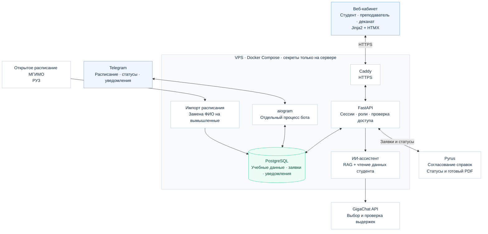
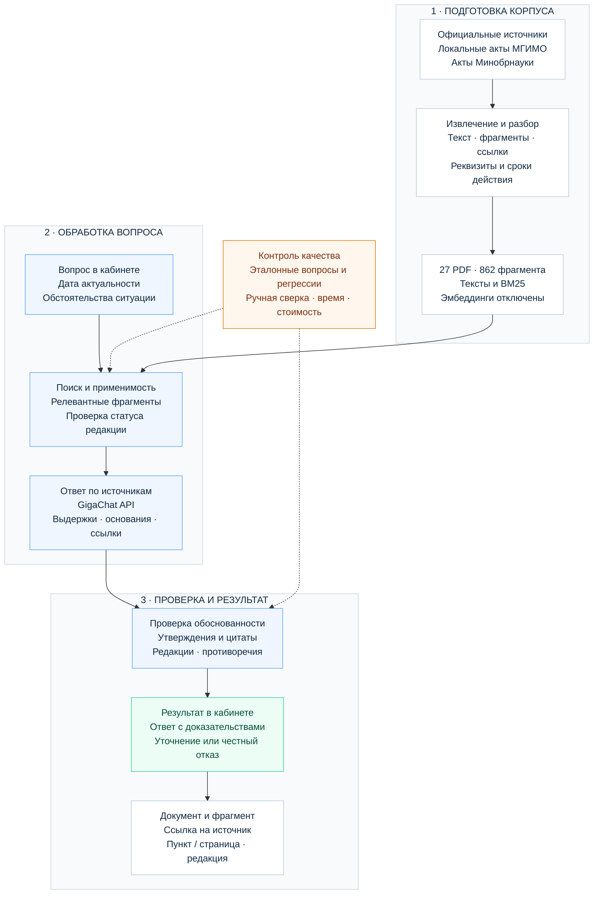

# MGIMO-LMS — цифровой деканат

Личный кабинет студента МГИМО, в котором всё, что связано с учёбой, собрано в одном месте
и работает с телефона: расписание, оценки, справки, объявления деканата и ИИ-ассистент,
который отвечает на вопросы и сам оформляет заявки.

> **Концепт для конкурса.** Прототип создан для хакатона MGIMO×AI Challenge (номинация
> «Вайб-кодинг») и не является официальным сервисом МГИМО. Все данные вымышленные,
> к системам вуза прототип не подключён.

## Как войти

Демо: **https://lms-university.ekanamfriends.ru**

Стенд обновлён **16 ноября 2026** из `dev` после слияния PR #35 (код `3d2106d`),
схема PostgreSQL — `0010`. Вход и расписание проверены на 360 px. Массовая догрузка
пока выключена; обновления из РУЗ блокируются ошибкой просроченного сертификата источника.
Состояние и резервная копия — в [документации стенда](docs/deploy.md#состояние-после-деплоя-16-ноября-2026).

| Логин | Пароль | Кто это |
|-------|--------|---------|
| `student1` | `mgimo-Oxq9JJow` | Вымыслова Алиса, 3-й курс, журналистика (группа 3МЖ-02) |
| `student2` | `mgimo-Oxq9JJow` | Придумкин Егор, 2-й курс, международные отношения (группа 2МО-24) |
| `teacher1` | `mgimo-Oxq9JJow` | Преподаватель группы student1: ставит баллы и ДЗ — student1 сразу видит их в «Успеваемости» |
| `teacher2` | `mgimo-Oxq9JJow` | Преподаватель группы student2 |
| `dean` | `mgimo-Oxq9JJow` | Сотрудник деканата: пишет объявления студентам (кабинет `/d/announcements`), они появляются у студентов в колокольчике |

Подробнее, что смотреть под каждой учёткой, — в [docs/test-accounts.md](docs/test-accounts.md).
Студенты вымышленные, расписание — настоящее, из открытого расписания МГИМО (ФИО
преподавателей заменены). Пароль общий для демо-учёток и публикуется специально: за ним нет
реальных данных.

**Сторона деканата — Pyrus** ([pyrus.com](https://pyrus.com), вход по почте и паролю):

| Логин | Пароль | Кто это |
|-------|--------|---------|
| `dekanhahatonov@gmail.com` | `mgimoaihahaton752u` | «Декан Хахатонов» — сотрудник деканата и декан в одном лице, все факультеты |

Здесь видны заявки на справки из ЛК: оба шага согласования («Проверка в деканате» →
«Подпись декана») назначены на этого пользователя. Статус, поменянный в Pyrus, сразу виден
студенту в ЛК и в Telegram. Свою заявку ищите по полю «Номер заявки ЛК». Логин общий для всего
жюри, пожалуйста, не меняйте пароль ([решение 0003](docs/decisions/0003-dean-office-pyrus.md)).

## Зачем

Сегодня учебная жизнь студента разбросана: расписание на сайте, оценки в отдельной системе,
справки через очередь в деканате, объявления в чатах и на почте. С телефона это почти не
работает. MGIMO-LMS собирает всё в один кабинет и строит его вокруг того, что студенту нужно
сегодня, а не вокруг структуры деканата.

## Сроки

Приём работ с 8 ноября 19:00 до **22 ноября 23:59**, прототип должен жить до 28 ноября.
Контрольная точка из [решения 0001](docs/decisions/0001-architecture.md): если к **18 ноября**
ядро не проходится на телефоне без ошибок, бот сокращается до уведомлений и `.ics`.

Что сделано и что осталось — в разделе «Что умеет» ниже, подробности в Issues и на доске проекта.

**Внутренний срок команды — до 19 ноября 2026:** завершить работы, чтобы оставить время
на доработку документации и выступления. Дополнения по итогам МФТИ: юнит-экономика
(`Legpopov`), RAG с API-моделью, проверка ответов по положениям и редакций на дату,
финальная презентация в стиле МГИМО и оценка схемы из нескольких агентов —
в [roadmap](ROADMAP.md) и [плане подготовки к финалу](docs/final-preparation.md).
Туда же добавлен сценарий проверки обоснованности и законности действий в отношении
студентов по локальным актам вуза и актам Минобрнауки.

## Что умеет

Состояние на 10 ноября 2026. Цель — личный кабинет, где студент не стоит в очереди в деканат
(главная идея питча); ниже — что уже работает, а что пока каркас.

**Работает**

| Раздел | Что внутри |
|--------|-----------|
| Вход и профиль | Вход по логину и паролю (argon2, серверная сессия); ФИО, факультет, направление, курс, группа. Роли `student`, `teacher`, `staff` |
| Календарь и расписание | Неделя из трёх слоёв — обязательные пары, элективы, внеучебные активности — на главной и в «Расписании». Данные из открытого расписания МГИМО (РУЗ), переносы и замены выделены ([решение 0006](docs/decisions/0006-calendar-layers.md)) |
| Элективные дисциплины | Студент сам выбирает подгруппы и курсы по выбору; записывается на мероприятия |
| Успеваемость | Оценки, зачёты, текущий накоп и ДЗ по дисциплинам, сессия, сводка «как у меня дела» ([решение 0007](docs/decisions/0007-grades.md)) |
| Справки | Заказ справки онлайн, статус и история заявки; заявки уходят в Pyrus, статусы и готовый PDF возвращаются в ЛК ([решение 0003](docs/decisions/0003-dean-office-pyrus.md)) |
| Уведомления | Колокольчик: статусы справок, новые баллы и ДЗ, объявления деканата, преподавателей и вуза; «Прочитать всё» ([решение 0009](docs/decisions/0009-notifications.md)) |
| Кабинет преподавателя | Как «сотрудник» в ЛК РАНХиГС: главная, свои курсы и ведомости, журнал баллов накопа, домашние задания, итоговая ведомость (экзамен, зачёт/незачёт, пересдачи), рабочее расписание, объявления своим группам, «Сервисы Академии» ([решение 0008](docs/decisions/0008-teacher-employee-cabinet.md)). Поставленный балл студент видит сразу |
| Кабинет деканата | Сотрудник пишет объявления всем, факультету или группе. Согласование справок идёт в Pyrus |
| Telegram-бот [@Lms_university_ekanamfriends_bot](https://t.me/Lms_university_ekanamfriends_bot) | Подключается кнопкой в профиле, без пароля. Расписание на сегодня/завтра/неделю, зачёты и экзамены, статусы справок, утренняя сводка, сообщения о переносах и отменах ([решение 0005](docs/decisions/0005-telegram-bot.md)). Пока показывает все пары группы, без учёта выбора элективов |
| Подписка на календарь | Ссылка `.ics` для Google, Apple и других календарей; расписание обновляется само |

**В работе**

- **ИИ-ассистент деканата.** Пока страница-каркас. Основа готова: корпус положений МГИМО
  (первые 27 документов на сервере), ключи и хранение фрагментов
  ([решение 0007](docs/decisions/0007-rag-assistant-infra.md)). Дальше — чат в кабинете, который
  отвечает по данным вошедшего студента, выполняет действия («закажи справку об обучении») и
  отвечает по положениям со ссылкой на документ.

**Каркасы (без бэкенда)**

Учебный план, воинский учёт, заявления, платные услуги, практики, психологическая служба,
обращения, справочная информация; у преподавателя — учебная нагрузка, конкурс ППС и кадровые
сервисы. Заявления и обращения пойдут по той же схеме, что справки (задача в Pyrus).

Задачи — в [Issues](https://github.com/Ekanam-Friends/MGIMO-LMS/issues) и на доске
[MGIMO-LMS — Цифровой деканат](https://github.com/orgs/Ekanam-Friends/projects/4).

## Как устроено

### Кабинет, бот и внешние сервисы

Веб-кабинет и бот работают с общей базой через серверный код. Ассистент обращается
к GigaChat с бэкенда; личные данные получает только в пределах серверной сессии.



- **Бэкенд** — Python, FastAPI, SQLAlchemy, Alembic. **Интерфейс** — серверные шаблоны Jinja2
  и HTMX, мобильный экран от 360 px как основной.
- **Данные** — PostgreSQL. Дисциплины, время и аудитории берутся из открытого расписания МГИМО;
  ФИО преподавателей при импорте заменяются на вымышленные. Студенты, оценки и заявки —
  сгенерированный тестовый набор.
- **Безопасность** — серверные сессии в cookie, пароли хэшируются (argon2), каждый запрос к данным
  студента фильтруется по id из сессии: чужой id в адресе возвращает 404. Роли `student`, `teacher` и `staff`; преподаватель видит только свои группы.
  Секреты только в `.env`, в репозитории — `.env.example`.
- **ИИ** (в разработке) — все вызовы модели идут с бэкенда; ассистент получает инструменты,
  которые работают от имени авторизованного студента. Ключи — только в `.env` на сервере.
- **Деплой** — docker-compose на VPS за Caddy, HTTPS, домен `lms-university.ekanamfriends.ru`.

Подробнее — в [docs/decisions/0001-architecture.md](docs/decisions/0001-architecture.md).

### От документа — к проверяемому ответу

**Рабочая RAG-цепочка.** Поиск по открытому корпусу и проверка выбранных выдержек
через GigaChat API. В текущем развёртывании используется BM25 без эмбеддингов.
Непроверенная актуальность загруженного снимка явно указывается в ответах.



Ответ опирается на применимую норму и редакцию на выбранную дату. Если документов или
обстоятельств недостаточно, система должна обозначить ограничение. Для проверки
действий в отношении студента запланированы вымышленные кейсы и сверка с профильным
экспертом. Подробности — в [roadmap](ROADMAP.md),
[плане подготовки](docs/final-preparation.md) и
[решении о качестве ответов](docs/decisions/0011-rag-answer-quality.md).

## Запуск

Есть кабинеты студента, преподавателя и деканата, импорт расписания, интеграция справок с
Pyrus, уведомления и Telegram-бот. Вёрстка повторяет ЛК РАНХиГС — см.
[решение 0004](docs/decisions/0004-web-shell.md).

```bash
cp .env.example .env            # заполнить DATABASE_URL, FAKE_NAME_SALT, DEMO_PASSWORD
pip install -e ".[dev]"
alembic upgrade head
python -m app.schedule.import_ruz --full    # весь семестр, все группы: ~40 минут
python -m app.schedule.import_ruz           # ежедневно: окно −7…+35 дней
python -m app.seed                          # тестовые учётки student1, student2, dean (пароль — DEMO_PASSWORD)
python -m app.generate                      # ~3000 вымышленных студентов, ведомости, баллы, зачётки; teacher1/teacher2
uvicorn app.main:app --port 8000            # кабинет: http://localhost:8000
python -m app.bot.main                      # бот (нужен TELEGRAM_BOT_TOKEN в .env)
python -m app.bot.demo_change --login student1   # показать пуш о переносе
pytest
```

Для быстрой проверки без Docker: `DATABASE_URL=sqlite+aiosqlite:///./local.db`, `COOKIE_SECURE=false`
(иначе браузер не сохранит cookie по http) и, например,
`--group 1МО-01 --group 1МО-02`. Как устроен импорт — в
[docs/decisions/0002-schedule-source.md](docs/decisions/0002-schedule-source.md).

Выкладка на сервер — `sh scripts/deploy.sh`, устройство стенда — [docs/deploy.md](docs/deploy.md).

## Как мы это делаем

Код пишут ИИ-ассистенты (Claude Code и другие), команда ставит задачи и проверяет результат.
Промпты, ошибки ИИ и скриншоты процесса ведутся в репозитории по ходу работы — правила
в [CLAUDE.md](CLAUDE.md).

```
docs/
├── brief.md        — задание хакатона, требования и критерии
├── deploy.md       — устройство стенда и выкладка
├── test-accounts.md — тестовые учётки для жюри
├── research/       — исследования: ЛК РАНХиГС как эталон, опрос студентов, гайд интервью
├── decisions/      — архитектурные решения
├── prompts/        — ключевые промпты по функциям
└── process/        — ошибки ИИ и скриншоты
```

Задачи — в [Issues](https://github.com/Ekanam-Friends/MGIMO-LMS/issues), доска —
[MGIMO-LMS — Цифровой деканат](https://github.com/orgs/Ekanam-Friends/projects/4).

## Команда

Ekanam & Friends: Legpopov, kelleshh, raxlin4ik.

## Лицензии и ограничения

Используются только открытые библиотеки, шрифты и иконки с разрешающей лицензией. Официальный
логотип МГИМО не используется. Персональных данных реальных студентов и преподавателей в проекте нет.
