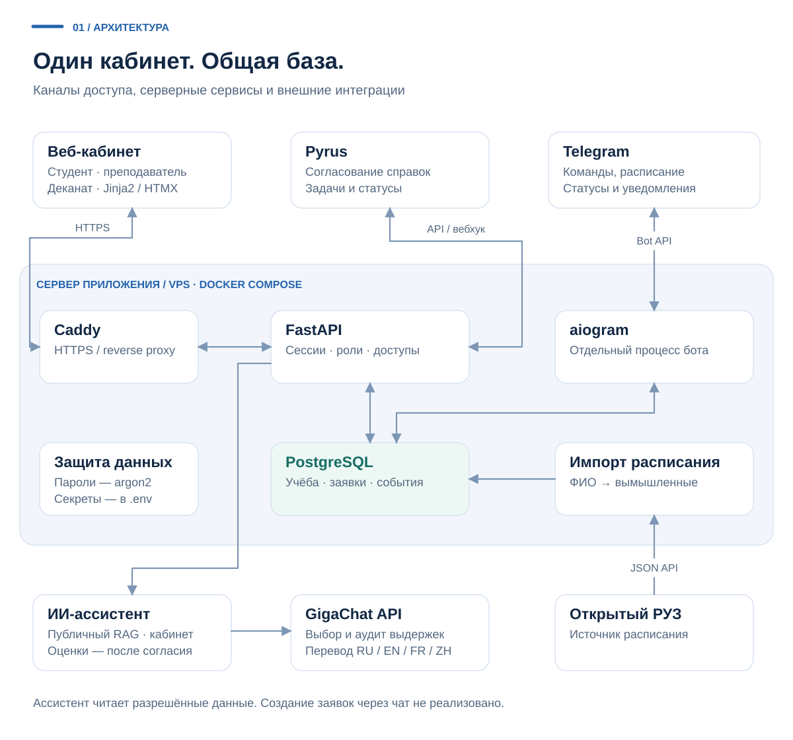
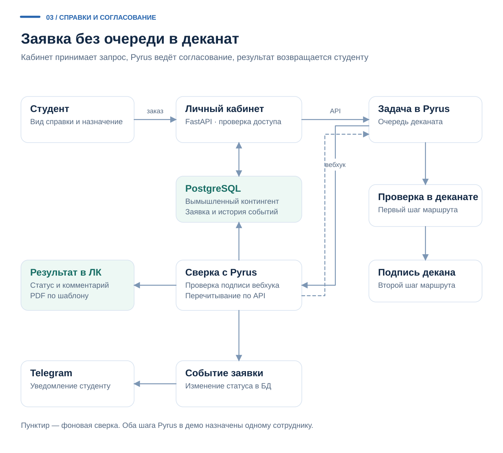
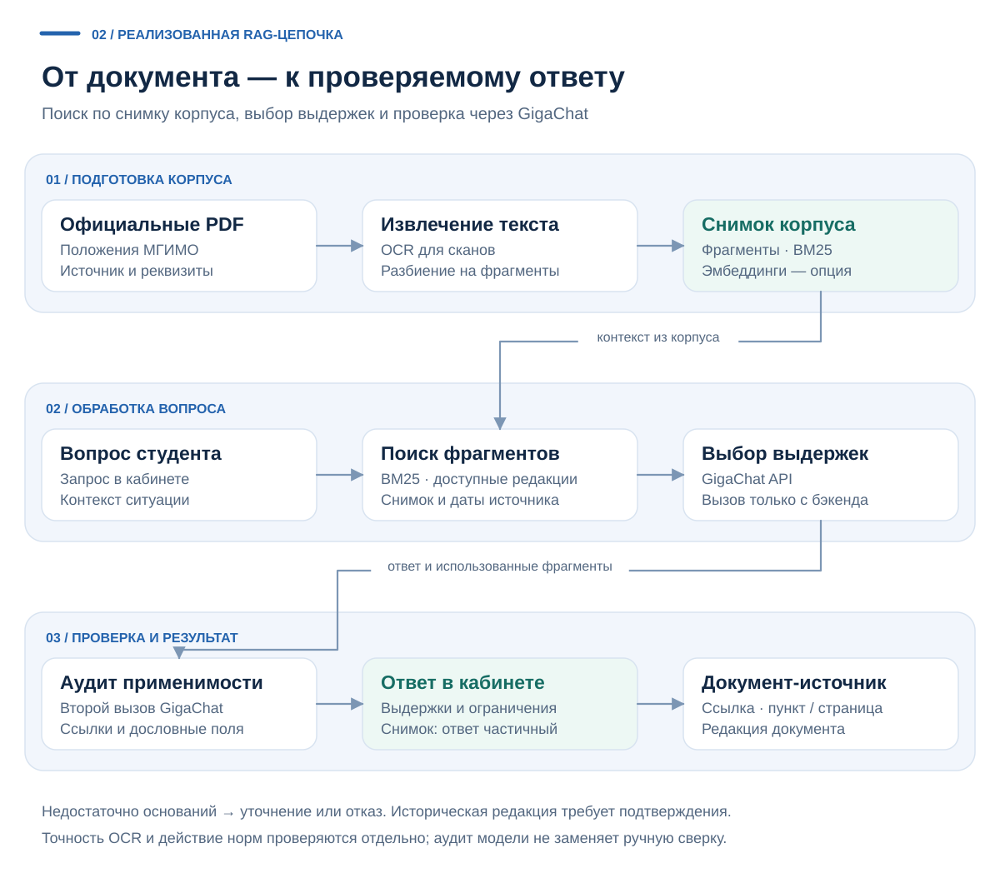
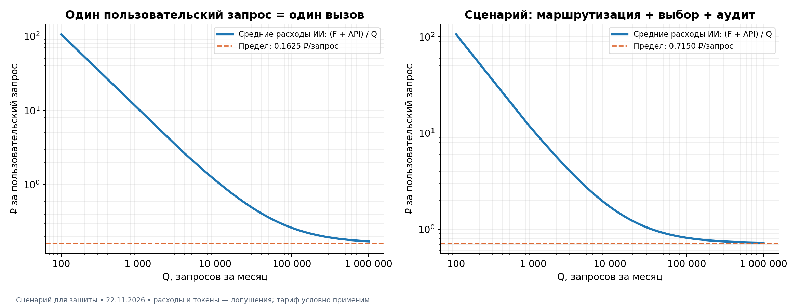
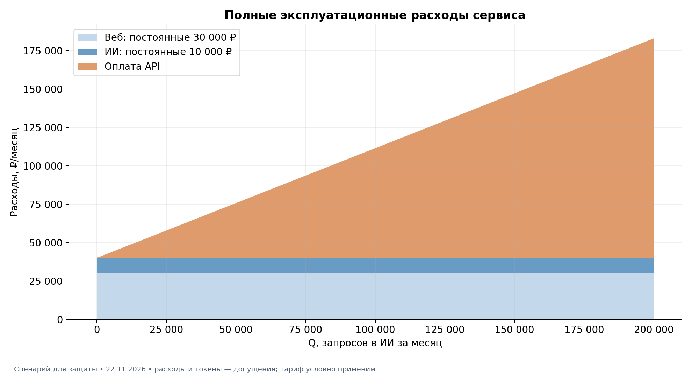

# MGIMO-LMS — цифровой деканат

MGIMO-LMS объединяет расписание, задания, оценки, справки и объявления в одном личном кабинете. Студент может сдать работу, получить справку или задать вопрос ИИ-ассистенту с телефона. Преподаватель ведёт ведомости и посещаемость, а деканат согласует заявки на справки в Pyrus.

**[Открыть демостенд](https://lms-university.ekanamfriends.ru)** · **[Демо-доступы к LMS и Pyrus](docs/test-accounts.md)** · [Telegram-бот](https://t.me/Lms_university_ekanamfriends_bot)

> **Концепт для конкурса MGIMO×AI Challenge.** Самостоятельный прототип с вымышленными учебными данными. Для расписания и положений используются открытые источники.

## Какие проблемы решаем

Провели три качественных интервью со студентами МГИМО, включая старосту. По их опыту, расписание, материалы, задания и сообщения приходят из разных мест, а часть работы по координации группы ложится на старосту. Наблюдения использовали для выбора сценариев прототипа. [Свод интервью и расшифровки](interview/README.md).

| Что услышали на интервью | Как это решаем |
| --- | --- |
| Расписание, оценки и задания приходится искать в разных сервисах. По одним предметам работы сдают в Moodle, по другим — по почте или через диск. | В личном кабинете видны расписание, успеваемость, задания и сроки. Там же студент сдаёт работу и получает ответ преподавателя. |
| Чтобы узнать о сообщении или изменении, нужно самому проверить нужный сервис. Староста пересылает объявления и отвечает на повторяющиеся вопросы. | Кабинет собирает уведомления, а подключённый Telegram доставляет их студенту. Ассистент отвечает по положениям и доступным данным студента, например по сроку задания или статусу справки. |
| Учёт посещаемости ведут вручную, часть работы выполняет староста. | Преподаватель открывает отметку на текущей паре, студент вводит шестизначный код в кабинете. Преподаватель может исправить отметку с указанием причины. |

Справки — отдельный сценарий цифрового деканата. Студент подаёт заявку и получает готовый PDF в кабинете, пока сотрудник работает с заявкой в Pyrus.

## Как войти и проверить решение

Откройте [демостенд](https://lms-university.ekanamfriends.ru) и возьмите нужные учётные записи из [инструкции с доступами](docs/test-accounts.md). Там есть две пары «студент и его преподаватель», доступ сотрудника деканата в LMS и отдельный вход в Pyrus. Команда также передаёт доступы жюри отдельно. Для проверки двух ролей одновременно откройте вторую сессию в приватном окне.

| Сценарий | Действия и ожидаемый результат |
| --- | --- |
| **Расписание и оценки** | Войдите студентом. Откройте «Расписание», переключите неделю и посмотрите пары и элективы. В «Успеваемости» откройте ведомость с баллами и заданиями. Войдите вторым студентом и сравните данные. |
| **Задание, решение и оценка** | Войдите преподавателем соответствующей группы. В «Мои курсы» откройте журнал курса и создайте ДЗ со сроком. Войдите студентом и откройте «Учёба» → «Задания и сообщения», чтобы отправить текст или файл. Преподаватель может ответить в карточке задания, оценить работу или вернуть её с комментарием. Студент увидит результат в кабинете. |
| **Посещаемость** | Во время пары преподаватель открывает занятие в «Посещаемости» и генерирует код. Студент своей группы вводит его через «Отметку на паре» в течение 90 секунд. В журнале преподавателя появляется отметка. |
| **Справка через Pyrus** | Под студентом откройте «Справки», закажите справку с электронной выдачей и запомните номер. Войдите в [Pyrus](https://pyrus.com) через отдельную учётную запись. Найдите задачу по полю «Номер заявки ЛК» и пройдите этапы «Проверка в деканате» и «Подпись декана». Вернитесь к заявке в LMS, проверьте статус и скачайте PDF. После первого скачивания можно запросить бумажный оригинал. |
| **Объявление деканата** | Под сотрудником LMS откройте «Объявления» и опубликуйте тестовое сообщение для группы демонстрационного студента. Под студентом проверьте колокольчик. |
| **ИИ-ассистент** | Откройте ассистента под студентом и подтвердите начало чата. Спросите «Когда у меня следующая пара?» и «Что в положениях сказано о пересдаче экзамена?». В первом ответе проверьте расписание студента, во втором — указанный источник и ограничения. Для вопроса об оценках потребуется отдельное согласие. |
| **Telegram и календарь** | В профиле студента привяжите [Telegram-бота](https://t.me/Lms_university_ekanamfriends_bot) и проверьте расписание на неделю. Чтобы проверить доставку события, привяжите бота до создания задания или изменения статуса справки. Ссылку подписки `.ics` можно добавить в календарь и сравнить события с расписанием в ЛК. |

[Учётные записи и проверка разграничения доступа](docs/test-accounts.md) · [Подробности учебных сценариев](docs/learning-workflows.md) · [Согласование справок в Pyrus](docs/decisions/0003-dean-office-pyrus.md)

## Как устроен код

### Кабинет, бот и внешние сервисы



- **Веб и данные.** FastAPI подключает маршруты в [app/main.py](app/main.py). Обработчики в [app/web](app/web/) проверяют роль и сессию, вызывают предметную логику и отдают страницы Jinja2. HTMX обновляет отдельные части страниц. Данные хранятся в PostgreSQL, миграции Alembic лежат в [migrations](migrations/). [Архитектурные решения](docs/decisions/0001-architecture.md).
- **Сессии и доступ.** [app/auth](app/auth/) проверяет пароль по хэшу и создаёт серверную сессию. Запросы к данным студента используют идентификатор из сессии. Преподаватель работает с назначенными ему курсами, доступ к чужой ведомости закрыт. [Роли и правила доступа](docs/decisions/0001-architecture.md).
- **Расписание, задания и посещаемость.** [app/schedule](app/schedule/) импортирует открытое расписание РУЗ и подменяет имена преподавателей. [app/grades](app/grades/) обслуживает ведомости и баллы. [app/learning.py](app/learning.py) хранит логику сдачи, сообщений и посещаемости. Проверка решения обновляет балл в общей ведомости, а правки посещаемости журналируются. [Учебные сценарии](docs/learning-workflows.md).
- **Уведомления и Telegram.** События видны в колокольчике, а [app/bot](app/bot/) доставляет поддерживаемые события в привязанный аккаунт и показывает расписание. Привязка начинается в профиле студента. [Интеграция Telegram](docs/decisions/0005-telegram-bot.md).
- **Развёртывание.** Веб, бот и PostgreSQL работают в Docker Compose. Caddy принимает HTTPS и перенаправляет запросы веб-приложению. [Документация стенда и схема развёртывания](docs/deploy.md).

### От заявки до готовой справки



[app/certificates](app/certificates/) сохраняет заявку в LMS и создаёт связанную задачу в Pyrus. Изменения подхватываются через вебхук и фоновую сверку. После согласования LMS формирует PDF по шаблону и обновляет статус заявки. Для электронной справки первое скачивание открывает заказ бумажного экземпляра. Для справки о периоде обучения при переводе бумажный вариант заказывается сразу. [Статусы, маршрут согласования и правила выдачи](docs/decisions/0003-dean-office-pyrus.md).

### От вопроса до ответа с источником



В [app/assistant](app/assistant/) запрос проходит маршрутизацию. Для вопроса по положениям поиск BM25 подбирает фрагменты корпуса, подготовленного из PDF с OCR при необходимости. GigaChat вызывается с бэкенда для выбора выдержек и аудита. Ответ содержит ссылки на доступные источники и отмечает, когда материалов недостаточно или актуальность редакции требует проверки.

Для личного вопроса сервер берёт данные текущего пользователя. Согласие на чтение оценок действует в пределах беседы. [Устройство и эксплуатация ассистента](docs/assistant.md) · [Все схемы и их исходники](docs/diagrams/README.md)

## Юнит-экономика

Платящий клиент — вуз. В базовом сценарии для одного вуза при **10 000 обращений к ассистенту в месяц** веб-сервис стоит **30 000 ₽/мес.**, ассистент добавляет **17 150 ₽/мес.** Общие расходы составляют **47 150 ₽/мес.** При сценарной цене **75 000 ₽/мес.** операционный результат — **27 850 ₽/мес.** до налогов, привлечения клиента и возмещения разработки.

Переменная стоимость обращения к ассистенту в этой модели — **0,715 ₽** при 11 000 токенов на всю цепочку вызовов. Расчёт использует сценарный тариф и условную смету. [Полная модель, допущения и чувствительность к цене токенов](economics/README.md).





## Локальный запуск и материалы проекта

```bash
cp .env.example .env            # заполнить DATABASE_URL, FAKE_NAME_SALT, DEMO_PASSWORD
pip install -e ".[dev]"
alembic upgrade head
python -m app.schedule.import_ruz
python -m app.seed
python -m app.generate
uvicorn app.main:app --port 8000
```

Для запуска Telegram-бота задайте `TELEGRAM_BOT_TOKEN` в `.env` и выполните `python -m app.bot.main`. Тесты запускаются командой `pytest`. Для быстрой локальной проверки можно использовать `DATABASE_URL=sqlite+aiosqlite:///./local.db` и `COOKIE_SECURE=false`. [Импорт расписания](docs/decisions/0002-schedule-source.md) · [Развёртывание и настройки стенда](docs/deploy.md)

- [Бриф конкурса](docs/brief.md)
- [Архитектурные решения](docs/decisions/)
- [Промпты по функциям](docs/prompts/) и [материалы процесса разработки](docs/process/)
- [Задачи проекта](https://github.com/Ekanam-Friends/MGIMO-LMS/issues) и [доска команды](https://github.com/orgs/Ekanam-Friends/projects/4)

**Команда Ekanam & Friends** — Legpopov, kelleshh, raxlin4ik.
