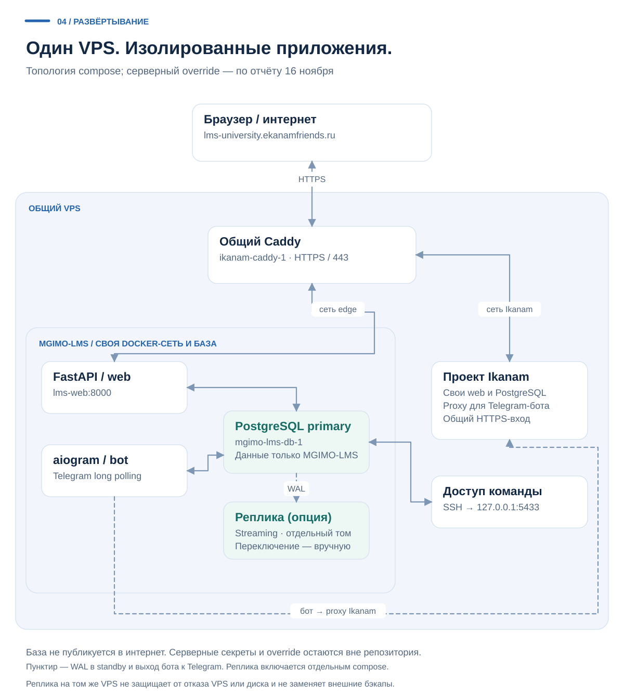

# Стенд на сервере

Демо: https://lms-university.ekanamfriends.ru. Сервер — общий VPS с ботом Ikanam-schedule
(`root@195.24.71.184`), как решено в [0001](decisions/0001-architecture.md).

## Как устроено



- Проект кабинета — `/opt/mgimo-lms`: свой compose, свой PostgreSQL (порт наружу не
  публикуется), свой `.env` (создан на сервере, в репозиторий не попадает).
- Общий у проектов только Caddy. Он подключён ко внешней docker-сети `edge`, в которой web
  кабинета виден под алиасом `lms-web`.
- В `/opt/ikanam` для этого добавлены (бэкапы рядом, `*.bak-2026-11-05`):
  - блок `lms-university.ekanamfriends.ru { … reverse_proxy lms-web:8000 }` в конце `Caddyfile`;
  - `caddy.networks: [default, edge]` и внешняя сеть `edge` в `docker-compose.override.yml`.

## Выкладка

Перед изменением рабочей БД обязательна резервная копия PostgreSQL. Хранить не более трёх
последних полных копий; старые удалять после успешной проверки новой версии. Для этого
деплоя использован формат `pg_dump -Fc`, архив проверен командой `pg_restore --list`.
Серверные `.env`, `docker-compose.override.yml` и каталог `data` при выкладке сохраняются.

```bash
sh scripts/deploy.sh
```

Скрипт отправляет закоммиченный `HEAD` архивом по ssh (репозиторий приватный, сервер его не
клонирует) и пересобирает `web`. Миграции применяются при старте контейнера.

Данные:

```bash
ssh root@195.24.71.184
cd /opt/mgimo-lms
docker compose exec web python -m app.schedule.import_ruz --full --group 24МЖ-02 --group 25МО-24
docker compose exec web python -m app.seed
```

На стенде импортированы только две группы демо-студентов (1987 занятий за семестр, 10 секунд).
Регулярно расписание обновляет бот: раз в `BOT_IMPORT_HOURS` часов по группам подключённых студентов.

Чтобы расписание на пустой базе заполнилось само ([решение 0011](decisions/0011-schedule-bootstrap.md)),
в серверном `.env` задайте `BOT_BOOTSTRAP_GROUPS=400` и перезапустите бота (`docker compose up -d bot`):
через ~2 минуты он начнёт догружать весь семестр недостающих групп. После подтверждения
покрытия текущего семестра повторные старты РУЗ не трогают. Пустые ответы и ошибки
не расходуют цель; время зависит от количества попыток и доступности источника.
`BOT_IMPORT_SCOPE=students` — обновлять раз в `BOT_IMPORT_HOURS` группы всех студентов, а не только с Telegram.

Перед первым запуском новой версии необходима миграция `0010` (через web): она добавляет
подтверждение покрытия семестра по каждой группе ([0012](decisions/0012-schedule-semester-coverage.md)).
Перед изменением рабочей БД сохранить `pg_dump`; хранить не более трёх последних копий.
Исторические импорты без подтверждения перечитываются один раз. Пустые группы не считаются
загруженными; если непустых групп недостаточно, в журнале будет предупреждение.

### Состояние после деплоя 16 ноября 2026

- **Код:** `dev`, merge-коммит PR #35 `3d2106d2bf4aab23c79c344c3285b8905fc8f8f4`.
  Web и bot пересобраны и запущены около 19:44 МСК. Бот начал Telegram polling.
- **PostgreSQL:** версия 16.15, healthy; миграции `0007 → 0008 → 0009 → 0010`
  применены при запуске web, `alembic current` показывает `0010 (head)`.
- **Данные:** 2 группы с расписанием, 1987 занятий, 26 студентов; таблица подтверждений
  покрытия семестра пуста. Seed, генератор и массовый импорт при деплое не запускались.
- **Настройки бота:** `BOT_BOOTSTRAP_GROUPS=0`, `BOT_IMPORT_SCOPE=linked`,
  `BOT_IMPORT_HOURS=6`; бот подключён к своей БД на `mgimo-lms-db-1`.
- **Проверка снаружи:** вход student1, главная и расписание текущей недели на 360 px;
  `innerWidth=360`, `scrollWidth=345`. [Скриншот после деплоя](process/screenshots/2026-11-16-pr35-deployed-360.jpg).
- **Бэкап до миграций:** `/opt/mgimo-lms/backups/lms-20261116T164050Z-before-pr35.dump`,
  235442 байта, формат custom, `pg_restore --list` успешен. В каталоге оставлены три
  полные копии БД. Исходный код до выкладки сохранён в `release-20261116T164050Z-before-pr35.tar.gz`,
  прежние образы — под тегами `mgimo-lms-web:rollback-pr35` и `mgimo-lms-bot:rollback-pr35`.

**Ограничение источника:** повторный HTTPS-запрос из нового контейнера бота к справочнику
факультетов РУЗ получает `CERTIFICATE_VERIFY_FAILED: certificate has expired`.
Проверку TLS не отключали; существующее расписание доступно из базы. Исправление bootstrap
не устраняет ошибку сертификата источника, поэтому догрузка на 400 групп пока не включена.

При откате сначала сохранить новое состояние БД. Старые образы можно использовать только
с учётом совместимости схемы; полный возврат к состоянию до выкладки требует восстановления
проверенной резервной копии и кода. Автоматического отката БД при ошибке приложения нет.

## Telegram-бот

Контейнер `bot` (решение [0005](decisions/0005-telegram-bot.md)), long polling — в Caddy ничего
добавлять не нужно. Один раз в `/opt/mgimo-lms/.env` на сервере:

```
TELEGRAM_BOT_TOKEN=<от @BotFather>
TELEGRAM_BOT_USERNAME=Lms_university_ekanamfriends_bot
PUBLIC_BASE_URL=https://lms-university.ekanamfriends.ru
```

`scripts/deploy.sh` поднимает `bot`, только если токен задан. Логи: `docker compose logs -f bot`.

**api.telegram.org с этого VPS напрямую недоступен** (проверено 2026-11-05: curl не соединяется).
Бот ходит через socks5-прокси проекта Ikanam — контейнер `proxy` в сети `ikanam_default`.
Для этого на сервере (не в репозитории) лежит `/opt/mgimo-lms/docker-compose.override.yml`,
который подключает к `ikanam_default` только сервис `bot`, а в `.env` —
`TELEGRAM_PROXY=socks5://proxy:1080`. Сам Ikanam не менялся. В `ikanam_default` есть и сервис
`db` (база Ikanam), поэтому override переопределяет боту `DATABASE_URL` на хост
`mgimo-lms-db-1` — иначе бот уходит в чужую базу. Если прокси Ikanam переедет или
упадёт, наш бот потеряет связь с Telegram вместе с ним.
Демонстрация пуша: `docker compose exec bot python -m app.bot.demo_change --login student1`.

## Корпус для ИИ-ассистента (RAG)

Решение [0007](decisions/0007-rag-assistant-infra.md). Это делает **root** один раз; Келли
после этого работает через `deploy`, `run app.<модуль>` и `corpus`.

Состояние на 2026-11-10: шаги 1 и 2 выполнены (папка `/opt/mgimo-lms/data/regulations` с 27 PDF и
`manifest.csv`, монтирование `/data` в `web` и `bot`, команда `corpus` в обёртке). Не сделаны шаги 3 и 4:
ключей LLM и сертификата на сервере пока нет, выход к провайдеру не проверен.

1. Папка корпуса. Контейнеры работают под uid 1000 (`lms`), поэтому папка принадлежит ему:

   ```bash
   mkdir -p /opt/mgimo-lms/data/regulations /opt/mgimo-lms/data/ca
   chown -R 1000:1000 /opt/mgimo-lms/data
   ```

2. Монтирование. В серверный `/opt/mgimo-lms/docker-compose.override.yml` (он уже есть:
   там сети и `DATABASE_URL` для бота) **добавить**, не заменяя файл целиком:

   ```yaml
   services:
     web:
       volumes:
         - /opt/mgimo-lms/data:/data
     bot:
       volumes:
         - /opt/mgimo-lms/data:/data
   ```

   Применить: `cd /opt/mgimo-lms && docker compose up -d --no-deps web bot`.

3. Ключи — в `/opt/mgimo-lms/.env` (имена — в `.env.example`, блок «ИИ-ассистент»). Значения
   передаются лично, не в чат и не в репозиторий. Для GigaChat корневой сертификат Минцифры
   кладётся в `/opt/mgimo-lms/data/ca/`, путь к нему — `GIGACHAT_CA_BUNDLE=/data/ca/<файл>`.
   После правки `.env`: `docker compose up -d --no-deps web bot` (`restart` переменные не перечитывает).

4. Проверка выхода к провайдеру из контейнера (до написания кода ассистента):

   ```bash
   docker compose exec web python -c "import urllib.request as u; print(u.urlopen('https://ngw.devices.sberbank.ru:9443', timeout=10).status)"
   ```

   Ответ с кодом (даже 4xx) — сеть есть; ошибка сертификата — нужен `GIGACHAT_CA_BUNDLE`;
   таймаут — доступа нет, нужен прокси (как для Telegram). Для YandexGPT адрес —
   `https://llm.api.cloud.yandex.net`.

   Результат 2026-11-10 из контейнера `web`: GigaChat (`ngw.devices.sberbank.ru:9443`,
   `gigachat.devices.sberbank.ru`) достижим, но `CERTIFICATE_VERIFY_FAILED` — нужен корневой сертификат
   Минцифры в `data/ca/` и `GIGACHAT_CA_BUNDLE`; YandexGPT достижим (404 на корне — норма);
   `mgimo.ru` отвечает 200, но это страница-проверка, не документ.

5. Файлы с mgimo.ru Келли кладёт в `/data/regulations` (внутри контейнера) или скачивает
   скриптом через `run app.<модуль>`. Корпус в git не попадает (`/data/` в `.gitignore`).

`pgvector` на старте не нужен. Если понадобится, образ `db` менять нельзя поверх старого тома
(см. «Риски» в 0007): сначала `pg_dump` в `/opt/mgimo-lms/backups/`.

## Доступ к базе для команды

База наружу не открыта: compose публикует её только на `127.0.0.1:5433` сервера (5432 на
хосте занят базой Ikanam). Участник ходит через SSH-туннель.

**Костя (raxlin4ik)** — выдано 2026-11-06:

- Linux-пользователь `kostya` без пароля и без шелла, ключ — с его GitHub
  (`github.com/raxlin4ik.keys`). В `authorized_keys` и в `/etc/ssh/sshd_config.d/70-kostya-db-tunnel.conf`
  ему разрешён только проброс на `127.0.0.1:5433`: ни команд, ни терминала, ни других портов.
- Роль PostgreSQL `kostya`: чтение и запись данных во всех таблицах `public`, без права
  создавать и менять таблицы — схема меняется только миграциями Alembic. Новые таблицы из
  миграций получают те же права автоматически (`ALTER DEFAULT PRIVILEGES FOR ROLE lms`).
  Не больше 5 соединений.
- Пароль роли лежит только на сервере: `/root/access/kostya-postgres.txt` (600). Передавать
  лично, не в чат проекта и не в репозиторий.

Подключение со своего компьютера:

```bash
ssh -N -L 5433:127.0.0.1:5433 kostya@195.24.71.184
```

и в другом окне (или в DBeaver / DataGrip: host `localhost`, port `5433`, db `lms`, user `kostya`):

```bash
psql -h localhost -p 5433 -U kostya -d lms
```

Отозвать: `userdel -r kostya`, удалить `70-kostya-db-tunnel.conf`, `systemctl reload ssh`,
в базе `REASSIGN OWNED BY kostya TO lms; DROP OWNED BY kostya; DROP ROLE kostya;`.

**Келли (kelleshh)** — выдано 2026-11-06, только этот проект:

- Linux-пользователь `kelli` без пароля, ключ — с её GitHub. Шелла на сервере нет:
  sshd (`/etc/ssh/sshd_config.d/71-kelli-mgimo-lms.conf`) любую команду отдаёт в
  `/usr/local/bin/mgimo-lms-ssh`, а та — через sudo в обёртку `/usr/local/bin/mgimo-lms`.
  В sudoers (`/etc/sudoers.d/mgimo-lms-kelli`) разрешена только эта обёртка.
- Обёртка ([scripts/server/mgimo-lms](../scripts/server/mgimo-lms), на сервер ставится
  руками root-ом) работает только с compose-проектом `/opt/mgimo-lms`: сервисы и модули по
  белому списку, каждый вызов пишется в журнал (`journalctl -t mgimo-lms`). В группу docker
  Келли не добавлена: это был бы root на всём VPS, включая Ikanam.
- При `deploy` обёртка не принимает архивы с символическими ссылками и выбрасывает из них
  `docker-compose*.yml` и `.env`: что монтируется с хоста, решает только root.

```bash
ssh kelli@195.24.71.184 help
ssh kelli@195.24.71.184 status
ssh kelli@195.24.71.184 logs web 100
DEPLOY_HOST=kelli@195.24.71.184 sh scripts/deploy.sh
ssh -t kelli@195.24.71.184 psql
ssh kelli@195.24.71.184 corpus ls                      # корпус положений для ассистента
ssh kelli@195.24.71.184 corpus put x.pdf < x.pdf        # записать файл (до 50 МБ, плоская папка)
ssh kelli@195.24.71.184 corpus rm x.pdf                 # удалить файл корпуса
```

`corpus` работает только с `/opt/mgimo-lms/data/regulations` (решение [0007](decisions/0007-rag-assistant-infra.md)):
имена по белому списку, ссылок и вложенных путей нет. Файл больше 50 МБ команда отклоняет с ошибкой.

Обновить обёртку: `scp scripts/server/mgimo-lms* root@…:/tmp/` и `install -m 755` в
`/usr/local/bin`. Отозвать: `userdel -r kelli`, удалить `71-kelli-mgimo-lms.conf` и
`/etc/sudoers.d/mgimo-lms-kelli`, `systemctl reload ssh`.

## Успеваемость и вымышленный контингент (решение 0007)

Миграция 0007 применяется сама при старте web (`alembic upgrade head` в Dockerfile). После
выкладки данные создаются один раз:

```bash
docker compose exec web python -m app.seed       # student1, student2, dean
docker compose exec web python -m app.generate   # ~3000 студентов, ведомости, баллы, teacher1/teacher2
```

Или со своего компьютера через туннель ролью `kostya` (схему она не меняет, данные — может):
в локальном `.env` `DATABASE_URL=postgresql+asyncpg://kostya:<пароль>@localhost:5433/lms` и
`DEMO_PASSWORD` — тот же, что на стенде (README), затем те же две команды без `docker compose exec web`.

Повторный запуск ничего не дублирует. `--reset` стирает сгенерированных студентов и **всю**
успеваемость, включая баллы, поставленные руками, — на стенде во время показа не запускать.

## Подводные камни

- **Caddyfile монтируется в контейнер одним файлом.** Если файл на хосте заменить целиком
  (scp, редактор с сохранением через новый файл), контейнер продолжит видеть старый: `caddy
  reload` ответит «config is unchanged». Так и случилось при первой выкладке. Помогает
  `docker compose up -d --no-deps caddy` в `/opt/ikanam` — перерыв у schedule.ekanamfriends.ru
  несколько секунд, сертификаты лежат в volume и не перевыпускаются.
- **Блок кабинета живёт и в репозитории бота** (`lkanam-schedule/Caddyfile`, коммит `b33f3b0`),
  поэтому деплой бота его не сотрёт. Подключение caddy к сети `edge` — только в серверном
  `docker-compose.override.yml`: его при деплое бота не перезаписывать.
- **Сборка образа на сервере медленная** (PyPI ~50 КБ/с, несколько минут), и ssh из
  `deploy.sh` может оборваться посреди неё. Тогда сборку запускать на сервере отвязанно:
  `nohup sh -c "docker compose up -d --build web && docker compose up -d --build bot" > /tmp/mgimo-deploy.log 2>&1 &`.
- Параметры Pyrus на стенде настроены (проверено 2026-11-16 без вывода секретов).
  Полный цикл внешнего согласования при этом деплое не проверялся.
