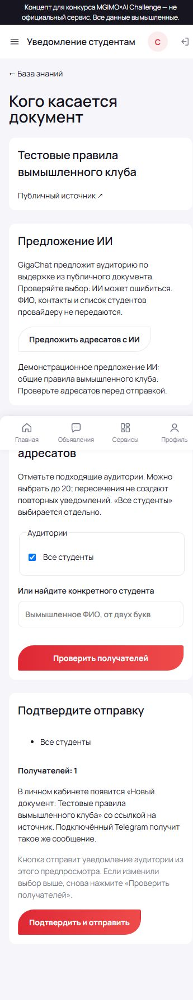
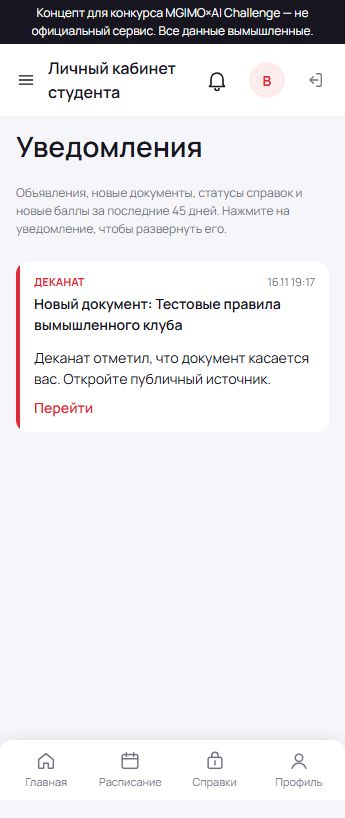

# Уведомления студентам о новом документе

1. Дождитесь статуса «Доступен ассистенту» в базе знаний работника.
2. Нажмите «Уведомить студентов», затем «Предложить адресатов с ИИ».
3. Проверьте объяснение и отмеченные аудитории. Их можно изменить вручную:
   все студенты, факультеты, группы, потоки (программа + курс); конкретного
   студента можно найти по вымышленному ФИО.
4. Нажмите «Проверить получателей», проверьте список аудиторий и число студентов.
5. Нажмите «Подтвердить и отправить». Только теперь создаются уведомления.

Пересечения аудиторий не создают несколько записей одному студенту. До 20
аудиторий за раз; «Все студенты» выбирается отдельно. Если ИИ недоступен,
ошибся или не определил область действия, выберите адресатов вручную.
Предпросмотр действителен 15 минут; при смене состава адресатов его нужно
сформировать заново. Повторное подтверждение не создаёт новую рассылку.

У студента появляется сообщение «Новый документ: …» в колокольчике и ленте
с публичной ссылкой на оригинал. Если Telegram был подключён при подтверждении,
сообщение доставит существующий фоновый обработчик бота. Успешная отправка
фиксируется в БД; временные ошибки повторяются, максимум пять попыток.
Привязка проверяется повторно перед отправкой. Позднее подключение бота не
вызывает рассылку старых документов.

Нужны миграция `0011_doc_notices` и обновление обоих процессов — web и bot.
Новые переменные окружения не требуются: используется текущий провайдер GigaChat
и существующий токен Telegram-бота. Загрузка PDF сама по себе не рассылает
сообщения; подтверждение работника обязательно. ФИО и контакты студентов ИИ
не передаются. Производственная рассылка в ходе разработки не запускалась.

Строго единственная доставка в Telegram не гарантируется при неоднозначном
сетевом сбое после отправки. Подробнее: [решение 0017](decisions/0017-document-notification-audience.md).

## Проверка

Профильный набор: `tests/test_document_notifications.py` и
`tests/test_document_upload.py`. Telegram и GigaChat в нём заменены заглушками.
Проверяется адресация, ручной сценарий, ошибки ИИ, неизвестные аудитории,
смена состава получателей, CSRF, повторы и сетевой отказ Telegram.

Ручной сценарий пройден на отдельной локальной БД с вымышленными учётками,
без секретов и реальных отправок. На 360 px `scrollWidth=360`, `innerWidth=360`.

