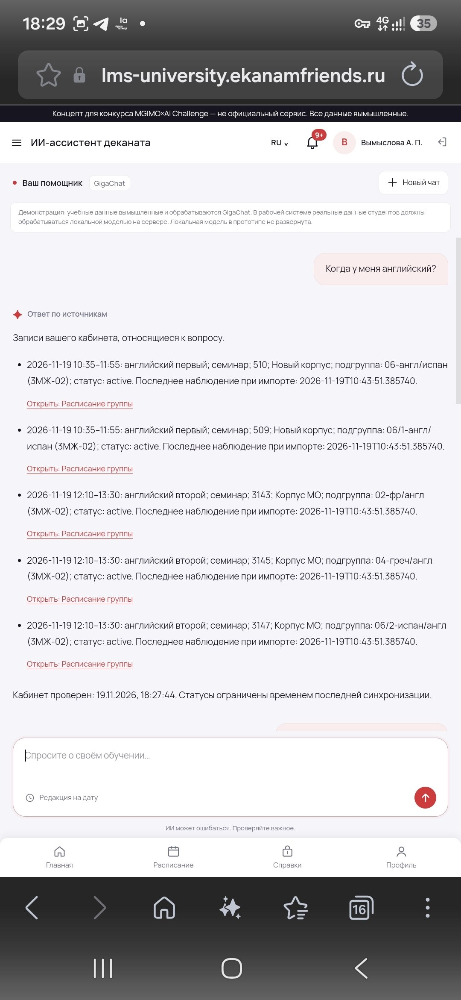
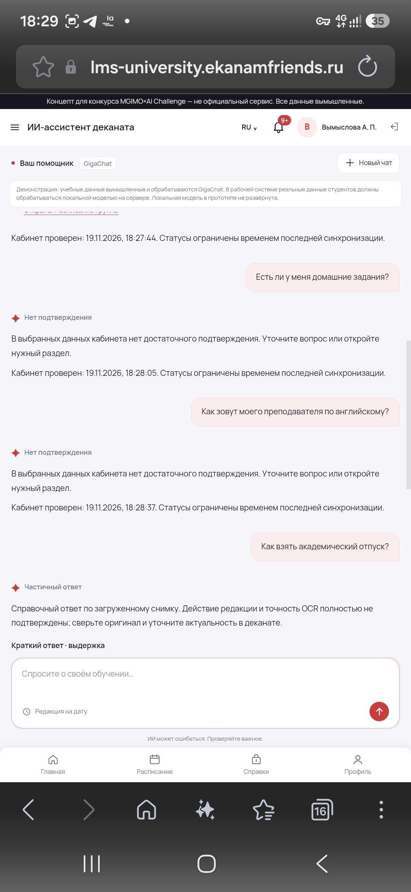
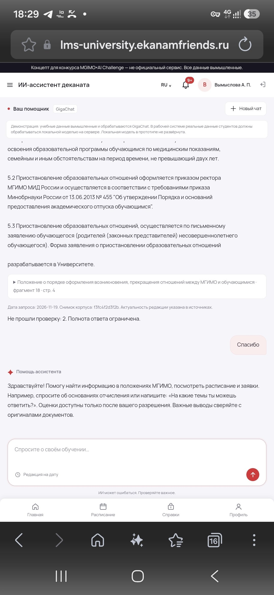
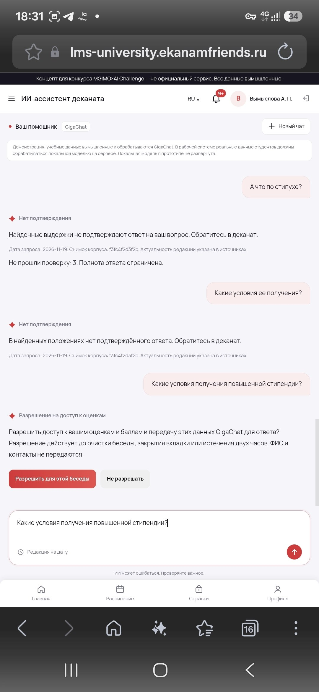
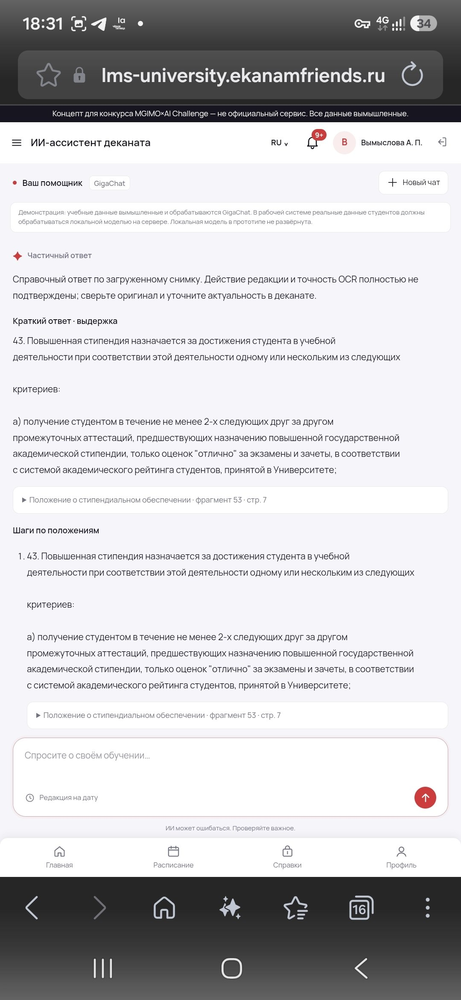
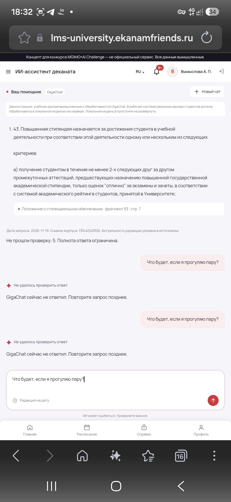

# Ручное тестирование мобильного ассистента — 19 ноября 2026

Отчёт оформлен 20 ноября 2026 по скриншотам Legpopov. Это разбор результатов
пользовательского прогона, без повторного запуска приложения и без исправления кода.

Проверенные причины и предложения: [диагностика 20 ноября](manual-testing-diagnosis-2026-11-20.md).

Исправления в коде PR №45 и результаты проверки: [20 ноября](manual-testing-fixes-2026-11-20.md).

## Материалы и среда

- На снимках открыт `lms-university.ekanamfriends.ru`, раздел «ИИ-ассистент деканата»,
  вымышленная учётная запись, русский интерфейс, обозначен GigaChat.
- Мобильный браузер Android; изображения 1080 × 2340 пикселей. Название и версия
  браузера, модель устройства, масштаб и ширина окна в CSS-пикселях неизвестны.
  Эти материалы не подтверждают проверку на 360 px.
- Интерфейс показывает дату запроса **2026-11-19**, проверки кабинета —
  **19.11.2026, 18:27:44–18:28:37**, часы телефона — около 18:29–18:32.
  Часовой пояс телефона не установлен. Названия пересланных файлов содержат 20 ноября,
  что не следует принимать за дату самого тестирования.
- В ответах по положениям указан снимок корпуса `f3fc4f2d3f2b`.
  Актуальность документов и соответствие ответов оригиналам в этой задаче не проверялись.

Просмотрены 23 файла JPEG из `tests`: 13 файлов относятся к этому прогону,
из них 6 уникальных и 7 повторов по SHA-256. Ещё 10 файлов — посторонние учебные
материалы (серии с датами 4 октября и 11 ноября в имени); в отчёт они не включены.
Исходники оставлены без изменений. В документацию скопированы только шесть
уникальных снимков без обрезки и перекодирования.

## Сценарии и наблюдаемый результат

Сценарии восстановлены по видимым сообщениям. Полная последовательность действий,
предыдущие вопросы и нажатия кнопок не записаны.

| ID | Запрос / действие | Результат на снимке | Оценка и граница вывода |
| --- | --- | --- | --- |
| MT-01 | «Когда у меня английский?» | Пять записей за 19 ноября, время, аудитории и разные подгруппы, ссылки на расписание | Данные показаны, но нет выбора своей подгруппы; не установлено, какую запись должен посетить студент. Вопрос задан после времени показанных занятий; будущая дата не предложена |
| MT-02 | «Есть ли у меня домашние задания?» | «Нет подтверждения», предложение уточнить вопрос или открыть нужный раздел | Полезного ответа нет; отсутствие заданий в БД из этого не следует |
| MT-03 | «Как зовут моего преподавателя по английскому?» | «Нет подтверждения», такая же общая подсказка | Имя не получено; наличие преподавателя в исходном расписании не проверено |
| MT-04 | «Как взять академический отпуск?» | Частичный ответ; пункты 5.2–5.3, ссылка на положение, фрагмент 18, стр. 4; два элемента не прошли проверку | Выдержка и ограничение видны. Полноценный порядок действий и актуальность редакции не подтверждены |
| MT-05 | «Спасибо» | Повторное приветствие с описанием возможностей | Ответ не учитывает благодарность; замечание к качеству диалога |
| MT-06 | «А что по стипухе?» → «Какие условия ее получения?» | Дважды «Нет подтверждения»; для первого запроса указаны три непрошедших проверку элемента | Разговорная формулировка и отсылка «ее» не дали полезного ответа. Потеря контекста — гипотеза, требующая воспроизведения |
| MT-07 | «Какие условия получения повышенной стипендии?» | Запрос разрешения на чтение оценок и передачу GigaChat | Для общего вопроса об условиях персональный доступ выглядит избыточным. Нужно проверить маршрутизацию запроса; нажатие «Разрешить» или «Не разрешать» на снимках не зафиксировано |
| MT-08 | Ответ по повышенной стипендии (вопрос над ответом не виден) | Частичный ответ: пункт 43, критерий «а», фрагмент 53, стр. 7; та же цитата повторена в «Шагах»; ниже пять элементов не прошли проверку | Показан один критерий, а не полный перечень. Нельзя считать условия полностью раскрытыми или утверждать, что ответ получен после согласия из MT-07 |
| MT-09 | «Что будет, если я прогуляю пару?» — два запроса подряд | Дважды «Не удалось проверить ответ»: «GigaChat сейчас не ответил. Повторите запрос позднее» | Видны два неуспешных ответа, повтор не помог. Таймаут, квота, сеть или иной источник сбоя без логов не установлены |

## Замечания для следующего прогона

| Приоритет | Наблюдение | Что проверить и критерий повторной проверки |
| --- | --- | --- |
| Высокий | MT-09: два неуспешных запроса подряд | Сопоставить серверные логи с временем прогона; повторить запрос. Получить ответ по источникам либо понятный отказ с доступным следующим действием |
| Высокий | MT-07: персональное согласие на общий вопрос | Задать общий вопрос без доступа к оценкам. Условия должны быть доступны по положениям; персональная оценка права на стипендию — отдельный сценарий |
| Средний | MT-02/03: общие отказы вместо данных кабинета | Проверить наличие тестовых заданий и вымышленных преподавателей в БД, затем повторить. При наличии данных — ответ со ссылкой, при отсутствии — конкретное объяснение ограничения |
| Средний | MT-01: несколько подгрупп и прошедшие занятия | Сверить подгруппу и дату; явно обозначать выбор или запрашивать уточнение, различать сегодняшние и ближайшие занятия |
| Средний | MT-06: разговорное продолжение не разрешено | Сравнить полное название стипендии, «стипуха» и вопрос с местоимением в одной беседе; при неоднозначности получить уточняющий вопрос |
| Низкий | MT-05: приветствие после благодарности | Ответить на благодарность коротко, без повторного знакомства |
| Низкий | MT-08: одинаковая выдержка в резюме и шагах | Сравнить блоки; шаги должны добавлять действие или пояснение, а не повторять цитату |
| Низкий | Технические детали в ответах | В расписании видны `active` и длинные метки импорта; счётчики «Не прошли проверку» не объясняют, каких сведений не хватает. Проверить понятность формулировок для студента |

Приоритеты предварительные: основаны на пользовательском результате, без подтверждения
технической причины. Исправления и повторная приёмка этим отчётом не заявляются.

## Галерея доказательств

### 1. Расписание английского — MT-01

Пять вариантов занятий с разными подгруппами и отметкой проверки кабинета.

### 2. Домашние задания, преподаватель и начало ответа об отпуске — MT-02–04

Два отказа по данным кабинета и начало частичного ответа по положению.

### 3. Академический отпуск и благодарность — MT-04–05

Продолжение выдержки, источник, ограничение полноты и повторное приветствие.

### 4. Уточнения о стипендии и запрос согласия — MT-06–07

Отказы на разговорные вопросы; общий вопрос вызывает запрос доступа к оценкам.

### 5. Частичный ответ по повышенной стипендии — MT-08

Одинаковый критерий в кратком ответе и первом шаге; источник — страница 7.

### 6. Два неуспешных запроса о пропуске пары — MT-09

Вверху — продолжение ответа по стипендии с ограничением полноты; ниже — два сбоя.

## Происхождение файлов

Копии названы по наблюдаемой дате прогона. Каждая соответствует
`tests/photo_N_2026-11-20_12-02-10.jpg`:

| N | Суффикс копии `2026-11-19-manual-*.jpg` |
| --- | --- |
| 1 | academic-leave-thanks |
| 2 | homework-teacher |
| 3 | english-schedule |
| 4 | scholarship-consent |
| 5 | scholarship-excerpt |
| 6 | provider-error |

Серия `12-02-26` — побайтовые повторы серии `12-02-10`.
`photo_2026-11-20_12-00-20.jpg` повторяет снимок N=1.
Размеры и SHA-256 всех 23 входных файлов — в
[реестре](manual-testing-2026-11-19-files.json). Посторонние изображения в Git не добавлены.

## Что не проверено

Не выполнены новый вход, отправка сообщений, раскрытие источников, переходы по ссылкам,
согласие и отказ на доступ к оценкам, очистка чата, проверка чужих данных,
отзыв разрешения, загрузка с клавиатурой и ширина 360 px. На снимках видны плашка
концепта, предупреждения о вымышленных данных и нижняя навигация; это подтверждает
их отображение только в зафиксированных состояниях. Версия сервера и ответы API неизвестны.
