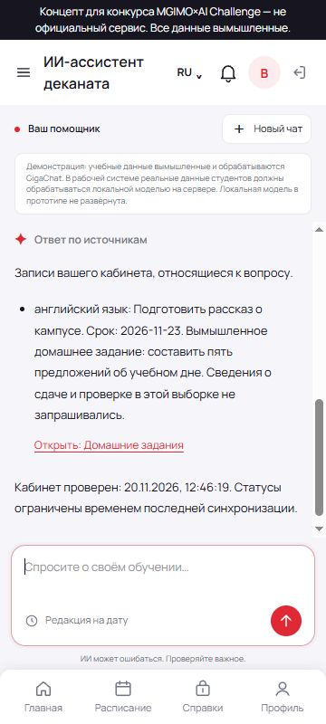
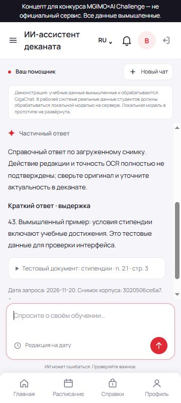
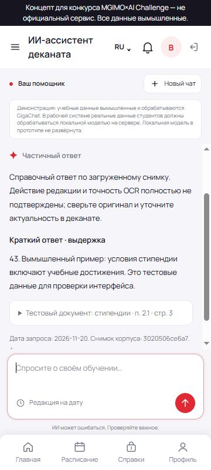
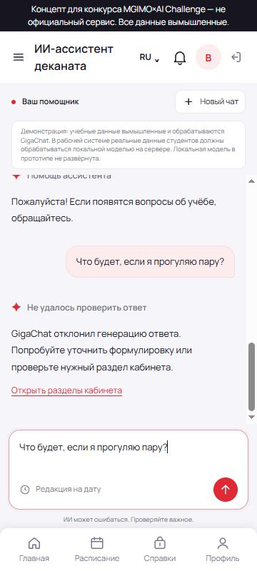

# Исправления по ручному тестированию — 20 ноября 2026

Изменения подготовлены в ветке `feature/contest-scale-integration`, существующий
[PR №45](https://github.com/Ekanam-Friends/MGIMO-LMS/pull/45).
Оба коммита материалов перенесены без изменения содержимого:

- `a9f6356` → `b56f56b`: отчёт и шесть исходных снимков;
- `2df4baa` → `6abae15`: диагностика причин и предложения.

Исходная рабочая копия с незакоммиченными изменениями не затронута.
[Скриншоты пользователя](manual-testing-2026-11-19.md) и
[диагностика](manual-testing-diagnosis-2026-11-20.md) сохранены как исторические
свидетельства. Архитектурное решение — [0024](../decisions/0024-assistant-manual-regressions.md).

## Реализовано

| Сценарии | Изменение |
| --- | --- |
| MT-01 | Общий с календарём выбор подгрупп/элективов; ближайшая незавершённая пара в пределах 14 дней; дисциплина фильтруется до лимита фактов. Неопределённая подгруппа явно отмечается |
| MT-02 | Отдельная область домашних заданий: описание, срок и курс без чтения баллов. Сначала ближайшие сроки; усечение списка/описания даёт partial |
| MT-03 | Вымышленные преподаватели загружаются через связи только доступных занятий |
| MT-04/08 | Подпункты 1), 2), в том числе OCR 6), сохраняются в родительском блоке. Текст не исправляется и snapshot не превращается в verified. Дубли резюме/шага убраны при показе |
| MT-05 | Благодарность получает короткий ответ, без повторного знакомства |
| MT-06 | not_found сохраняется в клиентской и серверной истории; местоимение разрешается по теме, иначе требуется уточнение. Добавлены разговорные формы стипухе/стипуху и прогуляю/прогулять |
| MT-07 | Общие правила стипендии не требуют grades даже при ошибке маршрутизатора; персональная проверка по оценкам по-прежнему требует согласия |
| MT-09 | Безопасные коды ошибок, этап и длительность в диагностике; раздельные сообщения, один повтор временного сетевого/HTTP-сбоя, учёт Retry-After; отказ генерации не повторяется автоматически |

## Автоматические проверки

- Профильный исходный набор после первых изменений: **68 passed**.
- Первый набор новых регрессий: **16 passed**.
- Общий прогон: **273 passed, 4 skipped, 2 subtests passed**, 252,62 с.
  Пропущены PostgreSQL-сценарии без выделенной тестовой БД.
- После ручной проверки уточнены выбор подгруппы, предел контекста заданий,
  передача нормализованного вопроса и разговорные формы; целевые прогоны:
  **45 passed**, затем **45 passed**.
- Последний прогон окончательного кода по затронутым сценариям, провайдеру,
  данным, преподавателям, языкам и регрессиям: **86 passed**.
  Числа пересекаются, их нельзя суммировать. Общий прогон до последних уточнений
  не заявляется повторным полным прогоном финального состояния.
- `node --check app/web/static/assistant.js`, `git diff --check`: без ошибок.
  Сохранены известные предупреждения pytest-asyncio и Alembic path_separator.

Регрессии проверяют SQL-изоляцию, отсутствие запроса таблиц оценок для homework,
сохранение темы после отказа, общий вопрос без согласия, личный вопрос с согласием,
выбор подгруппы и преподавателя, исключение прошедшей пары, единый блок подпунктов,
разговорные формы, 401/429/503, длительный Retry-After и отсутствие повторов при
отклонённой/незавершённой генерации. Секреты и ответы провайдера в лог не попадают.

## Ручной браузерный прогон

Локальный адрес `127.0.0.1:8098`, отдельная SQLite-БД вне проекта, вымышленная
учётка `demo-manual`, детерминированная заглушка GigaChat, синтетические источники.
Запуск приложения использует код ветки PR №45. Реальный сервер и БД не менялись.

На 360 × 800 выполнены:

1. Вход, открытие ассистента, подтверждение предупреждения.
2. Домашнее задание без оценки и без запроса разрешения; показаны описание и срок.
3. Преподаватель и ближайший английский — одна выбранная подгруппа.
4. Отказ на «А что по стипухе?» и продолжение «Какие условия её получения?» —
   ответ о стипендии, без доступа к оценкам, одна цитата без повторного шага.
5. «Спасибо» — короткий ответ без приветствия.
6. Смоделированный отказ генерации — отдельное сообщение и переход в сервисы;
   текст вопроса остаётся в поле ввода.
7. «Новый чат», отправка вопроса Enter, получение расписания.
8. Личные оценки — отдельное согласие; нажат отказ, показано «Оценки не переданы».
9. Новый чат и точный общий вопрос об условиях повышенной стипендии — без согласия.

Измерено `innerWidth=360`, `documentElement.scrollWidth=360`, горизонтального
переполнения нет. После проверки размер окна возвращён к обычному.
Проверка настоящей экранной клавиатуры телефона не выполнялась.

### Скриншоты

Неудачный первый вариант с лишним предупреждением о подгруппах сохранён:
[снимок](screenshots/2026-11-20-assistant-360-rejected.png). После устранения
предупреждения проверка повторена. PNG получены конвертацией снимков браузера
без обрезки, изменения размеров и перерисовки содержимого.

## Границы готовности

Перед финальным прогоном отдельно закреплён выбор только ближайшего временного слота:
**30 passed**. Более поздние пары не включаются вместо ближайшей.

Код исправлен и проверен локально. Реальный GigaChat с новым кодом, PostgreSQL,
производственная индексация и полный мобильный телефонный сценарий не проверялись.
Продовый корпус не переиндексирован; неверный символ OCR не исправлялся без
сверки оригинала. Выкладка и слияние PR не выполнялись.
