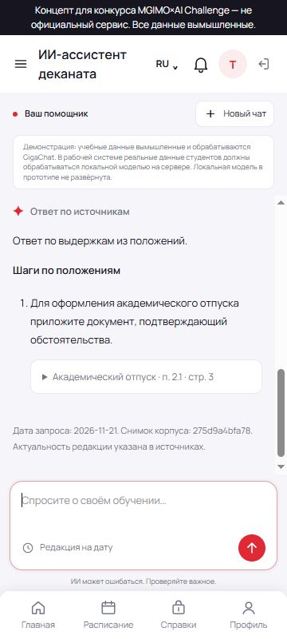
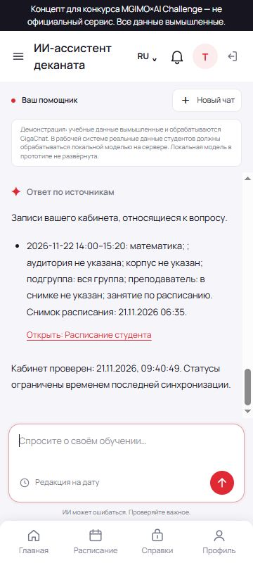

# Исправления ревью PR #45 — 21 ноября 2026

Постановщик: Legpopov. Запрос: исправить пять замечаний и потерю контекста беседы.
Исходный head: f7c1768148e702dc8a20f2705f9e91bdc048853e.

## Что изменилось

1. Вместо четырёх исходных вопросов хранятся восемь ходов вопрос–ответ в общем
   бюджете 24 000 символов. В контекст входят уточнения, отказы и видимая нумерация шагов.
   Браузерная история не используется; очистка удаляет серверную память и согласие.
2. Удалены TOPICS и подстановка местоимений по трём темам. Модель разрешает отсылки
   по серверному диалогу либо просит уточнение. Статический список тем больше не
   блокирует «Кто ведёт математику и как его зовут?».
3. Составные вопросы сохраняют несколько областей: задания и расписание,
   нормативные условия и статус заявки, задания и баллы с отдельным согласием.
4. ScheduleQuery отделяет интерпретацию вопроса от SQL. Фильтр дисциплины применяется
   до ограничения ближайшим слотом, включая математику и другие неязыковые предметы.
5. Последняя попытка определяется общим правилом зачётки и преподавательского
   ассистента; старые неудачные попытки не выдаются как текущий итог.

Архитектурное решение: [0025](../decisions/0025-assistant-dialogue-and-read-queries.md).

## Автоматические проверки

- Первый целевой прогон: 63 passed.
- Первая расширенная выборка: 29 passed, 1 failed. Новый тест обнаружил потерю
  заданий в «Условия стипендии и домашние задания»; правило исправлено.
- Финальный полный прогон: **295 passed, 4 skipped, 2 subtests passed**,
  18 предупреждений, 265,16 секунды. Пропущены отдельные сценарии PostgreSQL
  без тестовой БД. Целевые проверки входят в полный прогон; числа не суммируются.
- `node --check app/web/static/assistant.js`, `git diff --check` — без ошибок.
- Регрессии в tests/test_pr45_fixes.py проверяют контракты истории, видимый второй
  пункт, ответ на уточнение, смену темы, игнорирование истории браузера, бюджет,
  удаление истории и согласия, исключение прошлых оценок без согласия, смешанные
  области, ближайшую математику и общую последнюю попытку с несовпадающим порядком дат.
  Отдельно проверены шесть длинных пунктов: все номера сохраняются в валидном
  JSON истории, даже когда полные выдержки не помещаются в её бюджет.

## Браузер на 360×800

Локальный HTTP-стенд, отдельная SQLite с вымышленным студентом preview и заглушкой
провайдера. Выполнены вход через форму и следующие сценарии:

- Два шага оформления → «Поясни второй пункт»: сервер передал прошлый ответ,
  заглушка проверила его наличие, итог содержит соответствующую выдержку.
- «Покажи мои домашние задания и расписание по математике»: отображены обе области.
- «Когда у меня математика?»: показана математика 22 ноября, более ранняя история
  21 ноября не подменяет нужный предмет.
- Запрос оценок → явное согласие → свои 7 баллов.
- Новый чат → повторный запрос оценок снова требует согласия; прежние сообщения очищены.

`innerWidth=360`, `documentElement.scrollWidth=360`. В консоли ошибок JavaScript нет.
Временное изменение размера браузера снято после проверки.

Снимки браузера преобразованы из JPEG в PNG без обрезки, масштабирования и перерисовки.

## Реальный провайдер и границы проверки

Использованы локальные настройки GigaChat без вывода ключей. Проверка отправляла
только вымышленные вопросы и тестовый корпус, рабочая БД не читалась.
Первый route завершился безопасным кодом network, request_id=eb14a9d3b8a3,
elapsed=6.125. Причина транспортного сбоя не установлена; TLS не отключался.
Продолжение живой беседы и последующие пробы маршрутизации не выполнялись после ошибки.
Браузерный сценарий с заглушкой не выдаётся за проверку качества настоящего GigaChat.

Рабочий PostgreSQL, сервер, production и корпус не менялись. PR не сливался,
деплой не выполнялся. Исходная корневая папка с чужими незакоммиченными файлами сохранена.
