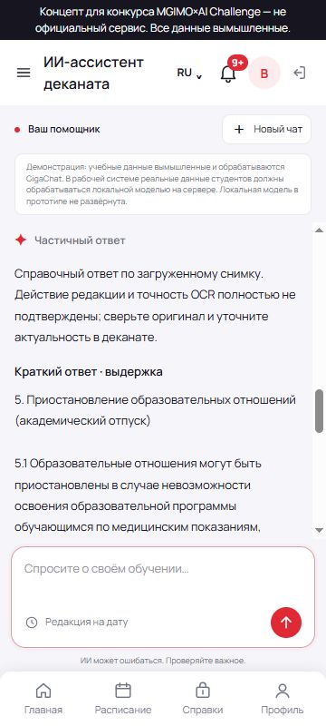

# PR #45: production и реальный GigaChat — 21 ноября 2026

Постановщик: Legpopov. Запрос: слить в dev, выложить на прод и устранить ошибку GigaChat.

## Слияние и исходное состояние

- PR #45 слит в dev, merge 5e29406d53e080a29f7e2b2458c49a0ee4198ae0.
- На VPS штатная primary (recovery=false), standby (recovery=true, streaming),
  схема 0013_merge. Соседние сервисы Ikanam работают; переключение БД не требовалось.
- Маркер прежней выкладки — 0f57321, фактические образы сохранены отдельно,
  поскольку маркер не доказывает отсутствия промежуточных серверных изменений.

## Причина network

Локально отсутствовал GIGACHAT_CA_BUNDLE. Запросы без ключей показали:

- OAuth: CERTIFICATE_VERIFY_FAILED, self signed certificate in certificate chain;
- API: CERTIFICATE_VERIFY_FAILED, unable to get local issuer certificate.

На сервере существующий /data/ca/gigachat-ca.pem содержал Russian Trusted Root CA
и Russian Trusted Sub CA. Те же запросы возвращали HTTP 405 и 401: TLS и сеть доступны.
Публичный бандл скопирован в игнорируемый локальный data/ca, в локальном .env изменён
только CA-путь; исходный файл сохранён в игнорируемом .secrets. После этого локальные
запросы тоже получили 405 и 401, затем прошли OAuth и генерация. Ключи не выводились.
Проверка TLS не отключалась, системное хранилище Windows не менялось.

## Доработка после живых проб

- История передаётся стандартными ролями API без дублирующего списка вопросов.
- Все новые поля маршрута явно описаны и обязательны в отправляемой схеме.
- Общие вопросы об академическом отпуске и справках не читают личное расписание.
- Введены проверки реального HTTP-payload, допустимых ролей и обязательных полей.
- Для живой приёмки использована GigaChat-2-Max, как на сервере. Базовая локальная
  GigaChat-2 дала нестабильные результаты и в отдельных пробах пустой content;
  это не выдаётся за проверку prod-модели и не меняет её настройки.

Живые примеры Max: академический отпуск → answer с двумя шагами; «поясни второй
пункт» → правильная тема документов и уточнение обстоятельств. В маршрутизации:
задания и расписание на завтра → обе области и 2026-11-22; математика → дисциплина
и nearest=true; преподаватель математики → discipline=математика; после стипендии
и нового вопроса о справке «когда её получать?» относится к справке.

## Подготовка безопасной выкладки

Полный набор окончательного дополнительного кода: **299 passed, 4 skipped,
2 subtests passed**, 18 предупреждений, 372,05 секунды. Целевая выборка входит
в этот набор, числа не суммируются. Отдельные PostgreSQL-сценарии pytest пропущены
без тестового URL; восстановление реального бэкапа и SQL-проверки описаны ниже.

Бэкап: /opt/mgimo-lms/backups/deploy-pr45-20261121T071325Z/lms.dump.
Создан pg_dump -Fc, список архива проверен. Сохранены source-and-config.tar.gz,
теги прежних web/bot и SHA-256 .env, override, chunks.jsonl и CA-бандла.

Первый образ merge 5e29406 собран отдельно. Бэкап восстановлен в изолированном
PostgreSQL 16, alembic upgrade head и alembic check прошли без новых операций.
Прочитаны 16 текущих курсов student1 и 132 факта teacher1; проверены реальные SQL
запросы зачётки и преподавательского адаптера. Временные контейнер, том и сеть удалены.
Хэши конфигурации и корпуса совпали. Рабочие web/bot на этом этапе не переключались.

## Окончательная выкладка и приёмка

После паузы повторно проверены dev и VPS: удалённый dev указывал на 4b02297,
рабочие образы и защищённые файлы не менялись. Перед переключением создан свежий
бэкап `/opt/mgimo-lms/backups/deploy-pr45-20261121T142439Z/lms.dump`, сохранены
прежние образы web/bot и source-and-config.tar.gz. Бэкап снова восстановлен в
изолированном PostgreSQL, upgrade head, alembic check и SQL-проверки прошли.

- **Код:** 4b02297b12116b200b143fbd5792931ae564dd8d; 21 ноября 2026, 17:32 МСК.
- **Архив:** SHA-256 `9eec929ad18d7a4b6e72e4408dc9d5f60d7e0dbd9cfcde09f9f0b0c4e07210dd`.
- **Образ web/bot:** `sha256:feedd9dde8a0c22e8a92739b4ba1ebeb41dc90f41e1c7f3c854e2778c84c5b2b`.
  Метка org.opencontainers.image.revision совпала с кодом. Пересозданы только
  web/bot через `--no-deps --no-build`. Соседние сервисы, primary, standby и Caddy
  не перезапускались. Оба новых процесса работают с RestartCount=0, ошибок в
  проверенных логах нет; Telegram polling начался.
- **БД:** schema=0013_merge, на primary pg_is_in_recovery=false, на standby=true,
  WAL receiver=streaming; на момент финальной проверки lag_bytes=0.
- **Конфигурация:** SHA-256 .env, override, chunks.jsonl и CA совпали до/после.
  Модель Max, лимит одного одновременного запроса и TLS-настройки production сохранены.
- **Внешний HTTP:** healthz=200; вход и страницы student1, teacher1, dean=200,
  ассистент доступен всем трём ролям. Реальный диалог студента: первый вопрос об
  академическом отпуске → partial с выдержкой; вопрос о документах → not_found
  после проверки подтверждений. Это безопасный отказ, а не доказательство
  полноты корпуса. HTTP-сессии теста закрыты.
- **Браузер:** публичный HTTPS-сайт, вход student1, экран 360×800. Вопрос
  «Как оформить академический отпуск?» → partial с разделом об академическом отпуске.
  «А кто принимает решение?» сохранил эту тему и показал проверяемую выдержку
  с приказом ректора. Ширина окна и документа 360, горизонтального переполнения
  и ошибок JavaScript нет. Диалог очищен, выполнен выход, viewport восстановлен.
- **Бэкапы:** после успешной приёмки оставлены три последние полные копии:
  20261121T142439Z, 20261121T071325Z и contest-scale/20261117T113649Z.
  Два старых custom-архива удалены; остальные данные и конфигурация не удалялись.
- **Состояние:** verified в `.deploy-pr45-state.json` и `.deploy-state-4b02297.json`;
  DEPLOYED_REVISION=4b02297b12116b200b143fbd5792931ae564dd8d.

Браузерный JPEG преобразован в PNG без обрезки и масштабирования. Скриншот
показывает реальную страницу production, не локальную заглушку.

## Оставшиеся ограничения

OCR и нормативная актуальность всего корпуса не пересверены. В ответах остаются
предупреждение о снимке и возможный not_found при недостаточных подтверждениях.
Нагрузочная приёмка и доставка пользовательского сообщения Telegram в этой
выкладке не проверялись. Seed, генератор и ручной массовый импорт не запускались.
