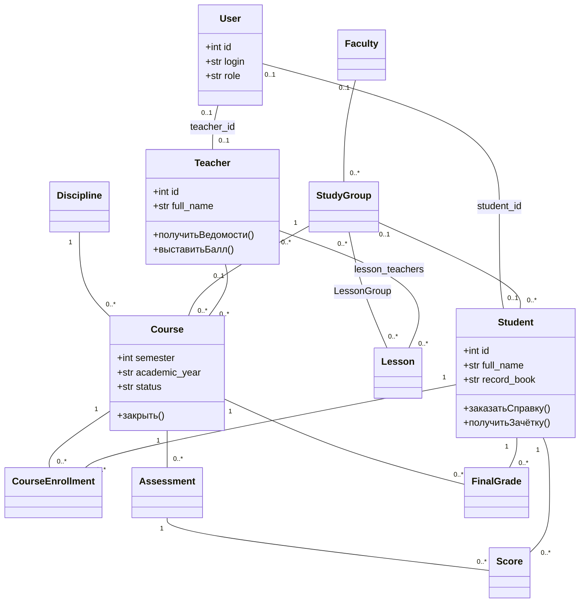
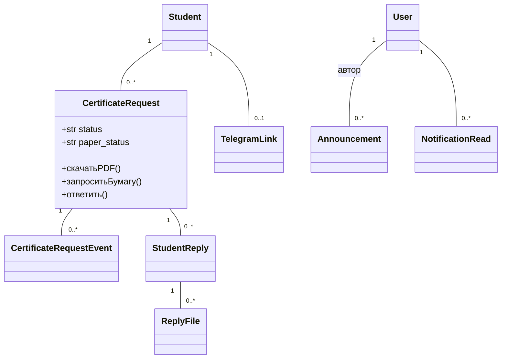
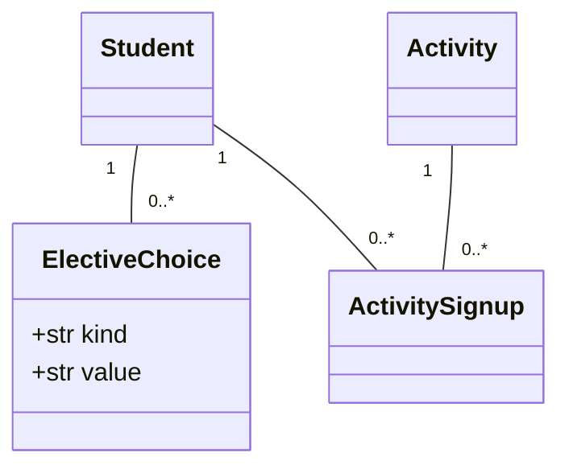
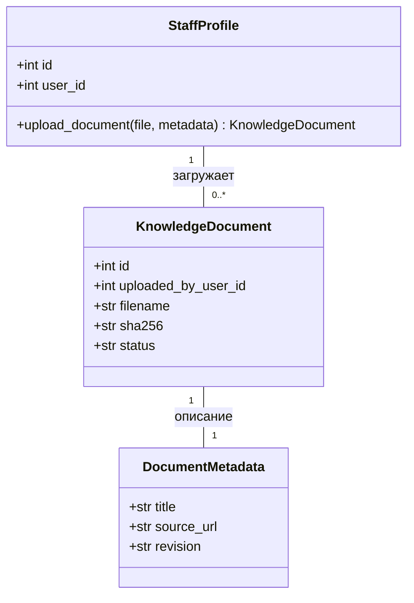
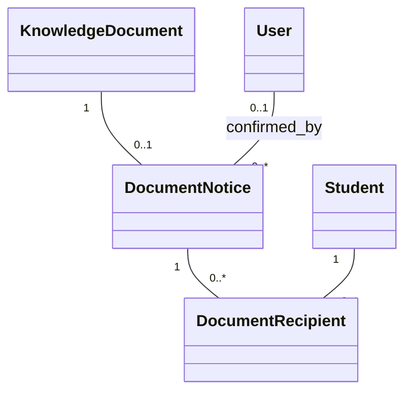

# 1. Предметная модель

[Навигация и обозначения](README.md). Поля — [ЕСТЬ]; операции в каталоге — [В СЕРВИСЕ].
Они описывают смысл действий и не являются методами текущих ORM-классов.
Сервис получает идентификатор действующего пользователя из проверенной серверной сессии.
Параметры инфраструктуры (db, сессия) в предметных операциях опущены.

## Люди, обучение и расписание

Это связи, а не наследование: студент не является подклассом учётной записи.
Один пользователь имеет одну роль; допустимость сочетания роли и ссылок задаётся логикой
приложения, схема сама по себе не запрещает все некорректные сочетания.
У сотрудника деканата сейчас User.role=staff; отдельного класса Staff нет.
Course имеет не более одного ведущего преподавателя, Lesson — несколько преподавателей.
Между Lesson и Discipline нет внешнего ключа, между Lesson и Course тоже.
Lesson.discipline — строка; одинаковое название не устанавливает связь объектов автоматически.

## Справки и коммуникации

Статус электронной заявки и статус бумажного оригинала независимы. Pyrus — внешняя система,
а не подкласс заявки. NotificationRead.key логически указывает на объявление или событие;
это не внешний ключ на общую таблицу Notification. Общей таблицы уведомлений нет:
лента собирается также из CertificateRequestEvent и GradeEvent.

## Выборы и мероприятия

ElectiveChoice выбирает строки расписания, CourseEnrollment включает студента в ведомость,
ActivitySignup записывает на мероприятие. Это три разных отношения.

## Дополнение: работник загружает документ [ПРЕДЛОЖЕНИЕ]

Для работника (`StaffProfile`) добавляется предметная операция
`upload_document(file: UploadedFile, metadata: DocumentMetadata) → KnowledgeDocument` —
загрузить новый документ в базу знаний ИИ-ассистента. Это дополнение к проектируемой
модели; сейчас работник представлен учётной записью `User` с ролью `staff`.

Обновление после реализации: `KnowledgeDocument` и `DocumentMetadata` — **[ЕСТЬ]**.
`StaffProfile` остаётся **[ПРЕДЛОЖЕНИЕ]**: работник представлен `User.role=staff`,
а загрузка — функцией сервиса `upload_document`. Схема сохраняет предметный
смысл действия работника. Загруженный файл
сохраняется вместе с автором и метаданными, затем проходит извлечение текста,
проверку и индексирование. Сохранение файла ещё не означает его доступность в ответах
ассистента. Поля, типы и распределение обязанностей — в
[учебной ООП-модели](03-oop-proposal.md#загрузка-документа-работником).
Сценарий согласуется с [планом индексирования](../assistant-indexing-plan.md).

## Каталог всех текущих ORM-классов

Обновление после реализации: к 30 первоначальным ORM-классам добавлена 31-я модель.

### KnowledgeDocument

**[ЕСТЬ]** — оригинал PDF и задание обработки. Источник:
[app/models/knowledge.py](../../app/models/knowledge.py).

| Поле | Тип |
| --- | --- |
| `id` | `int` |
| `uploaded_by_user_id` | `int` |
| `title` | `str` |
| `source_url` | `str` |
| `source_key` | `str` |
| `revision` | `str` |
| `filename` | `str` |
| `sha256` | `str` |
| `data` | `bytes` |
| `reviewed_public` | `bool` |
| `status` | `str` |
| `error` | `str \| None` |
| `chunk_count` | `int` |
| `uploaded_at` | `datetime` |
| `indexed_at` | `datetime \| None` |

Собственных методов нет. `uploaded_by_user_id` связан с `User.id`; автор определяется
по серверной сессии. Оригинал хранится в `data`, а `source_key` — уникальный хэш URL.
Состояния: queued / processing / published / needs_review / error.
**[В СЕРВИСЕ]**: `upload_document(db, actor, filename, data, metadata)` возвращает
документ и признак создания/исправления загрузки; `DocumentProcessor.process_one()`
обрабатывает запись очереди. Подробности: [загрузка работником](../staff-document-upload.md).

Типы соответствуют аннотациям кода: int — целое, str — строка, float — число с дробной частью,
bool — логическое значение, date — дата, time — время, datetime — дата и время,
bytes — двоичные данные; T | None означает необязательное значение.
Внешние ключи представлены идентификаторами; наличие поля student_id само по себе
не создаёт Python-атрибут student с объектом Student.

### User

Учётная запись для входа; связывает роль с профилем студента или преподавателя.

Источник: [app/models/auth.py](../../app/models/auth.py).

| Поле [ЕСТЬ] | Тип |
| --- | --- |
| `id` | `int` |
| `login` | `str` |
| `password_hash` | `str` |
| `role` | `str` |
| `student_id` | `int \| None` |
| `teacher_id` | `int \| None` |
| `created_at` | `datetime` |
| `last_login_at` | `datetime \| None` |

Предметные операции **[В СЕРВИСЕ]** (сокращённые концептуальные сигнатуры):

- `войти(login: str, password: str) → User?` — [authenticate](../../app/auth/service.py) в `app/auth/service.py`.
- `открытьСессию(ttl: timedelta) → str` — [open_session](../../app/auth/service.py) в `app/auth/service.py`.

**[ПРЕДЛОЖЕНИЕ]**: поле `is_active: bool`; метод `deactivate() → None`. Явное отключение учётной записи; потребуется проверка при входе и разрешении сессии.

### AuthSession

Серверная сессия пользователя. В БД хранится хэш токена, в cookie — исходный случайный токен.

Источник: [app/models/auth.py](../../app/models/auth.py).

| Поле [ЕСТЬ] | Тип |
| --- | --- |
| `token_hash` | `str` |
| `user_id` | `int` |
| `csrf_token` | `str` |
| `created_at` | `datetime` |
| `expires_at` | `datetime` |

Предметные операции **[В СЕРВИСЕ]** (сокращённые концептуальные сигнатуры):

- `завершить(token: str) → None` — [close_session](../../app/auth/service.py) в `app/auth/service.py`.

**[ПРЕДЛОЖЕНИЕ]**: поле `/is_expired: bool`; метод `is_valid(now: datetime) → bool`. Чистая проверка срока; отзыв сессии остаётся операцией сервиса.

### ElectiveChoice

Выбранная студентом дисциплина или подгруппа. value — строка, не внешний ключ на Discipline.

Источник: [app/models/calendar.py](../../app/models/calendar.py).

| Поле [ЕСТЬ] | Тип |
| --- | --- |
| `student_id` | `int` |
| `kind` | `str` |
| `value` | `str` |

Предметные операции **[В СЕРВИСЕ]** (сокращённые концептуальные сигнатуры):

- `сохранитьВыбор(подгруппы, дисциплины) → None` — [set_choices](../../app/web/calendar_view.py) в `app/web/calendar_view.py`.

**[ПРЕДЛОЖЕНИЕ]**: поле `—`; метод `matches(kind: str, value: str) → bool`. Не добавлять фиктивную ссылку на Discipline: текущая модель использует строки расписания.

### Activity

Внеучебное мероприятие.

Источник: [app/models/calendar.py](../../app/models/calendar.py).

| Поле [ЕСТЬ] | Тип |
| --- | --- |
| `id` | `int` |
| `title` | `str` |
| `starts_at` | `datetime` |
| `ends_at` | `datetime` |
| `place` | `str` |
| `organizer` | `str` |
| `description` | `str` |

Собственных предметных методов сейчас нет; это запись данных/связи, которую обрабатывают сервисы.

**[ПРЕДЛОЖЕНИЕ]**: поле `capacity: int?`; метод `has_started(now: datetime) → bool`. Лимит мест — новая возможность; проверка количества записей требует транзакции.

### ActivitySignup

Запись студента на мероприятие.

Источник: [app/models/calendar.py](../../app/models/calendar.py).

| Поле [ЕСТЬ] | Тип |
| --- | --- |
| `student_id` | `int` |
| `activity_id` | `int` |
| `created_at` | `datetime` |

Предметные операции **[В СЕРВИСЕ]** (сокращённые концептуальные сигнатуры):

- `задатьЗапись(activityId: int, on: bool) → Activity?` — [set_signup](../../app/web/calendar_view.py) в `app/web/calendar_view.py`.

**[ПРЕДЛОЖЕНИЕ]**: поле `—`; метод `matches(student_id: int, activity_id: int) → bool`. Простая связь может оставаться классом данных без поведения.

### Student

Профиль студента и сведения об обучении. Поле course — номер года обучения, а не объект Course.

Источник: [app/models/certificates.py](../../app/models/certificates.py).

| Поле [ЕСТЬ] | Тип |
| --- | --- |
| `id` | `int` |
| `full_name` | `str` |
| `gender` | `str` |
| `birth_date` | `date \| None` |
| `record_book` | `str` |
| `study_group_id` | `int \| None` |
| `faculty_name` | `str` |
| `course` | `int` |
| `level` | `str` |
| `form_of_education` | `str` |
| `education_basis` | `str` |
| `speciality` | `str` |
| `enrollment_order` | `str` |
| `enrollment_date` | `date \| None` |
| `expected_graduation` | `date \| None` |

Предметные операции **[В СЕРВИСЕ]** (сокращённые концептуальные сигнатуры):

- `заказатьСправку(kind: str, purpose: str, copies: int) → CertificateRequest` — [create_request](../../app/certificates/service.py) в `app/certificates/service.py`.
- `получитьЗачётку() → RecordBook` — [record_book](../../app/grades/service.py) в `app/grades/service.py`.
- `получитьКалендарь(start: date, end: date) → события` — [events_for](../../app/web/calendar_view.py) в `app/web/calendar_view.py`.

**[ПРЕДЛОЖЕНИЕ]**: поле `/display_name: str`; метод `display_label() → str`. Вычисляемое отображение имени и группы; не создавать копию данных в БД.

### CertificateRequest

Заявка на справку с независимыми электронным и бумажным статусами. Статус синхронизируется с Pyrus.

Источник: [app/models/certificates.py](../../app/models/certificates.py).

| Поле [ЕСТЬ] | Тип |
| --- | --- |
| `id` | `int` |
| `student_id` | `int` |
| `kind` | `str` |
| `purpose` | `str` |
| `copies` | `int` |
| `status` | `str` |
| `pyrus_task_id` | `int \| None` |
| `dean_message` | `str \| None` |
| `answered_message` | `str \| None` |
| `push_attempts` | `int` |
| `last_error` | `str \| None` |
| `ready_at` | `datetime \| None` |
| `download_until` | `datetime \| None` |
| `downloaded_at` | `datetime \| None` |
| `paper_status` | `str` |
| `paper_requested_at` | `datetime \| None` |
| `paper_pushed_at` | `datetime \| None` |
| `paper_push_attempts` | `int` |
| `paper_last_error` | `str \| None` |
| `pdf` | `bytes \| None` |
| `pdf_pushed` | `bool` |
| `created_at` | `datetime` |
| `updated_at` | `datetime` |
| `synced_at` | `datetime \| None` |

Предметные операции **[В СЕРВИСЕ]** (сокращённые концептуальные сигнатуры):

- `скачатьPDF() → bytes?` — [download_pdf](../../app/certificates/service.py) в `app/certificates/service.py`.
- `запроситьБумагу() → CertificateRequest?` — [request_paper](../../app/certificates/service.py) в `app/certificates/service.py`.
- `ответить(text: str, files: list[UploadedFile]) → StudentReply?` — [add_reply](../../app/certificates/service.py) в `app/certificates/service.py`.

**[ПРЕДЛОЖЕНИЕ]**: поле `/download_available: bool`; метод `can_download(now: datetime) → bool; can_request_paper() → bool`. Локальные условия выдачи. Сохранить независимость электронного и бумажного статусов.

### CertificateRequestEvent

Запись истории заявки и очередь уведомлений о ней.

Источник: [app/models/certificates.py](../../app/models/certificates.py).

| Поле [ЕСТЬ] | Тип |
| --- | --- |
| `id` | `int` |
| `request_id` | `int` |
| `kind` | `str` |
| `status` | `str \| None` |
| `text` | `str \| None` |
| `created_at` | `datetime` |
| `notified_at` | `datetime \| None` |

Собственных предметных методов сейчас нет; это запись данных/связи, которую обрабатывают сервисы.

**[ПРЕДЛОЖЕНИЕ]**: поле `—`; метод `mark_notified(at: datetime) → None`. Локальное обновление отметки уведомления.

### StudentReply

Ответ студента на запрос уточняющей информации по заявке.

Источник: [app/models/certificates.py](../../app/models/certificates.py).

| Поле [ЕСТЬ] | Тип |
| --- | --- |
| `id` | `int` |
| `request_id` | `int` |
| `text` | `str` |
| `created_at` | `datetime` |
| `pushed_at` | `datetime \| None` |
| `push_attempts` | `int` |
| `last_error` | `str \| None` |

Собственных предметных методов сейчас нет; это запись данных/связи, которую обрабатывают сервисы.

**[ПРЕДЛОЖЕНИЕ]**: поле `/is_pending: bool`; метод `mark_pushed(at: datetime) → None`. Отделить локальную отметку от сетевой отправки в Pyrus.

### ReplyFile

Файл, приложенный к ответу студента.

Источник: [app/models/certificates.py](../../app/models/certificates.py).

| Поле [ЕСТЬ] | Тип |
| --- | --- |
| `id` | `int` |
| `reply_id` | `int` |
| `filename` | `str` |
| `content_type` | `str` |
| `data` | `bytes` |
| `pyrus_guid` | `str \| None` |

Собственных предметных методов сейчас нет; это запись данных/связи, которую обрабатывают сервисы.

**[ПРЕДЛОЖЕНИЕ]**: поле `/size_bytes: int`; метод `validate_size(limit: int) → None`. Размер вычисляется из data; проверка не заменяет ограничения загрузки HTTP.

### Discipline

Название учебной дисциплины, общее для нескольких ведомостей.

Источник: [app/models/grades.py](../../app/models/grades.py).

| Поле [ЕСТЬ] | Тип |
| --- | --- |
| `id` | `int` |
| `name` | `str` |

Собственных предметных методов сейчас нет; это запись данных/связи, которую обрабатывают сервисы.

**[ПРЕДЛОЖЕНИЕ]**: поле `code: str?`; метод `rename(name: str) → None`. Код дисциплины требует источника; уникальность имени проверяется с участием БД.

### Course

Ведомость по дисциплине для группы/подгруппы в определённом семестре.

Источник: [app/models/grades.py](../../app/models/grades.py).

| Поле [ЕСТЬ] | Тип |
| --- | --- |
| `id` | `int` |
| `discipline_id` | `int` |
| `group_id` | `int` |
| `subgroup` | `str` |
| `teacher_id` | `int \| None` |
| `semester` | `int` |
| `academic_year` | `str` |
| `control_form` | `str` |
| `hours` | `int` |
| `credits` | `int` |
| `status` | `str` |
| `closed_at` | `datetime \| None` |
| `created_at` | `datetime` |

Предметные операции **[В СЕРВИСЕ]** (сокращённые концептуальные сигнатуры):

- `добавитьКонтрольнуюТочку(данные) → Assessment?` — [create_assessment](../../app/grades/service.py) в `app/grades/service.py`.
- `закрыть() → Course?` — [close_course](../../app/grades/service.py) в `app/grades/service.py`.

**[ПРЕДЛОЖЕНИЕ]**: поле `/is_closed: bool`; метод `ensure_open() → None; close(at: datetime) → None`. Локальное правило закрытой ведомости; полномочия и транзакция остаются в сервисе.

### CourseEnrollment

Запись студента в ведомость. Принадлежность группе сама по себе её не заменяет.

Источник: [app/models/grades.py](../../app/models/grades.py).

| Поле [ЕСТЬ] | Тип |
| --- | --- |
| `course_id` | `int` |
| `student_id` | `int` |

Собственных предметных методов сейчас нет; это запись данных/связи, которую обрабатывают сервисы.

**[ПРЕДЛОЖЕНИЕ]**: поле `enrolled_at: datetime?`; метод `matches(student_id: int) → bool`. Дата включения нужна только при требовании истории состава.

### Assessment

Контрольная точка: домашняя работа, контрольная, семинар, эссе или рубежный контроль.

Источник: [app/models/grades.py](../../app/models/grades.py).

| Поле [ЕСТЬ] | Тип |
| --- | --- |
| `id` | `int` |
| `course_id` | `int` |
| `kind` | `str` |
| `title` | `str` |
| `description` | `str` |
| `max_points` | `float` |
| `due_date` | `date \| None` |
| `position` | `int` |
| `created_at` | `datetime` |

Предметные операции **[В СЕРВИСЕ]** (сокращённые концептуальные сигнатуры):

- `удалить() → bool` — [delete_assessment](../../app/grades/service.py) в `app/grades/service.py`.

**[ПРЕДЛОЖЕНИЕ]**: поле `/is_overdue: bool`; метод `is_overdue(today: date) → bool; validate_points(value: float) → None`. Просроченность срока не равна наличию долга у конкретного студента.

### Score

Балл одного студента за одну контрольную точку.

Источник: [app/models/grades.py](../../app/models/grades.py).

| Поле [ЕСТЬ] | Тип |
| --- | --- |
| `id` | `int` |
| `assessment_id` | `int` |
| `student_id` | `int` |
| `points` | `float` |
| `comment` | `str` |
| `graded_by` | `int \| None` |
| `graded_at` | `datetime` |

Предметные операции **[В СЕРВИСЕ]** (сокращённые концептуальные сигнатуры):

- `изменить(points: float?, comment: str?) → результат` — [set_score](../../app/grades/service.py) в `app/grades/service.py`.

**[ПРЕДЛОЖЕНИЕ]**: поле `—`; метод `change(points: float, maximum: float, at: datetime) → None`. Инкапсулирует границы балла; права преподавателя и открытость ведомости проверяет сервис.

### FinalGrade

Итог по ведомости для студента на конкретной попытке сдачи.

Источник: [app/models/grades.py](../../app/models/grades.py).

| Поле [ЕСТЬ] | Тип |
| --- | --- |
| `id` | `int` |
| `course_id` | `int` |
| `student_id` | `int` |
| `attempt` | `int` |
| `current_points` | `float` |
| `exam_points` | `float \| None` |
| `total_points` | `float` |
| `result` | `str` |
| `teacher_id` | `int \| None` |
| `graded_on` | `date` |

Предметные операции **[В СЕРВИСЕ]** (сокращённые концептуальные сигнатуры):

- `выставить(данныеИтога) → результат` — [set_final](../../app/grades/service.py) в `app/grades/service.py`.

**[ПРЕДЛОЖЕНИЕ]**: поле `/is_negative: bool`; метод `is_negative() → bool`. Негативность одной попытки; долг вычисляется с учётом последней попытки по курсу.

### GradeEvent

Событие успеваемости для ленты студента и уведомлений.

Источник: [app/models/grades.py](../../app/models/grades.py).

| Поле [ЕСТЬ] | Тип |
| --- | --- |
| `id` | `int` |
| `student_id` | `int` |
| `course_id` | `int` |
| `kind` | `str` |
| `text` | `str` |
| `created_at` | `datetime` |
| `notified_at` | `datetime \| None` |

Собственных предметных методов сейчас нет; это запись данных/связи, которую обрабатывают сервисы.

**[ПРЕДЛОЖЕНИЕ]**: поле `—`; метод `mark_notified(at: datetime) → None`. Метка успешной отправки после фактического результата транспорта.

### Announcement

Объявление с автором и адресацией: всем, факультету, группе, потоку либо студенту.

Источник: [app/models/notifications.py](../../app/models/notifications.py).

| Поле [ЕСТЬ] | Тип |
| --- | --- |
| `id` | `int` |
| `source` | `str` |
| `author_user_id` | `int` |
| `title` | `str` |
| `body` | `str` |
| `audience` | `str` |
| `faculty_name` | `str \| None` |
| `group_id` | `int \| None` |
| `program` | `str \| None` |
| `course` | `int \| None` |
| `student_id` | `int \| None` |
| `created_at` | `datetime` |
| `group` | ORM-связь `'StudyGroup'` |
| `student` | ORM-связь `'Student'` |

Предметные операции **[В СЕРВИСЕ]** (сокращённые концептуальные сигнатуры):

- `опубликовать(адресаты, title: str, body: str) → Announcement` — [create](../../app/notifications/service.py) в `app/notifications/service.py`.

**[ПРЕДЛОЖЕНИЕ]**: поле `expires_at: datetime?`; метод `is_expired(now: datetime) → bool`. Потребует изменения выборки ленты; адресность и полномочия остаются в сервисе.

### NotificationRead

Отметка прочтения элемента ленты пользователем. key ссылается на источник логически, без внешнего ключа.

Источник: [app/models/notifications.py](../../app/models/notifications.py).

| Поле [ЕСТЬ] | Тип |
| --- | --- |
| `user_id` | `int` |
| `key` | `str` |
| `read_at` | `datetime` |

Предметные операции **[В СЕРВИСЕ]** (сокращённые концептуальные сигнатуры):

- `отметитьПрочитанным(kind: str, ref: int) → None` — [mark_read](../../app/notifications/service.py) в `app/notifications/service.py`.

**[ПРЕДЛОЖЕНИЕ]**: поле `—`; метод `matches(key: str) → bool`. Метод необязателен; сравнение ключей уже простое.

### Faculty

Факультет из справочника расписания.

Источник: [app/models/schedule.py](../../app/models/schedule.py).

| Поле [ЕСТЬ] | Тип |
| --- | --- |
| `id` | `int` |
| `abbr` | `str` |
| `name` | `str` |

Собственных предметных методов сейчас нет; это запись данных/связи, которую обрабатывают сервисы.

**[ПРЕДЛОЖЕНИЕ]**: поле `/display_title: str`; метод `display_title() → str`. Сокращение либо полное название.

### StudyGroup

Учебная группа с направлением, специализацией и годом обучения.

Источник: [app/models/schedule.py](../../app/models/schedule.py).

| Поле [ЕСТЬ] | Тип |
| --- | --- |
| `id` | `int` |
| `name` | `str` |
| `number` | `str` |
| `faculty_id` | `int \| None` |
| `course` | `int \| None` |
| `form_of_education` | `str` |
| `speciality` | `str` |
| `specialization` | `str` |

Собственных предметных методов сейчас нет; это запись данных/связи, которую обрабатывают сервисы.

**[ПРЕДЛОЖЕНИЕ]**: поле `/display_title: str`; метод `display_title() → str`. Единый выбор между названием набора и названием по курсу.

### Teacher

Профиль преподавателя с вымышленным ФИО.

Источник: [app/models/schedule.py](../../app/models/schedule.py).

| Поле [ЕСТЬ] | Тип |
| --- | --- |
| `id` | `int` |
| `ruz_oid` | `int` |
| `full_name` | `str` |

Предметные операции **[В СЕРВИСЕ]** (сокращённые концептуальные сигнатуры):

- `получитьВедомости() → list[CourseCard]` — [teacher_courses](../../app/grades/service.py) в `app/grades/service.py`.
- `выставитьБалл(courseId: int, assessmentId: int, studentId: int, points: float?) → результат` — [set_score](../../app/grades/service.py) в `app/grades/service.py`.

**[ПРЕДЛОЖЕНИЕ]**: поле `department: str?`; метод `display_label() → str`. Кафедра — новое необязательное поле; в прототипе только вымышленные сведения.

### ImportRun

Результат одного импорта расписания; вспомогательная техническая сущность.

Источник: [app/models/schedule.py](../../app/models/schedule.py).

| Поле [ЕСТЬ] | Тип |
| --- | --- |
| `id` | `int` |
| `started_at` | `datetime` |
| `finished_at` | `datetime \| None` |
| `period_start` | `date` |
| `period_end` | `date` |
| `status` | `str` |
| `groups_total` | `int` |
| `groups_ok` | `int` |
| `groups_failed` | `int` |
| `lessons_seen` | `int` |
| `error` | `str \| None` |

Собственных предметных методов сейчас нет; это запись данных/связи, которую обрабатывают сервисы.

**[ПРЕДЛОЖЕНИЕ]**: поле `/success_rate: float`; метод `success_rate() → float`. Доля успешно загруженных групп с обработкой нулевого количества.

### Lesson

Конкретное занятие на дату и время. Название дисциплины хранится строкой.

Источник: [app/models/schedule.py](../../app/models/schedule.py).

| Поле [ЕСТЬ] | Тип |
| --- | --- |
| `id` | `int` |
| `date` | `date` |
| `begins_at` | `time` |
| `ends_at` | `time` |
| `lesson_number` | `int \| None` |
| `discipline` | `str` |
| `kind_of_work` | `str` |
| `auditorium` | `str \| None` |
| `building` | `str \| None` |
| `stream` | `str \| None` |
| `subgroup` | `str \| None` |
| `status` | `str` |
| `moved_to_id` | `int \| None` |
| `ruz_modified_at` | `datetime \| None` |
| `first_seen_at` | `datetime` |
| `last_seen_at` | `datetime` |
| `last_seen_run_id` | `int \| None` |

Собственных предметных методов сейчас нет; это запись данных/связи, которую обрабатывают сервисы.

**[ПРЕДЛОЖЕНИЕ]**: поле `/duration_minutes: int`; метод `duration_minutes() → int`. Продолжительность из begins_at и ends_at; правила перехода через полночь требуют отдельного решения.

### LessonGroup

Связь занятия с группой и сведения о последнем импорте этой связи.

Источник: [app/models/schedule.py](../../app/models/schedule.py).

| Поле [ЕСТЬ] | Тип |
| --- | --- |
| `lesson_id` | `int` |
| `group_id` | `int` |
| `last_seen_run_id` | `int \| None` |

Собственных предметных методов сейчас нет; это запись данных/связи, которую обрабатывают сервисы.

**[ПРЕДЛОЖЕНИЕ]**: поле `—`; метод `matches(group_id: int) → bool`. Возможный простой предикат; отдельный метод необязателен для такой связующей записи.

### LessonChange

Событие изменения занятия: добавление, перенос, отмена, изменение или восстановление.

Источник: [app/models/schedule.py](../../app/models/schedule.py).

| Поле [ЕСТЬ] | Тип |
| --- | --- |
| `id` | `int` |
| `run_id` | `int` |
| `lesson_id` | `int` |
| `previous_lesson_id` | `int \| None` |
| `kind` | `str` |
| `details` | `dict` |
| `detected_at` | `datetime` |

Собственных предметных методов сейчас нет; это запись данных/связи, которую обрабатывают сервисы.

**[ПРЕДЛОЖЕНИЕ]**: поле `/summary: str`; метод `describe() → str`. Человекочитаемая сводка изменения из kind и details.

### TelegramLink

Привязка Telegram к студенту, настройки уведомлений и подписки на календарь.

Источник: [app/models/telegram.py](../../app/models/telegram.py).

| Поле [ЕСТЬ] | Тип |
| --- | --- |
| `id` | `int` |
| `student_id` | `int` |
| `telegram_id` | `int` |
| `linked_at` | `datetime` |
| `feed_token` | `str` |
| `digest_at` | `str \| None` |
| `digest_sent_on` | `date \| None` |
| `notify_changes` | `bool` |
| `notify_certificates` | `bool` |
| `exam_reminder_days` | `int \| None` |
| `reminder_minutes` | `int \| None` |

Предметные операции **[В СЕРВИСЕ]** (сокращённые концептуальные сигнатуры):

- `отвязать() → bool` — [unlink](../../app/bot/link.py) в `app/bot/link.py`.
- `перевыпуститьСсылку() → str` — [rotate_feed_token](../../app/bot/link.py) в `app/bot/link.py`.

**[ПРЕДЛОЖЕНИЕ]**: поле `/digest_enabled: bool`; метод `disable_digest() → None`. Локально установить digest_at=None; сохранение и идентификация владельца — сервис.

### TelegramLinkCode

Одноразовый код привязки; хранится хэш кода, срок действия и отметка использования.

Источник: [app/models/telegram.py](../../app/models/telegram.py).

| Поле [ЕСТЬ] | Тип |
| --- | --- |
| `code_hash` | `str` |
| `student_id` | `int` |
| `expires_at` | `datetime` |
| `used_at` | `datetime \| None` |

Предметные операции **[В СЕРВИСЕ]** (сокращённые концептуальные сигнатуры):

- `выдать(ttl: timedelta) → str` — [issue_code](../../app/bot/link.py) в `app/bot/link.py`.
- `использовать(code: str, telegramId: int) → привязкаИСтудент` — [consume_code](../../app/bot/link.py) в `app/bot/link.py`.

**[ПРЕДЛОЖЕНИЕ]**: поле `/is_usable: bool`; метод `is_usable(now: datetime) → bool`. Проверяет срок и used_at; атомарность однократного использования обеспечивает БД/сервис.

### BotCursor

Позиция чтения журнала ботом; техническая сущность.

Источник: [app/models/telegram.py](../../app/models/telegram.py).

| Поле [ЕСТЬ] | Тип |
| --- | --- |
| `name` | `str` |
| `value` | `int` |

Собственных предметных методов сейчас нет; это запись данных/связи, которую обрабатывают сервисы.

**[ПРЕДЛОЖЕНИЕ]**: поле `—`; метод `advance(value: int) → None`. Монотонное продвижение; требуется согласовать поведение при повторной обработке.

### BotNotice

Факт отправленного уведомления для защиты от повторной отправки.

Источник: [app/models/telegram.py](../../app/models/telegram.py).

| Поле [ЕСТЬ] | Тип |
| --- | --- |
| `id` | `int` |
| `student_id` | `int` |
| `key` | `str` |
| `sent_at` | `datetime` |

Собственных предметных методов сейчас нет; это запись данных/связи, которую обрабатывают сервисы.

**[ПРЕДЛОЖЕНИЕ]**: поле `—`; метод `matches(key: str) → bool`. Защита от дублей всё равно опирается на уникальность student_id + key в БД.

## Ограничения модели

- Score уникален по assessment_id + student_id. Нельзя выдать балл студенту вне ведомости.
- FinalGrade уникален по course_id + student_id + attempt. Долг нельзя определять по одной старой неудачной попытке.
- Course уникален по discipline_id + group_id + semester + subgroup; закрытая ведомость не редактируется обычными операциями.
- CourseEnrollment, ActivitySignup и LessonGroup имеют составные ключи.
- Student.study_group_id и Course.teacher_id могут отсутствовать; это отражено кратностями 0..1.
- Пользователь видит только свои данные; действия преподавателя ограничены его ведомостями.
- Скачивание справки зависит от готовности, наличия PDF и срока; для запроса бумаги действуют дополнительные условия сервиса.
- Все ФИО и учебные данные прототипа вымышленные. Пароли и коды доступа не хранятся открытым текстом; feed_token — секретная ссылка.

Полный перечень реальных сигнатур и вспомогательных классов — в [модели кода](02-current-code.md).

## Дополнение: уведомления о новом документе [ЕСТЬ]

Работник подтверждает адресатов, ИИ только предлагает.
[Сценарий и ограничения](../document-notifications.md).

Источник: [app/models/document_notice.py](../../app/models/document_notice.py).

### DocumentNotice

| Поле | Тип |
| --- | --- |
| `document_id` | `int` |
| `suggested_targets` | `list` |
| `explanation` | `str` |
| `suggestion_at` | `datetime \| None` |
| `preview_targets` | `list` |
| `preview_token` | `str \| None` |
| `preview_sha256` | `str \| None` |
| `preview_recipients_hash` | `str \| None` |
| `preview_count` | `int` |
| `preview_by` | `int \| None` |
| `preview_at` | `datetime \| None` |
| `confirmed_by` | `int \| None` |
| `confirmed_at` | `datetime \| None` |

Собственных методов нет. Правила и действия реализованы в сервисах.

### DocumentRecipient

| Поле | Тип |
| --- | --- |
| `document_id` | `int` |
| `student_id` | `int` |
| `telegram_id` | `int \| None` |
| `telegram_state` | `str` |
| `telegram_attempts` | `int` |
| `telegram_attempted_at` | `datetime \| None` |
| `telegram_sent_at` | `datetime \| None` |

Собственных методов нет. Правила и действия реализованы в сервисах.
