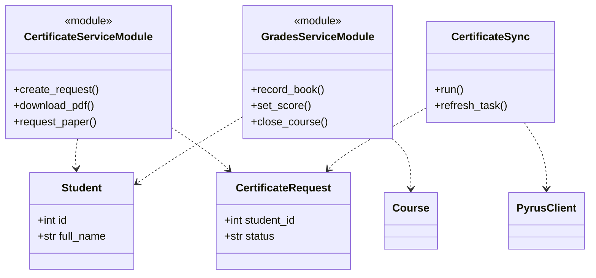

# 2. Текущее устройство кода

[Навигация](README.md). Это снимок объявлений классов в app/ на 16 ноября 2026.
Тестовые двойники, scripts/, миграции и классы зависимостей сюда не входят.
В каталог включены все классы уровня модуля app/, включая исключения и структуры передачи данных.
Приватные вспомогательные методы тоже перечислены, чтобы не выдавать сокращение за полный каталог.
Унаследованные члены SQLAlchemy/Pydantic не разворачиваются.

## Как сейчас распределено поведение

CertificateServiceModule и GradesServiceModule — условные прямоугольники для Python-модулей,
**не существующие Python-классы**. CertificateSync и PyrusClient — реальные классы.
Student.заказатьСправку() из предметной схемы здесь превращается в отдельную функцию
create_request(session, student_id, ...), а не метод ORM-модели.

| Область | Где находится поведение [ЕСТЬ] |
| --- | --- |
| Вход и сессии | app/auth/service.py: authenticate, open_session, resolve, close_session |
| Справки | app/certificates/service.py: create_request, get_request, add_reply, download_pdf, request_paper; класс CertificateSync |
| Успеваемость | app/grades/service.py: teacher_courses, journal, create_assessment, set_score, set_final, close_course, record_book |
| Календарь | app/web/calendar_view.py: events_for, set_choices, set_signup |
| Уведомления | app/notifications/service.py: feed, create, mark_read, mark_all_read |
| Привязка Telegram | app/bot/link.py: issue_code, consume_code, unlink, rotate_feed_token |
| Расписание | app/schedule/importer.py: ScheduleImporter; app/schedule/ruz_client.py: RuzClient |
| ИИ-ассистент | app/assistant/service.py: Assistant; corpus.py: Corpus, Chunk; conversations.py: Conversation, Conversations |

### Пример по шагам: студент заказывает справку

1. Обработчик запроса получает действующего студента из серверной сессии.
2. Функция create_request получает сессию БД, student_id и параметры заявки.
3. Она проверяет параметры и создаёт объект CertificateRequest и событие истории.
4. CertificateSync отправляет заявку в Pyrus и синхронизирует состояние.
5. Для скачивания download_pdf повторно выбирает заявку по student_id и request_id.

Здесь Student — класс; переменная student в обработчике — объект профиля;
student.id — его атрибут типа int; create_request — функция модуля;
CertificateSync.run — метод объекта синхронизации.

## Каталог объявлений классов

Аннотации ниже записаны как в исходниках, оболочка Mapped для полей ORM опущена.
«Тип не указан» означает отсутствие аннотации возвращаемого значения, а не отсутствие результата.
Поля экземпляра, назначенные внутри __init__, приводятся отдельно по тексту присваивания;
локальные переменные функций не считаются полями класса. Значения конфигурации не исполнялись.

### [app/assistant/conversations.py](../../app/assistant/conversations.py)

#### Conversation

Базовые классы: `явных базовых классов нет`.

| Атрибут | Тип |
| --- | --- |
| `owner` | `str` |
| `expires` | `float` |
| `grades_allowed` | `bool` |
| `grades_pending` | `bool` |

Собственных методов в объявлении нет.

#### Conversations

Базовые классы: `явных базовых классов нет`.

Поля экземпляра, создаваемые в конструкторе (выражения из кода):

- `self.items: dict[str, Conversation] = {}`

- метод: `__init__(self) → тип не указан`.
- метод: `start(self, owner: str) → str`.
- метод: `get(self, token: str, owner: str) → Conversation | None`.
- метод: `clear(self, token: str, owner: str) → тип не указан`.

### [app/assistant/corpus.py](../../app/assistant/corpus.py)

#### CorpusError

Базовые классы: `ValueError`.

Собственных методов в объявлении нет.

#### Chunk

Базовые классы: `BaseModel`.

| Атрибут | Тип |
| --- | --- |
| `id` | `str` |
| `document_id` | `str` |
| `revision` | `str` |
| `title` | `str` |
| `source_url` | `str` |
| `source_sha256` | `str` |
| `document_date` | `date \| None` |
| `effective_from` | `date \| None` |
| `effective_to` | `date \| None` |
| `retroactive_basis` | `str \| None` |
| `checked_at` | `date` |
| `downloaded_at` | `date` |
| `reviewed_public` | `bool` |
| `verification_status` | `Literal['verified', 'snapshot']` |
| `page` | `int` |
| `page_end` | `int \| None` |
| `clause` | `str` |
| `text` | `str` |
| `embedding_model` | `str` |
| `embedding` | `list[float]` |

Значения/связи уровня класса:

- `model_config = ConfigDict(extra='forbid')`

- метод: `valid_metadata(self) → тип не указан`.
- свойство: `original_url(self) → str`.

#### Corpus

Базовые классы: `явных базовых классов нет`.

Поля экземпляра, создаваемые в конструкторе (выражения из кода):

- `(self.chunks, self.snapshot) = (chunks, snapshot)`

- метод: `__init__(self, chunks: list[Chunk], snapshot: str) → тип не указан`.
- метод: `load(cls, path: Path) → 'Corpus'`.
- метод: `active(self, as_of: date, today: date, max_age: int) → list[Chunk]`.
- метод: `search(self, question: str, rows: list[Chunk], top_k: int, vector: list[float] | None=None, *, lexical_weight: float=1.0, semantic_weight: float=1.0) → list[Chunk]`.

### [app/assistant/provider.py](../../app/assistant/provider.py)

#### ProviderError

Базовые классы: `RuntimeError`.

Собственных методов в объявлении нет.

#### GigaChat

Базовые классы: `явных базовых классов нет`.

Поля экземпляра, создаваемые в конструкторе (выражения из кода):

- `(self.key, self.scope, self.model) = (key, scope, model)`
- `self.http = httpx.AsyncClient(verify=ctx, timeout=httpx.Timeout(30, connect=10), follow_redirects=False, trust_env=False, transport=transport)`
- `(self._token, self._expires) = ('', 0.0)`
- `self._lock = asyncio.Lock()`

- метод: `__init__(self, key: str, scope: str, model: str, ca_bundle: str='', *, transport=None) → тип не указан`.
- async: `aclose(self) → тип не указан`.
- async: `_json(self, url: str, **kwargs) → dict`.
- async: `_bearer(self) → str`.
- async: `_call(self, endpoint: str, payload: dict) → dict`.
- async: `complete(self, system: str, data: dict) → str`.
- async: `embed(self, texts: list[str], model: str) → list[list[float]]`.

### [app/assistant/service.py](../../app/assistant/service.py)

#### Wire

Базовые классы: `BaseModel`.

Значения/связи уровня класса:

- `model_config = ConfigDict(extra='forbid', strict=True)`

Собственных методов в объявлении нет.

#### DraftStep

Базовые классы: `Wire`.

| Атрибут | Тип |
| --- | --- |
| `source_id` | `str` |
| `responsible` | `str \| None` |
| `deadline` | `str \| None` |
| `form` | `str \| None` |

Собственных методов в объявлении нет.

#### Draft

Базовые классы: `Wire`.

| Атрибут | Тип |
| --- | --- |
| `status` | `Literal['answer', 'partial', 'clarify', 'not_found']` |
| `summary_id` | `str \| None` |
| `steps` | `list[DraftStep]` |
| `clarification` | `str \| None` |

Собственных методов в объявлении нет.

#### Audit

Базовые классы: `Wire`.

| Атрибут | Тип |
| --- | --- |
| `accepted_ids` | `list[str]` |
| `complete` | `bool` |

Собственных методов в объявлении нет.

#### Plan

Базовые классы: `Wire`.

| Атрибут | Тип |
| --- | --- |
| `scopes` | `list[Literal['public', 'grades', 'schedule', 'requests']]` |
| `start` | `str \| None` |
| `end` | `str \| None` |

Собственных методов в объявлении нет.

#### Selection

Базовые классы: `Wire`.

| Атрибут | Тип |
| --- | --- |
| `fact_ids` | `list[str]` |

Собственных методов в объявлении нет.

#### BusyError

Базовые классы: `RuntimeError`.

Собственных методов в объявлении нет.

#### Assistant

Базовые классы: `явных базовых классов нет`.

Поля экземпляра, создаваемые в конструкторе (выражения из кода):

- `(self.cfg, self.provider) = (cfg, provider)`
- `self.conversations = Conversations()`
- `self._active: set[int] = set()`
- `self._windows: OrderedDict[int, deque] = OrderedDict()`
- `self._slots = 0`

- метод: `__init__(self, cfg, provider=None) → тип не указан`.
- async: `aclose(self) → тип не указан`.
- свойство: `enabled(self) → тип не указан`.
- метод: `_reserve(self, user_id: int) → тип не указан`.
- метод: `_result(self, status: str, message: str, **kwargs) → тип не указан`.
- async: `ask(self, user_id: int, question: str, history: list[str], as_of: date | None) → тип не указан`.
- async: `chat(self, user_id, student_id, question, history, as_of, conversation, db) → тип не указан`.
- async: `_chat(self, student_id, question, history, as_of, conversation, db) → тип не указан`.
- async: `_answer(self, question, history, as_of) → тип не указан`.

### [app/bot/link.py](../../app/bot/link.py)

#### LinkError

Базовые классы: `Exception`.

Собственных методов в объявлении нет.

### [app/bot/scheduler.py](../../app/bot/scheduler.py)

#### Context

Базовые классы: `явных базовых классов нет`.

| Атрибут | Тип |
| --- | --- |
| `bot` | `Bot` |
| `settings` | `Settings` |
| `sf` | `async_sessionmaker[AsyncSession]` |

Собственных методов в объявлении нет.

### [app/certificates/pdf.py](../../app/certificates/pdf.py)

#### FontNotFound

Базовые классы: `RuntimeError`.

Собственных методов в объявлении нет.

### [app/certificates/pyrus_client.py](../../app/certificates/pyrus_client.py)

#### PyrusError

Базовые классы: `RuntimeError`.

Поля экземпляра, создаваемые в конструкторе (выражения из кода):

- `self.code = code`
- `self.status = status`

- метод: `__init__(self, message: str, *, code: str | None=None, status: int | None=None) → None`.

#### PyrusClient

Базовые классы: `явных базовых классов нет`.

Поля экземпляра, создаваемые в конструкторе (выражения из кода):

- `self._login = login`
- `self._security_key = security_key`
- `self._auth_url = auth_url`
- `self._http = httpx.AsyncClient(timeout=timeout, headers={'User-Agent': USER_AGENT}, transport=transport)`
- `self._token: str | None = None`
- `self._api_url = DEFAULT_API_URL`
- `self._auth_lock = asyncio.Lock()`

- метод: `__init__(self, login: str, security_key: str, *, auth_url: str='https://accounts.pyrus.com/api/v4/auth', timeout: float=30.0, transport: httpx.AsyncBaseTransport | None=None) → None`.
- async: `__aenter__(self) → PyrusClient`.
- async: `__aexit__(self, *exc: object) → None`.
- async: `aclose(self) → None`.
- async: `create_task(self, form_id: int, fields: list[dict[str, Any]]) → dict[str, Any]`.
- async: `get_task(self, task_id: int) → dict[str, Any]`.
- async: `add_comment(self, task_id: int, *, text: str | None=None, attachments: list[str] | None=None, field_updates: list[dict[str, Any]] | None=None, action: str | None=None) → dict[str, Any]`.
- async: `upload_file(self, filename: str, content: bytes, content_type: str) → str`.
- async: `_authorize(self, stale: str | None) → str`.
- async: `_request(self, method: str, path: str, **kwargs: Any) → dict[str, Any]`.

### [app/certificates/service.py](../../app/certificates/service.py)

#### ValidationError

Базовые классы: `ValueError`.

Собственных методов в объявлении нет.

#### UploadedFile

Базовые классы: `явных базовых классов нет`.

| Атрибут | Тип |
| --- | --- |
| `filename` | `str` |
| `content` | `bytes` |
| `content_type` | `str` |

Собственных методов в объявлении нет.

#### SyncReport

Базовые классы: `явных базовых классов нет`.

| Атрибут | Тип |
| --- | --- |
| `pushed` | `int` |
| `push_failed` | `int` |
| `replies_pushed` | `int` |
| `replies_failed` | `int` |
| `paper_pushed` | `int` |
| `paper_failed` | `int` |
| `refreshed` | `int` |
| `refresh_failed` | `int` |
| `changed` | `list[int]` |

Собственных методов в объявлении нет.

#### CertificateSync

Базовые классы: `явных базовых классов нет`.

Поля экземпляра, создаваемые в конструкторе (выражения из кода):

- `self._sf = session_factory`
- `self._client = client`
- `self._form_id = form_id`
- `self._font_path = font_path`
- `self._download_days = download_days`

- метод: `__init__(self, session_factory: async_sessionmaker[AsyncSession], client: PyrusClient, *, form_id: int, font_path: str='', download_days: int=30) → None`.
- async: `run(self) → SyncReport`.
- async: `push_pending_requests(self, report: SyncReport | None=None) → None`.
- async: `push_pending_replies(self, report: SyncReport | None=None) → None`.
- async: `push_pending_paper(self, report: SyncReport | None=None) → None`.
- async: `refresh_open(self, report: SyncReport | None=None) → None`.
- async: `refresh_task(self, task_id: int, report: SyncReport | None=None) → bool`.
- async: `push_ready_pdfs(self, report: SyncReport | None=None) → None`.
- async: `_apply(self, s: AsyncSession, request: CertificateRequest, task: dict[str, Any], report: SyncReport) → None`.
- метод: `_apply_paper(s: AsyncSession, request: CertificateRequest, paper: str | None) → None`.
- метод: `_set_status(s: AsyncSession, request: CertificateRequest, status: str, report: SyncReport) → None`.

### [app/certificates/status.py](../../app/certificates/status.py)

#### TaskState

Базовые классы: `явных базовых классов нет`.

| Атрибут | Тип |
| --- | --- |
| `status` | `str` |
| `message` | `str \| None` |
| `paper` | `str \| None` |

Собственных методов в объявлении нет.

### [app/core/config.py](../../app/core/config.py)

#### Settings

Базовые классы: `BaseSettings`.

| Атрибут | Тип |
| --- | --- |
| `database_url` | `str` |
| `ruz_base_url` | `str` |
| `ruz_request_delay` | `float` |
| `ruz_concurrency` | `int` |
| `ruz_timeout` | `float` |
| `fake_name_salt` | `str` |
| `pyrus_auth_url` | `str` |
| `pyrus_login` | `str` |
| `pyrus_security_key` | `str` |
| `pyrus_form_id` | `int` |
| `pyrus_sync_interval` | `int` |
| `cert_download_days` | `int` |
| `pdf_font_path` | `str` |
| `session_days` | `int` |
| `cookie_secure` | `bool` |
| `demo_password` | `str` |
| `telegram_bot_token` | `str` |
| `telegram_bot_username` | `str` |
| `telegram_proxy` | `str` |
| `public_base_url` | `str` |
| `telegram_link_code_minutes` | `int` |
| `bot_import_hours` | `int` |
| `bot_import_scope` | `str` |
| `bot_bootstrap_groups` | `int` |
| `llm_provider` | `str` |
| `gigachat_auth_key` | `SecretStr` |
| `gigachat_scope` | `str` |
| `gigachat_model` | `str` |
| `gigachat_ca_bundle` | `str` |
| `llm_embedding_model` | `str` |
| `rag_use_embeddings` | `bool` |
| `rag_corpus_dir` | `str` |
| `rag_top_k` | `int` |
| `rag_lexical_weight` | `float` |
| `rag_semantic_weight` | `float` |
| `rag_max_source_age_days` | `int` |
| `rag_requests_per_minute` | `int` |
| `rag_concurrent_requests` | `int` |

Значения/связи уровня класса:

- `model_config = SettingsConfigDict(env_file='.env', extra='ignore')`

- свойство: `bot_link_enabled(self) → bool`.
- метод: `feed_url(self, token: str) → str`.
- метод: `webcal_url(self, token: str) → str`.
- свойство: `pyrus_enabled(self) → bool`.

### [app/db/base.py](../../app/db/base.py)

#### Base

Базовые классы: `DeclarativeBase`.

Собственных методов в объявлении нет.

### [app/generate/run.py](../../app/generate/run.py)

#### Ctx

Базовые классы: `явных базовых классов нет`.

| Атрибут | Тип |
| --- | --- |
| `db` | `AsyncSession` |
| `today` | `date` |
| `seed` | `str` |
| `disciplines` | `dict[str, int]` |
| `teacher_pool` | `list[int]` |
| `stats` | `Counter` |
| `now` | `datetime` |

Собственных методов в объявлении нет.

#### CurrentDiscipline

Базовые классы: `явных базовых классов нет`.

| Атрибут | Тип |
| --- | --- |
| `name` | `str` |
| `lessons` | `int` |
| `has_exam` | `bool` |
| `teacher_id` | `int \| None` |

Собственных методов в объявлении нет.

### [app/grades/service.py](../../app/grades/service.py)

#### ValidationError

Базовые классы: `ValueError`.

Ошибка ввода, текст показывается преподавателю как есть.

Собственных методов в объявлении нет.

#### Locked

Базовые классы: `ValidationError`.

Ведомость закрыта — менять нельзя.

Собственных методов в объявлении нет.

#### CourseCard

Базовые классы: `явных базовых классов нет`.

| Атрибут | Тип |
| --- | --- |
| `course` | `Course` |
| `discipline` | `str` |
| `group` | `str` |
| `teacher` | `str` |
| `students` | `int` |
| `graded` | `int` |
| `assessments` | `int` |
| `avg_percent` | `float \| None` |
| `next_due` | `date \| None` |

- свойство: `form_title(self) → str`.
- свойство: `title(self) → str`.

#### JournalRow

Базовые классы: `явных базовых классов нет`.

| Атрибут | Тип |
| --- | --- |
| `student` | `Student` |
| `scores` | `dict[int, Score]` |
| `current` | `float` |
| `possible` | `float` |
| `final` | `FinalGrade \| None` |
| `suggested` | `str` |

- свойство: `admitted(self) → bool`.

#### Journal

Базовые классы: `явных базовых классов нет`.

| Атрибут | Тип |
| --- | --- |
| `card` | `CourseCard` |
| `assessments` | `list[Assessment]` |
| `rows` | `list[JournalRow]` |
| `current_max` | `float` |
| `planned_max` | `float` |

- свойство: `locked(self) → bool`.
- свойство: `is_exam(self) → bool`.
- свойство: `at_risk(self) → list[JournalRow]`.

#### HomeworkItem

Базовые классы: `явных базовых классов нет`.

| Атрибут | Тип |
| --- | --- |
| `assessment` | `Assessment` |
| `card` | `CourseCard` |
| `submitted` | `int` |
| `students` | `int` |

Собственных методов в объявлении нет.

#### StudentAssessment

Базовые классы: `явных базовых классов нет`.

| Атрибут | Тип |
| --- | --- |
| `assessment` | `Assessment` |
| `score` | `Score \| None` |

Собственных методов в объявлении нет.

#### StudentCourse

Базовые классы: `явных базовых классов нет`.

| Атрибут | Тип |
| --- | --- |
| `card` | `CourseCard` |
| `assessments` | `list[StudentAssessment]` |
| `current` | `float` |
| `planned_max` | `float` |
| `current_max` | `float` |
| `final` | `FinalGrade \| None` |
| `attempts` | `int` |
| `possible` | `float` |
| `earned` | `float` |
| `today` | `date` |

- свойство: `percent(self) → float | None`.
- свойство: `homework_due(self) → list[StudentAssessment]`.
- свойство: `debt(self) → bool`.
- свойство: `suggested(self) → str`.

#### Semester

Базовые классы: `явных базовых классов нет`.

| Атрибут | Тип |
| --- | --- |
| `number` | `int` |
| `academic_year` | `str` |
| `courses` | `list[StudentCourse]` |

- свойство: `title(self) → str`.

#### RecordBook

Базовые классы: `явных базовых классов нет`.

| Атрибут | Тип |
| --- | --- |
| `current` | `Semester \| None` |
| `past` | `list[Semester]` |
| `gpa` | `float \| None` |
| `debts` | `list[StudentCourse]` |
| `next_exam` | `tuple[date, str] \| None` |
| `events` | `list[GradeEvent]` |

- свойство: `current_percent(self) → float | None`.

### [app/models/auth.py](../../app/models/auth.py)

#### Role

Базовые классы: `явных базовых классов нет`.

Значения/связи уровня класса:

- `STUDENT = 'student'`
- `STAFF = 'staff'`
- `TEACHER = 'teacher'`

Собственных методов в объявлении нет.

#### User

Базовые классы: `Base`.

| Атрибут | Тип |
| --- | --- |
| `id` | `int` |
| `login` | `str` |
| `password_hash` | `str` |
| `role` | `str` |
| `student_id` | `int \| None` |
| `teacher_id` | `int \| None` |
| `created_at` | `datetime` |
| `last_login_at` | `datetime \| None` |

Собственных методов в объявлении нет.

#### AuthSession

Базовые классы: `Base`.

| Атрибут | Тип |
| --- | --- |
| `token_hash` | `str` |
| `user_id` | `int` |
| `csrf_token` | `str` |
| `created_at` | `datetime` |
| `expires_at` | `datetime` |

Собственных методов в объявлении нет.

### [app/models/calendar.py](../../app/models/calendar.py)

#### ChoiceKind

Базовые классы: `явных базовых классов нет`.

Значения/связи уровня класса:

- `SUBGROUP = 'subgroup'`
- `DISCIPLINE = 'discipline'`

Собственных методов в объявлении нет.

#### ElectiveChoice

Базовые классы: `Base`.

| Атрибут | Тип |
| --- | --- |
| `student_id` | `int` |
| `kind` | `str` |
| `value` | `str` |

Собственных методов в объявлении нет.

#### Activity

Базовые классы: `Base`.

| Атрибут | Тип |
| --- | --- |
| `id` | `int` |
| `title` | `str` |
| `starts_at` | `datetime` |
| `ends_at` | `datetime` |
| `place` | `str` |
| `organizer` | `str` |
| `description` | `str` |

Собственных методов в объявлении нет.

#### ActivitySignup

Базовые классы: `Base`.

| Атрибут | Тип |
| --- | --- |
| `student_id` | `int` |
| `activity_id` | `int` |
| `created_at` | `datetime` |

Собственных методов в объявлении нет.

### [app/models/certificates.py](../../app/models/certificates.py)

#### CertificateKind

Базовые классы: `явных базовых классов нет`.

Значения/связи уровня класса:

- `STUDY = 'study'`
- `MILITARY = 'military'`
- `VISA = 'visa'`
- `TRANSFER = 'transfer'`
- `TITLES = {STUDY: 'Справка об обучении', MILITARY: 'Справка для военного комиссариата', VISA: 'Справка для посольства (визовая)', TRANSFER: 'Справка о периоде обучения (для перевода)'}`
- `PAPER_ONLY = frozenset({TRANSFER})`

Собственных методов в объявлении нет.

#### RequestStatus

Базовые классы: `явных базовых классов нет`.

Значения/связи уровня класса:

- `ACCEPTED = 'accepted'`
- `IN_REVIEW = 'in_review'`
- `NEED_INFO = 'need_info'`
- `READY = 'ready'`
- `REJECTED = 'rejected'`
- `FINAL = (READY, REJECTED)`
- `TITLES = {ACCEPTED: 'Принята', IN_REVIEW: 'На согласовании', NEED_INFO: 'Нужна информация', READY: 'Готова', REJECTED: 'Отказ'}`

Собственных методов в объявлении нет.

#### PaperStatus

Базовые классы: `явных базовых классов нет`.

Бумажный оригинал — второй, независимый статус заявки (по образцу ЛК РАНХиГС).

Значения/связи уровня класса:

- `NONE = 'none'`
- `REQUESTED = 'requested'`
- `READY_FOR_PICKUP = 'ready_for_pickup'`
- `ISSUED = 'issued'`
- `NOT_COLLECTED = 'not_collected'`
- `ACTIVE = (REQUESTED, READY_FOR_PICKUP)`
- `TITLES = {REQUESTED: 'Бумажный оригинал запрошен', READY_FOR_PICKUP: 'Оригинал готов к выдаче в деканате', ISSUED: 'Оригинал выдан', NOT_COLLECTED: 'Оригинал не востребован'}`

Собственных методов в объявлении нет.

#### EventKind

Базовые классы: `явных базовых классов нет`.

Значения/связи уровня класса:

- `CREATED = 'created'`
- `STATUS = 'status'`
- `DEAN_MESSAGE = 'dean_message'`
- `STUDENT_REPLY = 'student_reply'`
- `PDF_READY = 'pdf_ready'`
- `PAPER = 'paper'`

Собственных методов в объявлении нет.

#### Student

Базовые классы: `Base`.

| Атрибут | Тип |
| --- | --- |
| `id` | `int` |
| `full_name` | `str` |
| `gender` | `str` |
| `birth_date` | `date \| None` |
| `record_book` | `str` |
| `study_group_id` | `int \| None` |
| `faculty_name` | `str` |
| `course` | `int` |
| `level` | `str` |
| `form_of_education` | `str` |
| `education_basis` | `str` |
| `speciality` | `str` |
| `enrollment_order` | `str` |
| `enrollment_date` | `date \| None` |
| `expected_graduation` | `date \| None` |

Собственных методов в объявлении нет.

#### CertificateRequest

Базовые классы: `Base`.

| Атрибут | Тип |
| --- | --- |
| `id` | `int` |
| `student_id` | `int` |
| `kind` | `str` |
| `purpose` | `str` |
| `copies` | `int` |
| `status` | `str` |
| `pyrus_task_id` | `int \| None` |
| `dean_message` | `str \| None` |
| `answered_message` | `str \| None` |
| `push_attempts` | `int` |
| `last_error` | `str \| None` |
| `ready_at` | `datetime \| None` |
| `download_until` | `datetime \| None` |
| `downloaded_at` | `datetime \| None` |
| `paper_status` | `str` |
| `paper_requested_at` | `datetime \| None` |
| `paper_pushed_at` | `datetime \| None` |
| `paper_push_attempts` | `int` |
| `paper_last_error` | `str \| None` |
| `pdf` | `bytes \| None` |
| `pdf_pushed` | `bool` |
| `created_at` | `datetime` |
| `updated_at` | `datetime` |
| `synced_at` | `datetime \| None` |

Собственных методов в объявлении нет.

#### CertificateRequestEvent

Базовые классы: `Base`.

Таймлайн заявки в ЛК и очередь уведомлений (Telegram читает строки с пустым notified_at).

| Атрибут | Тип |
| --- | --- |
| `id` | `int` |
| `request_id` | `int` |
| `kind` | `str` |
| `status` | `str \| None` |
| `text` | `str \| None` |
| `created_at` | `datetime` |
| `notified_at` | `datetime \| None` |

Собственных методов в объявлении нет.

#### StudentReply

Базовые классы: `Base`.

Ответ студента на «Нужна информация». Уходит в Pyrus комментарием (очередь: pushed_at).

| Атрибут | Тип |
| --- | --- |
| `id` | `int` |
| `request_id` | `int` |
| `text` | `str` |
| `created_at` | `datetime` |
| `pushed_at` | `datetime \| None` |
| `push_attempts` | `int` |
| `last_error` | `str \| None` |

Собственных методов в объявлении нет.

#### ReplyFile

Базовые классы: `Base`.

| Атрибут | Тип |
| --- | --- |
| `id` | `int` |
| `reply_id` | `int` |
| `filename` | `str` |
| `content_type` | `str` |
| `data` | `bytes` |
| `pyrus_guid` | `str \| None` |

Собственных методов в объявлении нет.

### [app/models/grades.py](../../app/models/grades.py)

#### ControlForm

Базовые классы: `явных базовых классов нет`.

Значения/связи уровня класса:

- `EXAM = 'exam'`
- `CREDIT = 'credit'`
- `DIFF_CREDIT = 'diff_credit'`
- `TITLES = {EXAM: 'Экзамен', CREDIT: 'Зачёт', DIFF_CREDIT: 'Зачёт с оценкой'}`

Собственных методов в объявлении нет.

#### AssessmentKind

Базовые классы: `явных базовых классов нет`.

Значения/связи уровня класса:

- `HOMEWORK = 'homework'`
- `TEST = 'test'`
- `SEMINAR = 'seminar'`
- `ESSAY = 'essay'`
- `MIDTERM = 'midterm'`
- `TITLES = {HOMEWORK: 'Домашнее задание', TEST: 'Контрольная работа', SEMINAR: 'Работа на семинарах', ESSAY: 'Эссе / доклад', MIDTERM: 'Рубежный контроль'}`

Собственных методов в объявлении нет.

#### FinalResult

Базовые классы: `явных базовых классов нет`.

Значения/связи уровня класса:

- `EXCELLENT = '5'`
- `GOOD = '4'`
- `SATISFACTORY = '3'`
- `FAIL = '2'`
- `PASS = 'pass'`
- `NO_PASS = 'fail'`
- `ABSENT = 'absent'`
- `TITLES = {EXCELLENT: 'Отлично', GOOD: 'Хорошо', SATISFACTORY: 'Удовлетворительно', FAIL: 'Неудовлетворительно', PASS: 'Зачтено', NO_PASS: 'Не зачтено', ABSENT: 'Неявка'}`
- `NEGATIVE = frozenset({FAIL, NO_PASS, ABSENT})`
- `NUMERIC = {EXCELLENT: 5, GOOD: 4, SATISFACTORY: 3, FAIL: 2}`

Собственных методов в объявлении нет.

#### CourseStatus

Базовые классы: `явных базовых классов нет`.

Значения/связи уровня класса:

- `OPEN = 'open'`
- `CLOSED = 'closed'`

Собственных методов в объявлении нет.

#### GradeEventKind

Базовые классы: `явных базовых классов нет`.

Значения/связи уровня класса:

- `SCORE = 'score'`
- `FINAL = 'final'`
- `HOMEWORK = 'homework'`

Собственных методов в объявлении нет.

#### Discipline

Базовые классы: `Base`.

| Атрибут | Тип |
| --- | --- |
| `id` | `int` |
| `name` | `str` |

Собственных методов в объявлении нет.

#### Course

Базовые классы: `Base`.

| Атрибут | Тип |
| --- | --- |
| `id` | `int` |
| `discipline_id` | `int` |
| `group_id` | `int` |
| `subgroup` | `str` |
| `teacher_id` | `int \| None` |
| `semester` | `int` |
| `academic_year` | `str` |
| `control_form` | `str` |
| `hours` | `int` |
| `credits` | `int` |
| `status` | `str` |
| `closed_at` | `datetime \| None` |
| `created_at` | `datetime` |

Собственных методов в объявлении нет.

#### CourseEnrollment

Базовые классы: `Base`.

| Атрибут | Тип |
| --- | --- |
| `course_id` | `int` |
| `student_id` | `int` |

Собственных методов в объявлении нет.

#### Assessment

Базовые классы: `Base`.

| Атрибут | Тип |
| --- | --- |
| `id` | `int` |
| `course_id` | `int` |
| `kind` | `str` |
| `title` | `str` |
| `description` | `str` |
| `max_points` | `float` |
| `due_date` | `date \| None` |
| `position` | `int` |
| `created_at` | `datetime` |

Собственных методов в объявлении нет.

#### Score

Базовые классы: `Base`.

| Атрибут | Тип |
| --- | --- |
| `id` | `int` |
| `assessment_id` | `int` |
| `student_id` | `int` |
| `points` | `float` |
| `comment` | `str` |
| `graded_by` | `int \| None` |
| `graded_at` | `datetime` |

Собственных методов в объявлении нет.

#### FinalGrade

Базовые классы: `Base`.

| Атрибут | Тип |
| --- | --- |
| `id` | `int` |
| `course_id` | `int` |
| `student_id` | `int` |
| `attempt` | `int` |
| `current_points` | `float` |
| `exam_points` | `float \| None` |
| `total_points` | `float` |
| `result` | `str` |
| `teacher_id` | `int \| None` |
| `graded_on` | `date` |

Собственных методов в объявлении нет.

#### GradeEvent

Базовые классы: `Base`.

| Атрибут | Тип |
| --- | --- |
| `id` | `int` |
| `student_id` | `int` |
| `course_id` | `int` |
| `kind` | `str` |
| `text` | `str` |
| `created_at` | `datetime` |
| `notified_at` | `datetime \| None` |

Собственных методов в объявлении нет.

### [app/models/notifications.py](../../app/models/notifications.py)

#### Source

Базовые классы: `явных базовых классов нет`.

Значения/связи уровня класса:

- `DEAN = 'dean'`
- `TEACHER = 'teacher'`
- `UNIVERSITY = 'university'`
- `TITLES = {DEAN: 'Деканат', TEACHER: 'Преподаватель', UNIVERSITY: 'Вуз'}`

Собственных методов в объявлении нет.

#### Audience

Базовые классы: `явных базовых классов нет`.

Значения/связи уровня класса:

- `ALL = 'all'`
- `FACULTY = 'faculty'`
- `GROUP = 'group'`
- `STREAM = 'stream'`
- `STUDENT = 'student'`

Собственных методов в объявлении нет.

#### Announcement

Базовые классы: `Base`.

| Атрибут | Тип |
| --- | --- |
| `id` | `int` |
| `source` | `str` |
| `author_user_id` | `int` |
| `title` | `str` |
| `body` | `str` |
| `audience` | `str` |
| `faculty_name` | `str \| None` |
| `group_id` | `int \| None` |
| `program` | `str \| None` |
| `course` | `int \| None` |
| `student_id` | `int \| None` |
| `created_at` | `datetime` |

Значения/связи уровня класса:

- `group = relationship('StudyGroup', lazy='joined')`
- `student = relationship('Student', lazy='joined')`

Собственных методов в объявлении нет.

#### NotificationRead

Базовые классы: `Base`.

Что пользователь уже открыл. `key` — «ann:12», «cert:7», «grade:31».

| Атрибут | Тип |
| --- | --- |
| `user_id` | `int` |
| `key` | `str` |
| `read_at` | `datetime` |

Собственных методов в объявлении нет.

### [app/models/schedule.py](../../app/models/schedule.py)

#### LessonStatus

Базовые классы: `явных базовых классов нет`.

Значения/связи уровня класса:

- `ACTIVE = 'active'`
- `CANCELLED = 'cancelled'`

Собственных методов в объявлении нет.

#### ChangeKind

Базовые классы: `явных базовых классов нет`.

Значения/связи уровня класса:

- `ADDED = 'added'`
- `CHANGED = 'changed'`
- `MOVED = 'moved'`
- `CANCELLED = 'cancelled'`
- `RESTORED = 'restored'`

Собственных методов в объявлении нет.

#### ImportStatus

Базовые классы: `явных базовых классов нет`.

Значения/связи уровня класса:

- `RUNNING = 'running'`
- `OK = 'ok'`
- `PARTIAL = 'partial'`
- `FAILED = 'failed'`

Собственных методов в объявлении нет.

#### Faculty

Базовые классы: `Base`.

| Атрибут | Тип |
| --- | --- |
| `id` | `int` |
| `abbr` | `str` |
| `name` | `str` |

Собственных методов в объявлении нет.

#### StudyGroup

Базовые классы: `Base`.

| Атрибут | Тип |
| --- | --- |
| `id` | `int` |
| `name` | `str` |
| `number` | `str` |
| `faculty_id` | `int \| None` |
| `course` | `int \| None` |
| `form_of_education` | `str` |
| `speciality` | `str` |
| `specialization` | `str` |

Собственных методов в объявлении нет.

#### Teacher

Базовые классы: `Base`.

| Атрибут | Тип |
| --- | --- |
| `id` | `int` |
| `ruz_oid` | `int` |
| `full_name` | `str` |

Собственных методов в объявлении нет.

#### ImportRun

Базовые классы: `Base`.

| Атрибут | Тип |
| --- | --- |
| `id` | `int` |
| `started_at` | `datetime` |
| `finished_at` | `datetime \| None` |
| `period_start` | `date` |
| `period_end` | `date` |
| `status` | `str` |
| `groups_total` | `int` |
| `groups_ok` | `int` |
| `groups_failed` | `int` |
| `lessons_seen` | `int` |
| `error` | `str \| None` |

Собственных методов в объявлении нет.

#### Lesson

Базовые классы: `Base`.

| Атрибут | Тип |
| --- | --- |
| `id` | `int` |
| `date` | `date` |
| `begins_at` | `time` |
| `ends_at` | `time` |
| `lesson_number` | `int \| None` |
| `discipline` | `str` |
| `kind_of_work` | `str` |
| `auditorium` | `str \| None` |
| `building` | `str \| None` |
| `stream` | `str \| None` |
| `subgroup` | `str \| None` |
| `status` | `str` |
| `moved_to_id` | `int \| None` |
| `ruz_modified_at` | `datetime \| None` |
| `first_seen_at` | `datetime` |
| `last_seen_at` | `datetime` |
| `last_seen_run_id` | `int \| None` |

Собственных методов в объявлении нет.

#### LessonGroup

Базовые классы: `Base`.

Какие группы видят занятие. Одна лекция потока — у десятков групп.

| Атрибут | Тип |
| --- | --- |
| `lesson_id` | `int` |
| `group_id` | `int` |
| `last_seen_run_id` | `int \| None` |

Собственных методов в объявлении нет.

#### LessonChange

Базовые классы: `Base`.

Журнал изменений расписания: из него подсветка в кабинете и уведомления в бот.

| Атрибут | Тип |
| --- | --- |
| `id` | `int` |
| `run_id` | `int` |
| `lesson_id` | `int` |
| `previous_lesson_id` | `int \| None` |
| `kind` | `str` |
| `details` | `dict` |
| `detected_at` | `datetime` |

Собственных методов в объявлении нет.

### [app/models/telegram.py](../../app/models/telegram.py)

#### TelegramLink

Базовые классы: `Base`.

| Атрибут | Тип |
| --- | --- |
| `id` | `int` |
| `student_id` | `int` |
| `telegram_id` | `int` |
| `linked_at` | `datetime` |
| `feed_token` | `str` |
| `digest_at` | `str \| None` |
| `digest_sent_on` | `date \| None` |
| `notify_changes` | `bool` |
| `notify_certificates` | `bool` |
| `exam_reminder_days` | `int \| None` |
| `reminder_minutes` | `int \| None` |

Собственных методов в объявлении нет.

#### TelegramLinkCode

Базовые классы: `Base`.

| Атрибут | Тип |
| --- | --- |
| `code_hash` | `str` |
| `student_id` | `int` |
| `expires_at` | `datetime` |
| `used_at` | `datetime \| None` |

Собственных методов в объявлении нет.

#### BotCursor

Базовые классы: `Base`.

До какой записи журнала бот уже дочитал (например, `lesson_changes`).

| Атрибут | Тип |
| --- | --- |
| `name` | `str` |
| `value` | `int` |

Собственных методов в объявлении нет.

#### BotNotice

Базовые классы: `Base`.

Что уже сказано студенту — чтобы напоминание не повторилось после перезапуска.

| Атрибут | Тип |
| --- | --- |
| `id` | `int` |
| `student_id` | `int` |
| `key` | `str` |
| `sent_at` | `datetime` |

Собственных методов в объявлении нет.

### [app/notifications/service.py](../../app/notifications/service.py)

#### Item

Базовые классы: `явных базовых классов нет`.

| Атрибут | Тип |
| --- | --- |
| `kind` | `str` |
| `ref` | `int` |
| `source` | `str` |
| `title` | `str` |
| `body` | `str` |
| `created_at` | `datetime` |
| `href` | `str \| None` |
| `unread` | `bool` |

- свойство: `key(self) → str`.
- свойство: `source_title(self) → str`.

#### AnnouncementError

Базовые классы: `ValueError`.

Текст ошибки показывается автору в форме.

Собственных методов в объявлении нет.

### [app/schedule/importer.py](../../app/schedule/importer.py)

#### ImportStats

Базовые классы: `явных базовых классов нет`.

| Атрибут | Тип |
| --- | --- |
| `run_id` | `int` |
| `status` | `str` |
| `groups_total` | `int` |
| `groups_ok` | `int` |
| `groups_failed` | `int` |
| `lessons_seen` | `int` |
| `changes` | `dict[str, int]` |
| `failed_groups` | `list[str]` |

Собственных методов в объявлении нет.

#### ScheduleImporter

Базовые классы: `явных базовых классов нет`.

Поля экземпляра, создаваемые в конструкторе (выражения из кода):

- `self._sf = session_factory`
- `self._client = client`
- `self._salt = fake_name_salt`
- `self._concurrency = max(1, concurrency)`
- `self._now = now`
- `self._run_id = 0`
- `self._teacher_ids: dict[int, int] = {}`
- `self._teacher_names: dict[int, str] = {}`
- `self._taken_names: set[str] = set()`
- `self._surnames: tuple[str, ...] = ()`
- `self._new_lesson_ids: list[int] = []`
- `self._ok_groups: set[int] = set()`
- `self._known_groups: set[int] = set()`
- `self._changes: dict[str, int] = {}`

- метод: `__init__(self, session_factory: async_sessionmaker[AsyncSession], client: RuzClient, *, fake_name_salt: str, concurrency: int=1, now: Callable[[], datetime]=datetime.now) → None`.
- async: `run(self, start: date, finish: date, *, group_filter: GroupFilter | None=None, limit: int | None=None) → ImportStats`.
- async: `_import_dictionaries(self) → list[GroupData]`.
- async: `_load_teachers(self) → None`.
- async: `_ensure_teachers(self, oids: set[int]) → None`.
- async: `_import_group(self, group_id: int, raw: list[dict], start: date, finish: date) → int`.
- async: `_store_group(self, group_id: int, lessons: dict[int, LessonData], start: date, finish: date) → int`.
- метод: `_apply(row: Lesson, data: LessonData) → None`.
- метод: `_update_existing(self, session: AsyncSession, row: Lesson, data: LessonData, old_teachers: set[int], new_teachers: set[int]) → None`.
- метод: `_names(self, teacher_ids: set[int]) → list[str]`.
- async: `_set_teachers(session: AsyncSession, lesson_id: int, old: set[int], new: set[int]) → None`.
- метод: `_log(self, session: AsyncSession, kind: str, lesson_id: int, details: dict, previous_lesson_id: int | None=None) → None`.
- async: `_finalize(self, start: date, finish: date) → None`.
- async: `_drop_stale_links(self, session: AsyncSession) → None`.
- async: `_find_cancelled(self, session: AsyncSession, start: date, finish: date) → list[Lesson]`.
- async: `_find_added(self, session: AsyncSession, start: date, finish: date) → list[Lesson]`.
- async: `_groups_of(session: AsyncSession, lesson_ids: list[int]) → dict[int, set[int]]`.
- метод: `_match_move(new: Lesson, cancelled: list[Lesson], groups_of: dict[int, set[int]]) → Lesson | None`.
- async: `_finish_run(self, stats: ImportStats, status: str, error: str | None=None) → None`.

### [app/schedule/normalize.py](../../app/schedule/normalize.py)

#### FacultyData

Базовые классы: `явных базовых классов нет`.

| Атрибут | Тип |
| --- | --- |
| `id` | `int` |
| `abbr` | `str` |
| `name` | `str` |

Собственных методов в объявлении нет.

#### GroupData

Базовые классы: `явных базовых классов нет`.

| Атрибут | Тип |
| --- | --- |
| `id` | `int` |
| `name` | `str` |
| `number` | `str` |
| `faculty_id` | `int \| None` |
| `course` | `int \| None` |
| `form_of_education` | `str` |
| `speciality` | `str` |
| `specialization` | `str` |
| `has_schedule` | `bool` |

Собственных методов в объявлении нет.

#### LessonData

Базовые классы: `явных базовых классов нет`.

| Атрибут | Тип |
| --- | --- |
| `id` | `int` |
| `date` | `date` |
| `begins_at` | `time` |
| `ends_at` | `time` |
| `lesson_number` | `int \| None` |
| `discipline` | `str` |
| `kind_of_work` | `str` |
| `auditorium` | `str \| None` |
| `building` | `str \| None` |
| `stream` | `str \| None` |
| `subgroup` | `str \| None` |
| `ruz_modified_at` | `datetime \| None` |
| `lecturer_oids` | `tuple[int, ...]` |

Собственных методов в объявлении нет.

### [app/schedule/ruz_client.py](../../app/schedule/ruz_client.py)

#### RuzError

Базовые классы: `RuntimeError`.

Собственных методов в объявлении нет.

#### RuzClient

Базовые классы: `явных базовых классов нет`.

Поля экземпляра, создаваемые в конструкторе (выражения из кода):

- `self._http = httpx.AsyncClient(base_url=base_url, timeout=timeout, headers={'User-Agent': USER_AGENT, 'Accept': 'application/json'}, transport=transport)`
- `self._delay = delay`
- `self._retries = retries`
- `self._backoff = backoff`
- `self._last_request: float | None = None`
- `self._throttle_lock = asyncio.Lock()`

- метод: `__init__(self, base_url: str, *, delay: float=1.0, timeout: float=120.0, retries: int=3, backoff: float=5.0, transport: httpx.AsyncBaseTransport | None=None) → None`.
- async: `__aenter__(self) → RuzClient`.
- async: `__aexit__(self, *exc: object) → None`.
- async: `aclose(self) → None`.
- async: `faculties(self) → list[dict[str, Any]]`.
- async: `groups(self) → list[dict[str, Any]]`.
- async: `lecturers(self) → list[dict[str, Any]]`.
- async: `group_schedule(self, group_id: int, start: date, finish: date) → list[dict[str, Any]]`.
- async: `_get_list(self, path: str, params: dict[str, Any] | None=None) → list[dict[str, Any]]`.
- async: `_get(self, path: str, params: dict[str, Any] | None) → Any`.
- async: `_throttle(self) → None`.

### [app/web/assistant_views.py](../../app/web/assistant_views.py)

#### Question

Базовые классы: `BaseModel`.

| Атрибут | Тип |
| --- | --- |
| `question` | `str` |
| `history` | `list[str]` |
| `as_of` | `date \| None` |
| `conversation_token` | `str` |

Значения/связи уровня класса:

- `model_config = ConfigDict(extra='forbid')`

Собственных методов в объявлении нет.

#### ConversationAction

Базовые классы: `BaseModel`.

| Атрибут | Тип |
| --- | --- |
| `action` | `str` |
| `acknowledged` | `bool` |
| `conversation_token` | `str` |

Значения/связи уровня класса:

- `model_config = ConfigDict(extra='forbid', strict=True)`

Собственных методов в объявлении нет.

### [app/web/calendar_view.py](../../app/web/calendar_view.py)

#### ElectiveCatalog

Базовые классы: `явных базовых классов нет`.

Что в расписании группы относится к выбору.

| Атрибут | Тип |
| --- | --- |
| `subgroups` | `dict[str, list[str]]` |
| `families` | `list[list[str]]` |

- свойство: `disciplines(self) → set[str]`.
- метод: `is_elective(self, discipline: str, subgroup: str | None) → bool`.

#### CalEvent

Базовые классы: `явных базовых классов нет`.

| Атрибут | Тип |
| --- | --- |
| `layer` | `str` |
| `title` | `str` |
| `begins_at` | `time` |
| `ends_at` | `time` |
| `kind` | `str` |
| `kind_class` | `str` |
| `place` | `str` |
| `auditorium` | `str` |
| `building` | `str` |
| `teachers` | `list[str]` |
| `subgroup` | `str` |
| `cancelled` | `bool` |
| `activity_id` | `int \| None` |
| `signed` | `bool` |
| `organizer` | `str` |
| `lane` | `int` |
| `lanes` | `int` |

- свойство: `top(self) → int`.
- свойство: `length(self) → int`.

### [app/web/deps.py](../../app/web/deps.py)

#### LoginRequired

Базовые классы: `Exception`.

Перехватывается в app.main и превращается в редирект на /login.

Собственных методов в объявлении нет.

#### Viewer

Базовые классы: `явных базовых классов нет`.

| Атрибут | Тип |
| --- | --- |
| `user` | `User` |
| `auth_session` | `AuthSession` |
| `student` | `Student \| None` |
| `teacher` | `Teacher \| None` |

- свойство: `csrf(self) → str`.
- свойство: `student_id(self) → int`.
- свойство: `teacher_id(self) → int`.

### [app/web/schedule_view.py](../../app/web/schedule_view.py)

#### LessonView

Базовые классы: `явных базовых классов нет`.

| Атрибут | Тип |
| --- | --- |
| `id` | `int` |
| `discipline` | `str` |
| `kind` | `str` |
| `begins_at` | `time` |
| `ends_at` | `time` |
| `auditorium` | `str` |
| `building` | `str` |
| `subgroup` | `str` |
| `teachers` | `list[str]` |
| `cancelled` | `bool` |
| `groups` | `list[str]` |

- свойство: `kind_class(self) → str`.

#### Slot

Базовые классы: `явных базовых классов нет`.

Одна пара на экране. Параллельные занятия по подгруппам (языки) сворачиваются в один слот.

| Атрибут | Тип |
| --- | --- |
| `begins_at` | `time` |
| `ends_at` | `time` |
| `lessons` | `list[LessonView]` |

- свойство: `grouped(self) → bool`.

Итого: **102** объявлений классов в app/. Полный каталог ORM выше — **30** классов.

### Реализованная загрузка документов работником

Предыдущий каталог фиксирует 102 класса до реализации загрузки. Следующие восемь
объявлений добавлены этой фичей: всего теперь **110** классов приложения, **31** ORM-модель.
`StaffProfile` и `DocumentUploadService` остаются учебными предложениями, а функция
`app.assistant.documents.upload_document` и `DocumentProcessor` реализуют сценарий.

#### [app/models/knowledge.py](../../app/models/knowledge.py)

**DocumentStatus** — базовые классы: нет.

- значение уровня класса `QUEUED = 'queued'`.
- значение уровня класса `PROCESSING = 'processing'`.
- значение уровня класса `PUBLISHED = 'published'`.
- значение уровня класса `NEEDS_REVIEW = 'needs_review'`.
- значение уровня класса `ERROR = 'error'`.
- значение уровня класса `TITLES = {QUEUED: 'В очереди', PROCESSING: 'Обрабатывается', PUBLISHED: 'Доступен ассистенту', NEEDS_REVIEW: 'Нужна проверка', ERROR: 'Ошибка обработки'}`.

**KnowledgeDocument** — базовые классы: Base.

- поле `id: Mapped[int]`.
- поле `uploaded_by_user_id: Mapped[int]`.
- поле `title: Mapped[str]`.
- поле `source_url: Mapped[str]`.
- поле `source_key: Mapped[str]`.
- поле `revision: Mapped[str]`.
- поле `filename: Mapped[str]`.
- поле `sha256: Mapped[str]`.
- поле `data: Mapped[bytes]`.
- поле `reviewed_public: Mapped[bool]`.
- поле `status: Mapped[str]`.
- поле `error: Mapped[str | None]`.
- поле `chunk_count: Mapped[int]`.
- поле `uploaded_at: Mapped[datetime]`.
- поле `indexed_at: Mapped[datetime | None]`.

#### [app/assistant/documents.py](../../app/assistant/documents.py)

**DocumentError** — базовые классы: ValueError.

**ReviewRequired** — базовые классы: DocumentError.

**DocumentMetadata** — базовые классы: BaseModel.

- значение уровня класса `model_config = ConfigDict(extra='forbid', str_strip_whitespace=True)`.
- поле `title: str`.
- поле `source_url: str`.
- поле `revision: str`.
- поле `reviewed_public: bool`.
- метод `validate_url(cls, value: str) → str`.

**DocumentProcessor** — базовые классы: нет.

- метод `__init__(self, session_factory, cfg) → тип не указан`.
- метод `process_one(self) → bool`.
- метод `run(self) → None`.
- поля конструктора: `session_factory` (фабрика AsyncSession), `cfg` (Settings), `stop` (asyncio.Event).

#### [app/web/document_views.py](../../app/web/document_views.py)

**UploadTooLarge** — базовые классы: Exception.

**DocumentBodyLimit** — базовые классы: нет.

- метод `__init__(self, app) → тип не указан`.
- метод `__call__(self, scope, receive, send) → тип не указан`.
- поле конструктора: `app` — вложенное ASGI-приложение.

`KnowledgeDocument` хранит данные, `DocumentMetadata` валидирует ввод,
`DocumentProcessor` обрабатывает очередь. DocumentError и ReviewRequired — исключения.
DocumentStatus — константы. DocumentBodyLimit — ASGI-ограничитель размера тела;
UploadTooLarge — его исключение. Подробности: [реализованный сценарий](../staff-document-upload.md).

## Что здесь не является предметным классом

Role, RequestStatus, ControlForm и аналогичные классы содержат константы и справочники;
это не Python Enum, хотя в предметной UML их удобно мыслить как перечисления.
Wire, Draft, DraftStep, Audit, Plan и Selection — структуры обмена с моделью, а не таблицы.
CourseCard, Journal, RecordBook, CalEvent, Item — представления данных для экранов/ответов.
Исключения сообщают об ошибках; Settings хранит конфигурацию; клиенты работают с внешними API.

Assistant отвечает по источникам и разрешённым данным кабинета. Наличие первоначальных
планов действий ассистента не означает, что он создаёт заявки сейчас: текущий код запрещает
модели заявлять, что она что-либо создала/отправила. Conversation — состояние разрешений
в памяти процесса, а не постоянная история сообщений в таблице БД.

Предложения по полям и методам находятся отдельно в [предметном каталоге](01-domain.md)
и [учебной модели](03-oop-proposal.md); они не добавлены в это представление как существующие.
