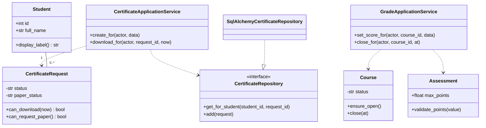
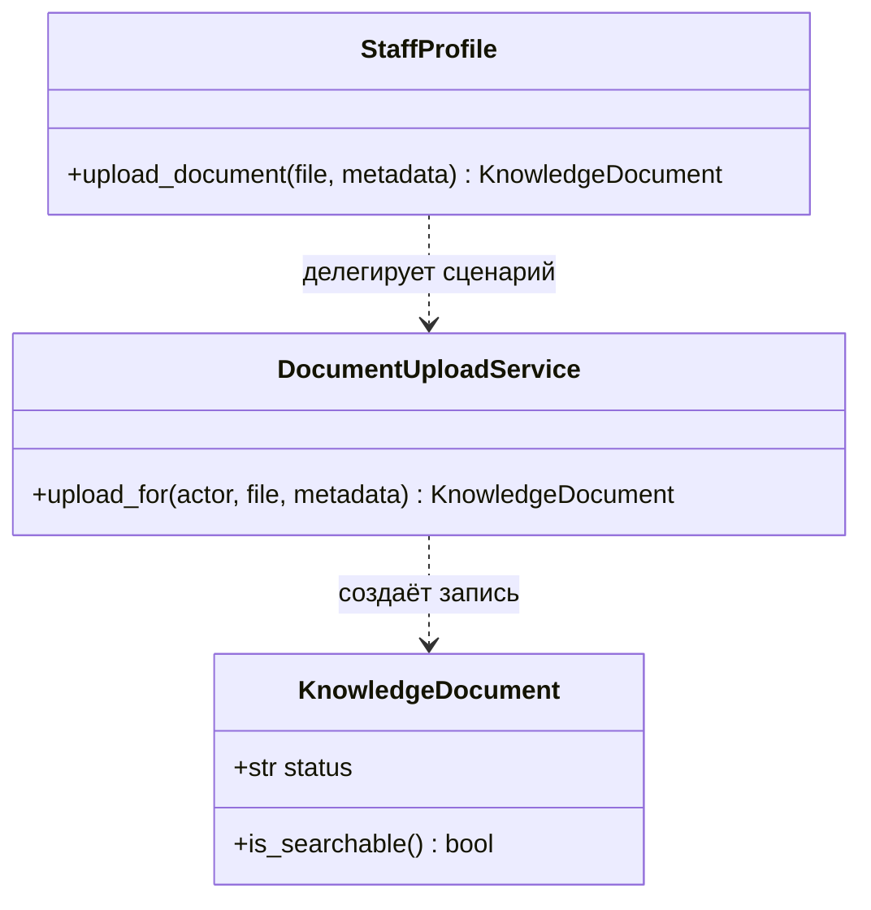

# 3. Учебная ООП-модель: предложение

[Навигация](README.md). **Все методы, интерфейсы и классы этой схемы — [ПРЕДЛОЖЕНИЕ]**,
даже если одноимённые классы данных уже существуют. Это вариант для изучения и обсуждения,
а не согласованная архитектура и не выполненный перенос кода.

## Как разделить ответственность

Объект может отвечать за правила своих данных. Сервис координирует несколько объектов,
проверяет действующего пользователя, открывает транзакцию, вызывает БД и внешние системы.
Репозиторий — предложенный объект доступа к сохранённым данным. Интерфейс описывает
необходимые операции без привязки к SQLAlchemy. Добавлять его ради одного простого запроса необязательно.

Например, can_download(now) может проверить статус, наличие PDF и срок внутри заявки.
Но он не доказывает право пользователя на эту заявку: сервис сначала выбирает её с фильтром
по владельцу. Метод close(at) может изменить состояние ведомости, но не авторизует преподавателя.



Закрытые поля на схеме — желаемая инкапсуляция: менять состояние через методы с проверками.
Это не описание текущих публичных ORM-атрибутов и не гарантия строгой приватности Python.
Наследование Student от User здесь не нужно: профиль человека и учётная запись имеют разные обязанности.
Базовый класс Person тоже не обязателен ради единственного общего full_name.

## Предлагаемые поля и методы по всем ORM-сущностям

Текущие поля полностью перечислены в [предметном каталоге](01-domain.md); эта таблица
дополняет их, не заменяя. `/` обозначает вычисление. `—` означает, что новое поле не требуется.
Методы-предикаты для простых связей приведены как учебные варианты и могут быть избыточны.

| Класс | Новое/вычисляемое поле [ПРЕДЛОЖЕНИЕ] | Метод [ПРЕДЛОЖЕНИЕ] | Смысл и границы |
| --- | --- | --- | --- |
| User | `is_active: bool` | `deactivate() → None` | Явное отключение учётной записи; потребуется проверка при входе и разрешении сессии. |
| AuthSession | `/is_expired: bool` | `is_valid(now: datetime) → bool` | Чистая проверка срока; отзыв сессии остаётся операцией сервиса. |
| ElectiveChoice | `—` | `matches(kind: str, value: str) → bool` | Не добавлять фиктивную ссылку на Discipline: текущая модель использует строки расписания. |
| Activity | `capacity: int?` | `has_started(now: datetime) → bool` | Лимит мест — новая возможность; проверка количества записей требует транзакции. |
| ActivitySignup | `—` | `matches(student_id: int, activity_id: int) → bool` | Простая связь может оставаться классом данных без поведения. |
| Student | `/display_name: str` | `display_label() → str` | Вычисляемое отображение имени и группы; не создавать копию данных в БД. |
| CertificateRequest | `/download_available: bool` | `can_download(now: datetime) → bool; can_request_paper() → bool` | Локальные условия выдачи. Сохранить независимость электронного и бумажного статусов. |
| CertificateRequestEvent | `—` | `mark_notified(at: datetime) → None` | Локальное обновление отметки уведомления. |
| StudentReply | `/is_pending: bool` | `mark_pushed(at: datetime) → None` | Отделить локальную отметку от сетевой отправки в Pyrus. |
| ReplyFile | `/size_bytes: int` | `validate_size(limit: int) → None` | Размер вычисляется из data; проверка не заменяет ограничения загрузки HTTP. |
| Discipline | `code: str?` | `rename(name: str) → None` | Код дисциплины требует источника; уникальность имени проверяется с участием БД. |
| Course | `/is_closed: bool` | `ensure_open() → None; close(at: datetime) → None` | Локальное правило закрытой ведомости; полномочия и транзакция остаются в сервисе. |
| CourseEnrollment | `enrolled_at: datetime?` | `matches(student_id: int) → bool` | Дата включения нужна только при требовании истории состава. |
| Assessment | `/is_overdue: bool` | `is_overdue(today: date) → bool; validate_points(value: float) → None` | Просроченность срока не равна наличию долга у конкретного студента. |
| Score | `—` | `change(points: float, maximum: float, at: datetime) → None` | Инкапсулирует границы балла; права преподавателя и открытость ведомости проверяет сервис. |
| FinalGrade | `/is_negative: bool` | `is_negative() → bool` | Негативность одной попытки; долг вычисляется с учётом последней попытки по курсу. |
| GradeEvent | `—` | `mark_notified(at: datetime) → None` | Метка успешной отправки после фактического результата транспорта. |
| Announcement | `expires_at: datetime?` | `is_expired(now: datetime) → bool` | Потребует изменения выборки ленты; адресность и полномочия остаются в сервисе. |
| NotificationRead | `—` | `matches(key: str) → bool` | Метод необязателен; сравнение ключей уже простое. |
| Faculty | `/display_title: str` | `display_title() → str` | Сокращение либо полное название. |
| StudyGroup | `/display_title: str` | `display_title() → str` | Единый выбор между названием набора и названием по курсу. |
| Teacher | `department: str?` | `display_label() → str` | Кафедра — новое необязательное поле; в прототипе только вымышленные сведения. |
| ImportRun | `/success_rate: float` | `success_rate() → float` | Доля успешно загруженных групп с обработкой нулевого количества. |
| Lesson | `/duration_minutes: int` | `duration_minutes() → int` | Продолжительность из begins_at и ends_at; правила перехода через полночь требуют отдельного решения. |
| LessonGroup | `—` | `matches(group_id: int) → bool` | Возможный простой предикат; отдельный метод необязателен для такой связующей записи. |
| LessonChange | `/summary: str` | `describe() → str` | Человекочитаемая сводка изменения из kind и details. |
| TelegramLink | `/digest_enabled: bool` | `disable_digest() → None` | Локально установить digest_at=None; сохранение и идентификация владельца — сервис. |
| TelegramLinkCode | `/is_usable: bool` | `is_usable(now: datetime) → bool` | Проверяет срок и used_at; атомарность однократного использования обеспечивает БД/сервис. |
| BotCursor | `—` | `advance(value: int) → None` | Монотонное продвижение; требуется согласовать поведение при повторной обработке. |
| BotNotice | `—` | `matches(key: str) → bool` | Защита от дублей всё равно опирается на уникальность student_id + key в БД. |

## Дополнительные предметные объекты для обсуждения

Обновление после реализации: `KnowledgeDocument` и `DocumentMetadata` уже существуют.
Остальные классы этой таблицы остаются предложениями. Точный текущий состав полей —
в [каталоге предметных классов](01-domain.md#knowledgedocument).

| Класс и статус | Свойства | Методы | Когда нужен |
| --- | --- | --- | --- |
| StaffProfile | id: int; user_id: int; full_name: str; department: str | display_label() → str; upload_document(file: UploadedFile, metadata: DocumentMetadata) → KnowledgeDocument | Профиль работника; загрузка нового документа в базу знаний через серверный сервис |
| KnowledgeDocument [ЕСТЬ] | Поля полностью перечислены в предметном каталоге; оригинал хранится в data: bytes | is_searchable() → bool [ПРЕДЛОЖЕНИЕ] | Учёт оригинала и результата обработки; собственных методов сейчас нет |
| DocumentMetadata [ЕСТЬ] | title: str; source_url: str; revision: str; reviewed_public: bool | validate_url(value: str) → str | Pydantic проверяет ввод; даты действия загрузкой не подтверждаются |
| AcademicProgram | id: int; code: str; name: str; level: str | display_title() → str | Если направления надо вести справочником, а не строками |
| Notification | key: str; source: str; title: str; created_at: datetime; read_at: datetime? | is_read() → bool | Единое представление ленты; не обязательно новая таблица |
| DocumentRevision | document_id: str; revision: str; title: str; effective_from: date?; effective_to: date?; source_url: str | is_effective(on: date) → bool | Если нужно выделить редакцию из существующих Chunk; неизвестные даты не считать подтверждённой действительностью |
| AssistantAnswer | status: str; text: str; sources: list[Chunk]; as_of: date | has_sources() → bool | Если нужен типизированный итог вместо словаря ответа |

Текущие Assistant, Corpus и Chunk уже содержат поведение. Не нужно искусственно переносить
работу с GigaChat в Student: сеть, секреты и ограничения запросов остаются на сервере в сервисах.
Разрешение на оценки в Conversation не является паролем, постоянной ролью или владением данными.

## Загрузка документа работником

По запросу пользователя у работника добавлен метод **[ПРЕДЛОЖЕНИЕ]**:

```text
StaffProfile.upload_document(
    file: UploadedFile,
    metadata: DocumentMetadata
) → KnowledgeDocument
```

`StaffProfile` — проектируемый класс работника. `file` — параметр с объектом файла:
имя, MIME-тип и содержимое в байтах. Структура `UploadedFile` уже существует в
`app/certificates/service.py`; её можно использовать как образец формата входа,
но правила вложений к справке не становятся правилами загрузки нормативных документов.
`metadata` — параметр с объектом класса `DocumentMetadata`, описанного в таблице.
Оба параметра доступны внутри метода. Результат — объект `KnowledgeDocument`,
по которому работник видит идентификатор и состояние обработки.

В предметной модели действие принадлежит работнику. В учебном варианте его координирует
предлагаемый `DocumentUploadService.upload_for(actor, file, metadata) → KnowledgeDocument`:
он определяет автора из серверной сессии, проверяет роль `staff`, файл и метаданные,
сохраняет оригинал и ставит фоновую обработку. Доступ к БД и сетевые вызовы не следует
помещать непосредственно в объект профиля работника.



Предлагаемые состояния `KnowledgeDocument.status`:

- `queued` — оригинал сохранён, документ ещё не участвует в поиске;
- `processing` — извлечение текста/OCR и подготовка индекса;
- `needs_review` — нужна проверка текста, публичности или метаданных;
- `published` — документ включён в успешно опубликованный снимок корпуса;
- `error` — обработка не завершилась, причина отражена в `error`.

`is_searchable()` возвращает `True` только для `published`. Поле `indexed_at`
показывает завершение индексирования и само по себе не заменяет статус публикации.
Повторная загрузка распознаётся по хэшу и метаданным редакции; сбой нового документа
не должен повреждать рабочий корпус. До отправки текста в GigaChat проверяется
его публичность. В реализованной версии: PDF с текстом, максимум 10 МБ и 100 страниц.
Подробный процесс уже описан в [плане индексирования](../assistant-indexing-plan.md).

Схема выше остаётся учебным вариантом. Реальная форма `/d/documents`, миграция и
серверная обработка уже реализованы через `User(role=staff)`, функцию `upload_document`
и класс `DocumentProcessor`; отдельного `DocumentUploadService` пока нет. См.
[описание реализации](../staff-document-upload.md).

## Пример нового метода с параметрами и результатом

Псевдокод **[ПРЕДЛОЖЕНИЕ]**, не фрагмент для вставки поверх существующего класса:

```python
class CertificateRequest:
    def can_download(self, now: datetime) -> bool:
        return (
            self.status == RequestStatus.READY
            and self.pdf is not None
            and (self.download_until is None or now <= self.download_until)
        )
```

CertificateRequest — класс. self — параметр метода, ссылка на конкретный объект заявки;
доступен внутри метода. now — параметр типа datetime, создаётся вызывающим кодом и тоже
доступен внутри метода. status, pdf и download_until — уже существующие атрибуты объекта;
RequestStatus — существующий класс констант, READY — строковая константа. Метод возвращает bool.
Граница срока соответствует текущему download_expired: в точности на границе скачивание
допускается, а None не означает истечение срока. Метод проверяет состояние заявки;
проверка владельца и фиксация первого скачивания по-прежнему нужны в сервисе.

## Порядок возможного внедрения

1. Обсудить, какие предложенные правила действительно нужны; не добавлять поля ради полноты UML.
2. Начать с чистых методов без запросов к БД: длительность занятия, проверка балла, состояние ведомости.
3. При переносе поведения сохранить проверки владельца, закрытой ведомости, состав ведомости и транзакции.
4. Новые хранимые поля вводить миграциями Alembic, вычисляемые — без дублирования колонок.
5. Сервисы и репозитории выделять там, где это упрощает реальные сценарии; отдельный класс не является целью.

У исходного решения с функциями сервисов нет автоматического недостатка: оно уже отделяет
данные от сценариев. Учебный вариант помогает понять инкапсуляцию, но его реализация требует
отдельной задачи и решения об архитектуре.
