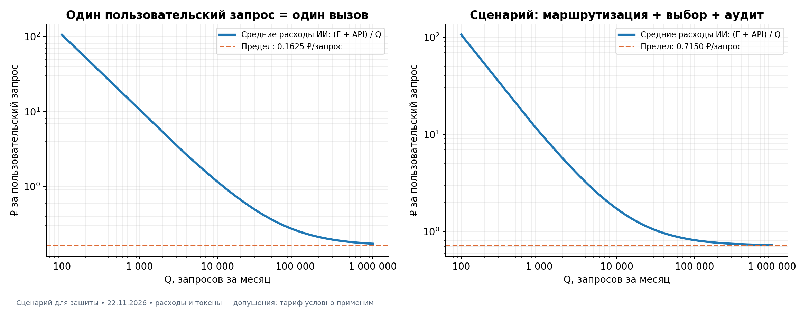
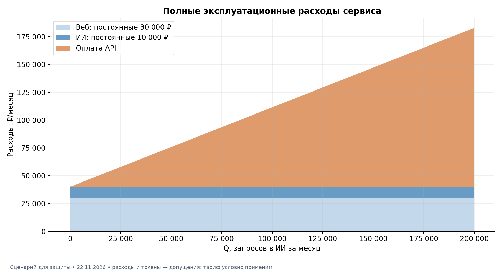
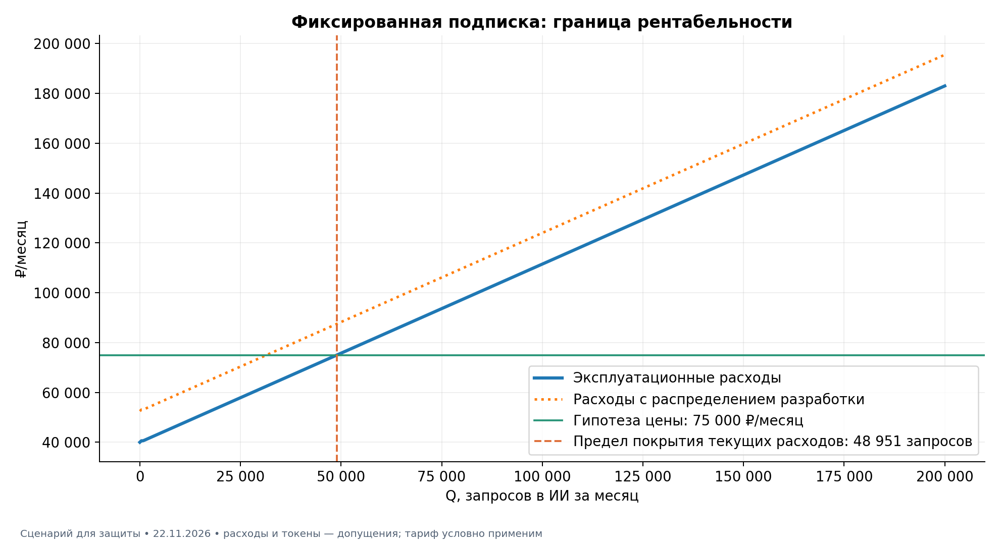
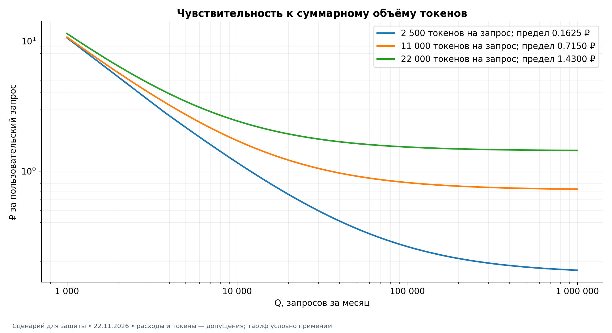

# Экономика веб-сервиса и ИИ-ассистента

Дата расчёта: **22 ноября 2026 года**. Назначение: защита MGIMO-LMS на конкурсе.
Платящий клиент — вуз. Это **сценарная модель**, а не отчёт о фактических затратах или согласованное коммерческое предложение.

## 1. Результат для защиты

При принятом объёме 11 000 токенов на пользовательский запрос и условно применимом тарифе GigaChat Lite 0,065 ₽ за 1 000 токенов переменная стоимость запроса равна **0,715 ₽**. При 10 000 запросов в месяц расходы ИИ составляют **17 150 ₽**, а всего сервиса — **47 150 ₽/месяц**. При гипотетической цене 75 000 ₽/месяц операционный результат — **27 850 ₽/месяц**, до налогов продавца, привлечения клиента и возмещения разработки.

Средняя стоимость пользовательского запроса приближается к переменной стоимости всей цепочки вызовов. Только в упрощённой модели с одним вызовом она приближается к стоимости одного вызова GigaChat. Количество студентов не определяет расходы API: независимая переменная — **Q, число запросов за месяц**.

## 2. Единицы и границы модели

- Пользовательский запрос — одно обращение к ассистенту. В Q включаются также обращения, завершившиеся уточнением или ошибкой; они могут потреблять токены. Для простоты в сценарии всем назначена одна средняя стоимость.
- Вызов API — одна операция модели. На пользовательский запрос может приходиться несколько вызовов.
- Токены — оплачиваемый объём входа и выхода модели; системные инструкции, выдержки документов и передаваемая история тоже входят во вход.
- Юнит продаж — один договор с вузом на год. Годовая цена в базовом сценарии — 900 000 ₽; расчёт ведётся помесячно, затем умножается на 12 при постоянной нагрузке.
- Веб-сервис без ИИ и добавочные расходы ИИ учитываются отдельно, после чего складываются без двойного включения общих ресурсов.

## 3. Что установлено, а что принято для расчёта

### Проверенные источники

1. [Официальные тарифы GigaChat API для юридических лиц](https://developers.sber.ru/docs/ru/gigachat/tariffs/legal-tariffs), обновление страницы 19.11.2026, проверено 22.11.2026. В синхронном режиме Lite / `GigaChat-2` — **0,065 ₽/1 000 токенов**, Pro — 0,5 ₽, Max — 0,65 ₽. Минимальный платёж при использовании — **600 ₽/месяц**, при отсутствии использования — 0 ₽. Цены включают НДС.
2. Важное ограничение источника: эти условия опубликованы **для действующих корпоративных клиентов**. Новых клиентов с 01.09.2026 направляют на Cloud.ru. Модель ниже — сценарий на опубликованном тарифе GigaChat-2, **не подтверждение доступности этого тарифа новому вузу**. Для реального договора нужно заменить тариф условиями выбранного подключения; расчёт Cloud.ru здесь не выполнен.
3. Изучен код MGIMO-LMS в рабочем дереве ветки `feature/large-contest-stand`, HEAD `701e3dc`, 22.11.2026. `app/core/config.py` задаёт `GigaChat-2` для основных вызовов и `GigaChat-2-Max` для переводов. Это значения кода, **не проверка переменных боевого сервера**.
4. В `app/assistant/service.py` метод `_chat` вызывает маршрутизацию; ветка публичных документов `_answer` может вызывать выбор выдержек и аудит. Полный успешный путь по документам может включать **три вызова**. При наличии личных фактов добавляется их отбор; переводы в `translation.py` добавляют вызовы другой модели. Короткие отказы и уточнения могут обходиться дешевле. При включённых эмбеддингах есть дополнительный вызов `embed`.
5. `app/assistant/provider.py` задаёт предел вывода `max_tokens=2200` по умолчанию. Это **не фактический расход и не лимит суммарных токенов входа и выхода**. Возвращаемый `usage` не используется этим методом для учёта затрат: среднее потребление нужно измерить отдельно.

### Изменяемые допущения

| Параметр | Значение | Основание |
|---|---:|---|
| Токены одного вызова в упрощённой модели | 2 000 вход + 500 выход = 2 500 | Иллюстрация, не замер |
| Маршрутизация | 800 вход + 200 выход = 1 000 | Сценарий |
| Выбор выдержек | 5 000 вход + 700 выход = 5 700 | Сценарий |
| Аудит | 4 000 вход + 300 выход = 4 300 | Сценарий |
| Суммарно для цепочки | 11 000 токенов | Сумма трёх стадий |
| Постоянные расходы ИИ | 10 000 ₽/месяц | Смета ниже |
| Постоянные расходы веба без ИИ | 30 000 ₽/месяц | Смета ниже |
| Цена всему вузу | 75 000 ₽/месяц | Гипотеза для проверки, не рыночная оценка |
| Первоначальная разработка | 300 000 ₽ | Условная оценка труда, не оплаченный счёт |
| Период распределения разработки | 24 месяца | Управленческое допущение |

## 4. Экономика ИИ

Для одного вызова на фиксированном среднем объёме токенов:

\[
c_{call}=\frac{(T_{in}+T_{out})p}{1000}
=\frac{2500\cdot0{,}065}{1000}=0{,}1625\;₽.
\]

В сценарии трёх вызовов:

\[
c=\frac{(1000+5700+4300)\cdot0{,}065}{1000}=0{,}715\;₽.
\]

Более общая формула: `c = E[сумма по вызовам (вход + выход) × тариф / 1000] + прочие переменные затраты`. Для разных моделей используются разные тарифы. Поэтому число вызовов само по себе тоже недостаточно: важны их объём и состав. Нельзя умножать токены всей цепочки ещё раз на три.

Месячный счёт API с минимальным платежом:

\[
B(Q)=\begin{cases}0,&Q=0,\\\max(600;cQ),&Q>0.\end{cases}
\]

Минимум применяется один раз к счёту, а не к каждому запросу или стадии. Здесь предполагается отдельный расчётный контур ИИ этого вуза. При общем аккаунте с другими потребителями распределение минимума будет иным.

Общие расходы ИИ: `C_AI(Q) = 10 000 + B(Q)`.

При Q > 0 средняя стоимость `AC_AI(Q) = C_AI(Q) / Q`. В нуле она не определена.

\[
\lim_{Q\to\infty}AC_{AI}(Q)=c.
\]

В упрощённой модели предел **0,1625 ₽/вызов**, в сценарии цепочки — **0,715 ₽/пользовательский запрос**. Общие расходы при этом растут, а не стремятся к цене одного вызова. В базовом сценарии минимум API перестаёт влиять после `600 / 0,715 ≈ 839,16`, то есть с 840 запросов.



На графике логарифмические оси: так видны и малая нагрузка, и приближение к пределу. Пунктир — математический предел, а не цена подписки.

### Смета добавочных постоянных расходов ИИ

| Статья | ₽/месяц |
|---|---:|
| Дополнительные серверные ресурсы и хранение корпуса | 2 000 |
| Проверка ответов, актуализация корпуса: 6 ч × 1 000 ₽ | 6 000 |
| Мониторинг и сопровождение: 2 ч × 1 000 ₽ | 2 000 |
| **Итого** | **10 000** |

Это бюджетные оценки для модели, не тарифы провайдера инфраструктуры и не фактический табель. Обновление и первоначальная индексация корпуса токенами отдельно не оценены. Часовая ставка — предположение о полной стоимости труда.

## 5. Экономика веб-сервиса

| Статья без ИИ | ₽/месяц |
|---|---:|
| Основное приложение и БД | 5 000 |
| Резервные копии, хранение и мониторинг | 2 000 |
| Домен и сопутствующие сервисы: годовой бюджет / 12 | 1 000 |
| Поддержка пользователей: 10 ч × 1 000 ₽ | 10 000 |
| Обслуживание и исправления: 12 ч × 1 000 ₽ | 12 000 |
| **Итого веб без ИИ** | **30 000** |

Все статьи — условная смета. Размещение прототипа на общем VPS не делает ресурсы бесплатными: здесь предусмотрена доля затрат. Реальные счета, распределение ресурсов и необходимая мощность не проверялись.

Полные текущие расходы: `C_service(Q) = 30 000 + 10 000 + B(Q)`.
Годовые расходы при одинаковом Q каждый месяц: `12 × C_service(Q)`. При сезонности нужно складывать 12 отдельных месяцев с их минимальными платежами; просто объединять годовой Q нельзя.



### Таблица сценариев

| Q за месяц | API, ₽ | ИИ всего, ₽ | ИИ на запрос, ₽ | Сервис всего, ₽ | Операционный результат при цене 75 000 ₽ |
|---:|---:|---:|---:|---:|---:|
| 0 | 0 | 10 000 | — | 40 000 | 35 000 |
| 100 | 600 | 10 600 | 106,0000 | 40 600 | 34 400 |
| 1 000 | 715 | 10 715 | 10,7150 | 40 715 | 34 285 |
| 10 000 | 7 150 | 17 150 | 1,7150 | 47 150 | 27 850 |
| 50 000 | 35 750 | 45 750 | 0,9150 | 75 750 | −750 |
| 100 000 | 71 500 | 81 500 | 0,8150 | 111 500 | −36 500 |
| 1 000 000 | 715 000 | 725 000 | 0,7250 | 755 000 | −680 000 |

При Q=0 постоянные расходы сохраняются, пока сервис поддерживается. Строка 1 млн — математическая экстраполяция: достаточность текущей мощности на такой нагрузке не доказана.

## 6. Доход, разработка и границы рентабельности

При фиксированной подписке `R = 75 000 ₽/месяц`, `Π = R − C_service(Q)`. Это модельный операционный результат до налогов продавца, затрат на продажу и разработки, а не чистая прибыль. Суммы учитываются в денежных ценах; возмещение входного НДС и налоговый режим продавца не моделируются.

При Q=10 000:

- Доход: 75 000 ₽/месяц, или 900 000 ₽/год.
- Текущие расходы: 47 150 ₽/месяц, или 565 800 ₽/год.
- Операционный результат: 27 850 ₽/месяц, или 334 200 ₽/год.
- Операционная маржа: `27 850 / 75 000 = 37,13%`.
- Условная разработка: `200 ч × 1 500 ₽ = 300 000 ₽` единовременно; часы и ставка не измерены.
- Распределение разработки на 24 месяца: `300 000 / 24 = 12 500 ₽/месяц`.
- Результат после такого распределения: **15 350 ₽/месяц**, маржа **20,47%**.
- Денежный результат первого года, если вся разработка оплачена в этом году: `334 200 − 300 000 = 34 200 ₽`, до исключённых статей.
- Простая окупаемость разработки при неизменной нагрузке и отсутствии других расходов: `300 000 / 27 850 ≈ 10,77 месяца`. Это сценарная оценка, не прогноз.

При фиксированной цене увеличение Q увеличивает расходы, а не доход. Максимальная нагрузка с неотрицательным текущим результатом:

\[
Q_{max}=\frac{75000-40000}{0{,}715}\approx48951{,}05.
\]

То есть максимум **48 951 целый запрос/месяц** при этих допущениях. С распределением разработки — максимум **31 468 запросов/месяц**. Это граница допустимой нагрузки, а не «минимальное число запросов для окупаемости».



Для целевой маржи 30% при Q=10 000 минимальная цена по текущим расходам — `47 150 / 0,7 = 67 357,14 ₽/месяц`; с распределением разработки — `59 650 / 0,7 = 85 214,29 ₽/месяц`. Целевая маржа — выбранное допущение. Следовательно, цена 75 000 ₽ не обеспечивает 30% после распределения разработки.

Возможная конструкция договора: фиксированная плата за веб-сервис и включённый лимит запросов, затем доплата за превышение. Например, чисто иллюстративно: 75 000 ₽ включает 10 000 запросов, превышение по 1,10 ₽. Тогда добавочный вклад сверх лимита — `1,10 − 0,715 = 0,385 ₽/запрос` до прочих переменных затрат. Это не проверенная готовность вуза платить и не учёт растущих мощностей.

## 7. Чувствительность и пределы модели



| Токены на пользовательский запрос | Предельная стоимость, ₽ | Сервис при Q=10 000, ₽/месяц |
|---:|---:|---:|
| 2 500 | 0,1625 | 41 625 |
| 11 000 | 0,7150 | 47 150 |
| 22 000 | 1,4300 | 54 300 |

При тех же 11 000 токенов целиком на Pro переменная стоимость была бы 5,50 ₽, на Max — 7,15 ₽. Это сценарии смены модели, не цена существующей смешанной цепочки. Дополнительные 2 000 токенов перевода на Max стоят 1,30 ₽; при 20% таких обращений это добавило бы в среднем 0,26 ₽/запрос. Доля и объём переводов — иллюстрации. Если повторы увеличивают суммарное потребление на 10%, базовые 0,715 ₽ превращаются в 0,7865 ₽ до иных расходов.

Предел `AC → c` требует постоянных средних токенов, тарифов и прочих затрат на запрос, а также `F(Q)/Q → 0`. Если мощности приходится наращивать пропорционально нагрузке, их стоимость тоже входит в предел. Ступенчатое расширение мощностей нарушает гладкость кривой. Бесконечная нагрузка на одном VPS не предполагается.

Для реального бюджета не хватает: фактического `usage` по каждому вызову и модели, долей веток и языков, повторов и ошибок, оплаченного тарифа аккаунта, счетов за ресурсы, трудозатрат поддержки и условий интеграции. Не включены продажи и закупочные процедуры, внедрение и обучение сотрудников, аудит безопасности, миграция, налоги продавца, масштабирование инфраструктуры и стоимость капитала. LTV и CAC не вычислены: нет данных об удержании вузов и привлечении клиентов.

Экономия времени сотрудников и ROI для вуза тоже **не доказаны**. Их можно оценивать отдельно: `Q × доля действительно заменённых обращений × минуты экономии / 60 × стоимость часа`, после измерений. Не каждый ответ ИИ заменяет обращение в деканат.

## 8. Формулировка для слайда

> Мы моделируем расходы через количество запросов, а не число студентов. Средняя стоимость запроса снижается за счёт распределения постоянных затрат и приближается к стоимости его обработки в GigaChat. При сценарных 11 тысячах токенов на запрос это 0,715 рубля. При 10 тысячах запросов в месяц бюджет всего сервиса — 47,15 тысячи рублей. Тариф, токены, трудозатраты и цена продажи требуют проверки перед внедрением.

## 9. Как воспроизвести

В папке находятся `generate.py`, `assumptions.json`, `calculations.csv` и четыре изображения в `graphs/`. Скрипт использует Matplotlib и NumPy, создаёт все таблицы CSV и графики, а также проверяет контрольные значения и асимптоту. Markdown содержит развёрнутые пояснения; при изменении сценария его таблицы и выводы нужно синхронизировать с CSV.

```bash
python -m pip install matplotlib numpy
python generate.py
```

Параметры меняются в словаре `P` в начале скрипта; `assumptions.json` — создаваемый снимок этих параметров, не входной файл. Иллюстрации имеют русские подписи, денежные единицы и месячный период. Изменений интерфейса приложения и боевой БД нет; вход тестовым студентом для проверки расчёта не требуется.
